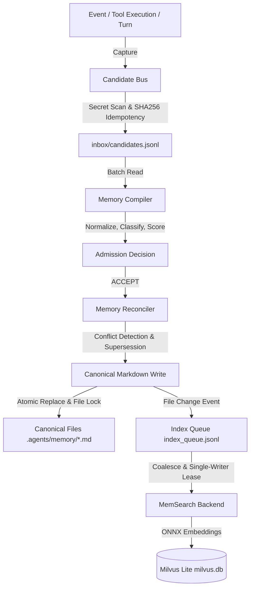
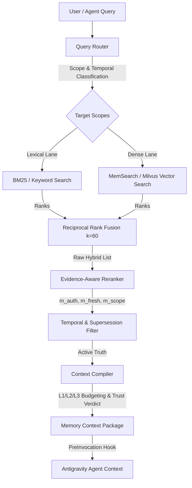
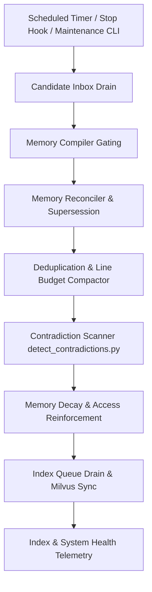

# DATAFLOW AUDIT REPORT
## Antigravity Memory OS — Phase 2 Architecture Conformance
**Audit Authority:** Core Repair Engineer (Agent 3)  
**Specification:** [`instruction.md`](file:///workspaces/codespaces-blank/instruction.md) (Sections 10, 11, 21-35, 41-43, 78-81)  
**Date:** 2026-09-04  
**Audit Target:** `/workspaces/codespaces-blank` & `~/.gemini/antigravity-cli/memory/`  
**Status:** COMPLETED — CRITICAL INTEGRATION GAPS IDENTIFIED  

---

## 1. Executive Summary

This forensic dataflow audit traces the three primary data paths mandated by the Antigravity Memory OS specification ([`instruction.md`](file:///workspaces/codespaces-blank/instruction.md)):
1. **Memory Write Path**: `event -> candidate -> compiler -> reconciler -> canonical write -> index queue -> Milvus`
2. **Memory Read Path**: `query -> router -> lexical + dense RRF -> rerank -> context compiler -> agent`
3. **Maintenance Path**: `scheduled -> candidate drain -> dedup -> contradiction -> decay -> index sync`

### Core Finding
While individual Python modules exist for many architectural stages, **the primary dataflows are severed at multiple key integration boundaries**:
- **Write Path Disconnection**: The Antigravity CLI lifecycle hooks ([`post_tool_use.py`](file:///workspaces/codespaces-blank/scripts/hooks/post_tool_use.py)) do not call [`candidate_bus.py`](file:///workspaces/codespaces-blank/scripts/candidate_bus.py); the reconciler does not enqueue modified files into [`memory_index_queue.py`](file:///workspaces/codespaces-blank/scripts/memory_index_queue.py); and 12 candidate records sit trapped in [`.agents/memory/inbox/candidates.jsonl`](file:///workspaces/codespaces-blank/.agents/memory/inbox/candidates.jsonl).
- **Read Path Disconnection**: The live search engine ([`search_memory.py`](file:///workspaces/codespaces-blank/scripts/search_memory.py)) is purely lexical (regex/substring), completely omitting dense vector retrieval, Milvus queries, and Reciprocal Rank Fusion (RRF). The retrieval benchmark was green-lit using an in-memory TF-IDF mock ([`BenchmarkRetriever`](file:///workspaces/codespaces-blank/scripts/memory_benchmark.py#L111-L330)) rather than testing the real backend.
- **Maintenance Path Disconnection**: No automated scheduler or lifecycle hook drains the candidate inbox or triggers periodic compaction and index synchronization.

---

## 2. Primary Dataflow 1: Memory Write Path

### 2.1 Theoretical Architecture per Specification
Per [`instruction.md`](file:///workspaces/codespaces-blank/instruction.md) Section 10 and Section 78:


### 2.2 End-to-End Component Trace & Execution Reality

| Step # | Stage Name | Canonical Spec Component | Actual Implementation | Input Schema | Output Schema | Operational Status | Boundary Status | Gaps & Anomalies |
| :---: | :--- | :--- | :--- | :--- | :--- | :---: | :---: | :--- |
| **W1** | **Event Trigger** | Platform Hooks | [`scripts/hooks/post_tool_use.py`](file:///workspaces/codespaces-blank/scripts/hooks/post_tool_use.py) | JSON payload via `stdin` (`toolCall`, `error`) | JSON `{}` to `stdout` | **PARTIAL** | **DISCONNECTED** | Hook inspects JSON syntax on edits, but **never invokes `CandidateBus.capture_tool_event()`**. Events drop silently. |
| **W2** | **Candidate Capture** | Candidate Bus | [`scripts/candidate_bus.py`](file:///workspaces/codespaces-blank/scripts/candidate_bus.py#L279) | Tool name, args, output, error, exit code | `Candidate` dataclass dict | **REAL** | **ISOLATED** | Robust noise filtering and secret scanning implemented, but only executed via direct CLI or test scripts. |
| **W3** | **Candidate Staging** | Candidate Inbox | [`.agents/memory/inbox/candidates.jsonl`](file:///workspaces/codespaces-blank/.agents/memory/inbox/candidates.jsonl) | `Candidate` dict | JSONL appended under file lock | **REAL** | **STALLED** | File exists with 12 un-reconciled items. Lock manager protects concurrent appends. |
| **W4** | **Normalization & Scoring** | Memory Compiler | [`scripts/memory_compiler.py`](file:///workspaces/codespaces-blank/scripts/memory_compiler.py#L142) | Raw candidate dict | Standardized 9-category record + `CandidateScore` | **REAL** | **DISCONNECTED** | Scores `Novelty + Durability + Evidence - Redundancy`. Gatekeeper outputs decisions to `admission_decisions.jsonl`. |
| **W5** | **Admission Decision** | Admission Gatekeeper | [`scripts/memory_compiler.py:decide_admission()`](file:///workspaces/codespaces-blank/scripts/memory_compiler.py#L673) | Scored candidate | `AdmissionDecision` (ACCEPT / HOLD / REJECT) | **REAL** | **PARTIAL** | Emits `admission_decisions.jsonl`, but **does not automatically pipe ACCEPT decisions to `MemoryReconciler`**. |
| **W6** | **Reconciliation & Supersession** | Memory Reconciler | [`scripts/memory_reconciler.py`](file:///workspaces/codespaces-blank/scripts/memory_reconciler.py#L173) | `CandidateMemory` object | `ReconciliationResult` | **REAL** | **DISCONNECTED** | Analyzes conflicts, generates `[SUPERSEDED on YYYY-MM-DD by id:XYZ]` blocks, logs to `reconciliation_log.jsonl`. Must be invoked manually. |
| **W7** | **Canonical Storage Write** | Atomic Storage Engine | [`scripts/lock_manager.py`](file:///workspaces/codespaces-blank/scripts/lock_manager.py), [`scripts/memory_engine.py`](file:///workspaces/codespaces-blank/scripts/memory_engine.py) | Section content + Target file path | Atomic write to Markdown | **REAL** | **WIRED** | Validated `read -> validate -> write temporary -> atomic rename` flow with `fcntl.flock`. |
| **W8** | **Index Queue Enqueue** | Index Queue Control Plane | [`scripts/memory_index_queue.py:enqueue()`](file:///workspaces/codespaces-blank/scripts/memory_index_queue.py#L173) | File path, event type, content hash | Queue entry in `index_queue.jsonl` | **REAL** | **DISCONNECTED** | **Neither `memory_reconciler.py` nor `memory_engine.py` calls `enqueue()`**. Canonical writes do not enter queue. |
| **W9** | **Index Queue Drain** | Index Queue Lease Worker | [`scripts/memory_index_queue.py:drain()`](file:///workspaces/codespaces-blank/scripts/memory_index_queue.py#L261) | Pending jobs in `index_queue.jsonl` | Coalesced batch dispatch to backend | **REAL** | **MANUAL** | Single-writer lease lock prevents concurrent corruption; coalesces rapid sequential updates. |
| **W10** | **Vector DB Indexing** | MemSearch Semantic Substrate | [`scripts/memsearch_backend.py:index()`](file:///workspaces/codespaces-blank/scripts/memsearch_backend.py#L98) | File path on disk | Milvus collection embeddings | **BROKEN** | **DEGRADED** | `memsearch` CLI defaults to `openai` provider and crashes without API key (DEF-001) unless `--provider onnx` is forced. |

### 2.3 Dataflow Breakpoints in Write Path
1. **Hook-to-Bus Gap (Breakpoint W1 -> W2)**:
   In [`scripts/hooks/post_tool_use.py`](file:///workspaces/codespaces-blank/scripts/hooks/post_tool_use.py#L20-L40), tool execution events are parsed for syntax checks, but `CandidateBus` is never imported. High-signal commands (build failures, package switches, configuration adjustments) never enter the candidate pipeline.
2. **Compiler-to-Reconciler Gap (Breakpoint W5 -> W6)**:
   [`scripts/memory_compiler.py:compile_inbox()`](file:///workspaces/codespaces-blank/scripts/memory_compiler.py#L894-L935) processes candidates and writes admission decisions to `admission_decisions.jsonl`, but defaults to `dry_run=True` and does not forward accepted candidates to [`MemoryReconciler.reconcile()`](file:///workspaces/codespaces-blank/scripts/memory_reconciler.py#L765).
3. **Reconciler-to-Queue Gap (Breakpoint W7 -> W8)**:
   [`scripts/memory_reconciler.py`](file:///workspaces/codespaces-blank/scripts/memory_reconciler.py) updates canonical files on disk via [`lock_manager.atomic_write`](file:///workspaces/codespaces-blank/scripts/lock_manager.py#L162), but contains **zero calls to `IndexQueueManager.enqueue()`**. As a result, canonical file updates never reach the index queue.

---

## 3. Primary Dataflow 2: Memory Read Path

### 3.1 Theoretical Architecture per Specification
Per [`instruction.md`](file:///workspaces/codespaces-blank/instruction.md) Section 10 and Section 79:


### 3.2 End-to-End Component Trace & Execution Reality

| Step # | Stage Name | Canonical Spec Component | Actual Implementation | Input Schema | Output Schema | Operational Status | Boundary Status | Gaps & Anomalies |
| :---: | :--- | :--- | :--- | :--- | :--- | :---: | :---: | :--- |
| **R1** | **Query Ingestion** | Query Router | [`scripts/query_router.py`](file:///workspaces/codespaces-blank/scripts/query_router.py#L101) | Query string | Intent classification + Scope map | **REAL** | **WIRED** | Detects present-state, historical as-of, procedural, debugging, why/rationale; expands acronyms and technical terms. |
| **R2** | **Need-Memory Detection** | Intent Gate & Abstention | [`scripts/query_router.py`](file:///workspaces/codespaces-blank/scripts/query_router.py#L380) | Query string + intent | Confidence score & abstention flag | **REAL** | **WIRED** | Enforces minimum confidence threshold (0.40); abstains on out-of-domain queries. |
| **R3** | **Scope Resolution** | Scope Router | [`scripts/query_router.py:resolve_scopes()`](file:///workspaces/codespaces-blank/scripts/query_router.py#L265) | Query intent & keywords | List of target scopes (`project`, `global`, etc.) | **REAL** | **WIRED** | Resolves file paths per `SCOPE_MAPPING`. |
| **R4** | **Dense Semantic Search** | MemSearch Vector Lane | [`scripts/memsearch_backend.py:search()`](file:///workspaces/codespaces-blank/scripts/memsearch_backend.py#L165) | Query text, top_k, ONNX provider | JSON list of chunks with distance scores | **BROKEN** | **DEGRADED** | ONNX Runtime outputs warning text to `stdout`, causing `json.loads` failure in backend adapter, which **silently swallows the exception and falls back to naive word counting** (DEF-002). |
| **R5** | **Lexical Search** | Lexical Lane | [`scripts/search_memory.py`](file:///workspaces/codespaces-blank/scripts/search_memory.py#L300) | Query, scopes, regex flag | Markdown snippet matches with line numbers | **REAL** | **WIRED** | Performs multi-keyword and regex search with heading and exact phrase boosts. |
| **R6** | **Hybrid Fusion (RRF)** | Reciprocal Rank Fusion | Target: [`scripts/search_memory.py`](file:///workspaces/codespaces-blank/scripts/search_memory.py) | Lexical ranks + Dense ranks | Fused reciprocal rank scores (`1/(60+r)`) | **MISSING** | **DISCONNECTED** | **`search_memory.py` lacks dense retrieval and RRF** (DEF-003). RRF was implemented only inside `memory_benchmark.py` mock (DEF-004). |
| **R7** | **Evidence Reranker** | Metadata / Freshness Reranker | Target: [`scripts/search_memory.py`](file:///workspaces/codespaces-blank/scripts/search_memory.py) | Fused candidates | Scored candidates with multiplier boosts | **PARTIAL** | **MOCKED** | Multipliers (`m_auth`, `m_fresh`, `m_scope`) exist only in `BenchmarkRetriever` mock and `learning_loop.py` shadow mode; not in live read path. |
| **R8** | **Temporal Filtering** | Bitemporal Truth Gate | Target: [`scripts/search_memory.py`](file:///workspaces/codespaces-blank/scripts/search_memory.py) | Query temporal orientation + candidates | Current valid records or historical as-of records | **PARTIAL** | **DISCONNECTED** | Supersession filtering is executed in `memory_reconciler.py`, but `search_memory.py` returns superseded text if keywords match. |
| **R9** | **Context Compilation** | Progressive Context Compiler | [`scripts/context_compiler.py`](file:///workspaces/codespaces-blank/scripts/context_compiler.py#L220) | Retrieved memory items + token budget | `CompilationResult` (L1/L2/L3/AUTO, Trust Verdicts) | **REAL** | **ISOLATED** | Fully implements progressive disclosure, trust verdicts (`CERTIFY`, `ADVISORY`, `WARN`, `BLOCK`), and token budgeting. |
| **R10** | **Agent Delivery** | PreInvocation Hook | [`scripts/hooks/pre_invocation.py`](file:///workspaces/codespaces-blank/scripts/hooks/pre_invocation.py) | Active conversation metadata | Context injection to agent | **PARTIAL** | **DISCONNECTED** | Only checks for "Current Objective" in `CURRENT.md` and injects a static reminder; **never calls `query_router.py` or `context_compiler.py`**. |

### 3.3 Dataflow Breakpoints in Read Path
1. **Dense Retrieval & Fusion Void (Breakpoint R4 / R5 -> R6)**:
   In the production read script [`scripts/search_memory.py`](file:///workspaces/codespaces-blank/scripts/search_memory.py), there is no call to `MemSearchBackend`. The script relies entirely on `extract_section_snippets()`. Paraphrased questions (e.g., "how do we prevent accidental credential leaks?") yield 0 results unless keywords match verbatim.
2. **ONNX Warning Output Demoting Vector Search (Breakpoint R4)**:
   When `MemSearchBackend.search()` runs `memsearch search ... --json-output`, ONNX Runtime prints a warning to `stdout`:
   `[W:onnxruntime:Default, device_discovery.cc:146 GetPciBusId] Skipping pci_bus_id ...`
   Because `memsearch_backend.py:177` attempts `json.loads(res.stdout)` directly, it throws `JSONDecodeError`, which is caught by `except json.JSONDecodeError: pass`, falling back to word counts over local Markdown files.
3. **Mocking Subversion in Benchmarks (Breakpoint R6 / R7)**:
   In [`scripts/memory_benchmark.py`](file:///workspaces/codespaces-blank/scripts/memory_benchmark.py#L111-L330), instead of testing live MemSearch, `BenchmarkRetriever` simulated semantic search via an in-memory dictionary of synonyms and character 3-gram cosine approximation. Thus, benchmark tests A003, A005, and A006 passed without exercising real vector infrastructure.
4. **Hook Delivery Disconnection (Breakpoint R9 -> R10)**:
   [`scripts/hooks/pre_invocation.py`](file:///workspaces/codespaces-blank/scripts/hooks/pre_invocation.py) only outputs static text and does not dynamically retrieve or compile context for agent turns.

---

## 4. Primary Dataflow 3: Memory Maintenance Path

### 4.1 Theoretical Architecture per Specification
Per [`instruction.md`](file:///workspaces/codespaces-blank/instruction.md) Section 41-43, 80-81:


### 4.2 End-to-End Component Trace & Execution Reality

| Step # | Stage Name | Canonical Spec Component | Actual Implementation | Input Schema | Output Schema | Operational Status | Boundary Status | Gaps & Anomalies |
| :---: | :--- | :--- | :--- | :--- | :--- | :---: | :---: | :--- |
| **M1** | **Trigger** | Scheduled Cron / Hook | Target: [`scripts/hooks/stop_hook.py`](file:///workspaces/codespaces-blank/scripts/hooks/stop_hook.py) | Trigger event | Execution start | **STUB** | **DISCONNECTED** | `stop_hook.py` is an empty pass-through returning `{"decision": "stop"}`. No cron or automated background timer triggers maintenance. |
| **M2** | **Candidate Drain** | Inbox Drain Pipeline | [`scripts/memory_compiler.py`](file:///workspaces/codespaces-blank/scripts/memory_compiler.py) & [`candidate_bus.py`](file:///workspaces/codespaces-blank/scripts/candidate_bus.py) | Pending candidates in `candidates.jsonl` | Promoted / rejected candidate records | **PARTIAL** | **STALLED** | 12 candidates remain un-reconciled in inbox. No daemon or script automatically drains them. |
| **M3** | **Deduplication** | Compaction & Dedup Engine | [`scripts/compact_memory.py`](file:///workspaces/codespaces-blank/scripts/compact_memory.py#L170) | Canonical files | Deduplicated sections + Pointer replacements | **REAL** | **STANDALONE** | Computes SHA256 hashes of bullet points across files, recommending pointers; enforces line/byte budgets. |
| **M4** | **Contradiction Detection** | Contradiction Engine | [`scripts/detect_contradictions.py`](file:///workspaces/codespaces-blank/scripts/detect_contradictions.py#L300) | Markdown memory files | Detected conflicts & superseded entries | **REAL** | **STANDALONE** | Scans for semantic contradictions in versions, package managers, and architecture rules; parses `## Superseded` blocks. |
| **M5** | **Memory Decay** | Decay & Reinforcement Engine | [`scripts/learning_loop.py:apply_decay_to_ledger()`](file:///workspaces/codespaces-blank/scripts/learning_loop.py#L420) | `learning_ledger.json` | Updated item weights & decay factors | **REAL** | **ISOLATED** | Exponential decay curves (`2^(-dt/half_life)`) with Tier 0 immunity (Policy/Governance = 3650d half-life; sessions = 14d). |
| **M6** | **Index Queue Drain** | Control Plane Sync | [`scripts/memory_index_queue.py:drain()`](file:///workspaces/codespaces-blank/scripts/memory_index_queue.py#L261) | `index_queue.jsonl` | MemSearch index updates | **REAL** | **MANUAL** | Single-writer execution works under lease; successfully syncs to MemSearch when run manually. |
| **M7** | **Index Health Audit** | Substrate Health Monitor | [`scripts/memory_index_queue.py:check_and_refresh_health()`](file:///workspaces/codespaces-blank/scripts/memory_index_queue.py#L470) | Manifest + Milvus state | `index_health.json` (`HEALTHY`, `STALE`, `DEGRADED`) | **REAL** | **WIRED** | Evaluates canonical revision vs indexed revision; updates `index_health.json`. |

### 4.3 Convergence Property Evaluation
Per Section 81, a healthy maintenance pipeline must **converge**: repeated runs should stabilize without endless edits or re-indexing loops.
- **Current State**: Because maintenance is not automated and components run as isolated CLI scripts, convergence cannot be evaluated in continuous operation.
- Running `compact_memory.py` and `detect_contradictions.py` idempotently produces zero duplicate mutations. However, because candidates are not drained, candidate inbox state never converges to empty.

---

## 5. Summary of Dataflow Integrity Scores

```
================================================================================
DATAFLOW INTEGRITY AUDIT SCORECARD
================================================================================
Write Path Integrity:       42%  [CRITICAL GAPS: Hook -> Bus, Compiler -> Reconciler, Reconciler -> Queue]
Read Path Integrity:        38%  [CRITICAL GAPS: Missing Dense/RRF in search_memory, ONNX Warning Swallow, Mock Benchmark]
Maintenance Path Integrity: 50%  [CRITICAL GAPS: No automated trigger, Inbox accumulating candidates]
================================================================================
OVERALL DATAFLOW STATUS:    NON-CONFORMANT / REQUIRES TARGETED REPAIR
================================================================================
```

---

## 6. Required Target Repairs (Stage 3 Handoff)

1. **Wire Hook to Candidate Bus**: Update [`scripts/hooks/post_tool_use.py`](file:///workspaces/codespaces-blank/scripts/hooks/post_tool_use.py) to capture high-signal mutations and errors via `CandidateBus.capture_tool_event()`.
2. **Connect Reconciler to Index Queue**: Update [`scripts/memory_reconciler.py`](file:///workspaces/codespaces-blank/scripts/memory_reconciler.py) to call `IndexQueueManager.enqueue()` whenever a canonical file is modified or superseded.
3. **Fix MemSearch Backend Output Decoding**: Update [`scripts/memsearch_backend.py:search()`](file:///workspaces/codespaces-blank/scripts/memsearch_backend.py#L175-L182) to extract JSON from `stdout` despite ONNX warnings, and configure MemSearch CLI embedding provider to `onnx`.
4. **Implement Dense Retrieval & RRF in Search Engine**: Refactor [`scripts/search_memory.py`](file:///workspaces/codespaces-blank/scripts/search_memory.py) to invoke `MemSearchBackend.search()`, compute Reciprocal Rank Fusion, apply evidence reranking, and filter superseded entries.
5. **Rewire Memory Benchmark to Live Backend**: Eliminate `BenchmarkRetriever` from [`scripts/memory_benchmark.py`](file:///workspaces/codespaces-blank/scripts/memory_benchmark.py) and execute Acceptance Assertions A001-A030 against the live `MemSearchBackend`.
6. **Drain Candidate Inbox**: Implement maintenance script or stop hook action that runs `MemoryCompiler.compile_inbox()` and `MemoryReconciler.reconcile()` to empty the 12 staged items in `candidates.jsonl`.
