# ANTIGRAVITY MEMORY OS — CANONICAL & WORKING MEMORY AUDIT
## State Extraction, Mechanics, Taxonomy, Working State & Episodic Session Memory
**Document Identifier:** `03_canonical_working_memory.md`  
**Staging Location:** [`.agent/memory-state/staging/03_canonical_working_memory.md`](file:///workspaces/codespaces-blank/.agent/memory-state/staging/03_canonical_working_memory.md)  
**Author:** Agent 3: Canonical & Working Memory Auditor  
**Directives Governed:** [`instruction.md`](file:///workspaces/codespaces-blank/instruction.md) (Sections 15, 16, 17, 18, 46; Section 2 Evidence Hierarchy; Section 3 No-Change Policy)  
**Execution Timestamp:** 2026-09-04T19:15:00Z  
**Target Repository:** `/workspaces/codespaces-blank`  
**Associated Artifacts & Reports:**
- Master Compilation: [`11_master_compilation.md`](file:///workspaces/codespaces-blank/.agent/memory-state/staging/11_master_compilation.md)
- Ingestion & Reconciler Audit: [`04_ingestion_reconciliation.md`](file:///workspaces/codespaces-blank/.agent/memory-state/staging/04_ingestion_reconciliation.md)

---

## 1. Executive Summary & Evidence Hierarchy

This forensic report provides an evidence-backed architectural extraction of the canonical, working, episodic, and taxonomic memory layers of the Antigravity Memory OS. The inspection strictly adhered to Section 3 (No-Change Policy) of [`instruction.md`](file:///workspaces/codespaces-blank/instruction.md): all canonical markdown files, candidate queues, vector indexes, configuration files, and scripts were inspected in read-only mode without modification or deletion.

### 1.1 Evidence Taxonomy Applied
Every finding throughout this audit is labeled according to the absolute evidence hierarchy specified in Section 2:
- `OBSERVED_EXECUTION`: Empirically observed tool execution outputs, exit codes, process behavior, and file system states.
- `SOURCE_CODE`: Concrete implementations in Python 3.12 scripts within [`scripts/`](file:///workspaces/codespaces-blank/scripts/) and shell hooks.
- `CONFIGURATION`: Static settings in JSON, YAML, or Markdown files governing runtime parameters.
- `TEST_EVIDENCE`: Formally executed unit tests, diagnostic suites, and assertion matrices.
- `DOCUMENTED`: Explicit architectural specifications in [`instruction.md`](file:///workspaces/codespaces-blank/instruction.md), [`AGENTS.md`](file:///workspaces/codespaces-blank/AGENTS.md), or [`POLICY.md`](file:///home/codespace/.gemini/antigravity-cli/memory/POLICY.md).
- `CONTRADICTED`: Instances where code, configuration, or runtime behavior diverges from documentation.
- `UNKNOWN`: Items where conclusive evidence cannot be obtained without speculative extrapolation.

### 1.2 Key Audit Findings
1. **Memory Taxonomy (Section 15):** The system defines and implements 10 distinct memory types (`working`, `semantic`, `episodic`, `profile`, `procedural`, `decision`, `gotcha`, `negative knowledge`, `candidate`, `historical`). Each type possesses distinct storage locations, schemas, lifecycle rules, scopes, and decay curves.
2. **Canonical Markdown Authority (Section 16):** Canonical Markdown files are **100% AUTHORITATIVE**. The vector substrate (Milvus Lite / MemSearch SQLite) and search indexes are **strictly DERIVED, NON-AUTHORITATIVE, and FULLY REBUILDABLE** from the Markdown sources on disk.
3. **17 Canonical Markdown Files Inspected (Section 16):** Exactly 17 canonical Markdown files exist across the workspace ([`.agents/memory/`](file:///workspaces/codespaces-blank/.agents/memory/) - 6 files) and the global user home ([`~/.gemini/antigravity-cli/memory/`](file:///home/codespace/.gemini/antigravity-cli/memory/) - 11 files). All 17 were forensically cataloged with line counts, byte sizes, and cryptographic SHA-256 checksums.
4. **Active Working State ([`CURRENT.md`](file:///workspaces/codespaces-blank/.agents/memory/CURRENT.md)) (Section 17):** Measures exactly 13 lines (504 bytes), fully compliant with the `< 30 lines` budget. It encapsulates the active objective, phase status, blockers, and handoff links, and is read during session pre-invocation and resumption.
5. **Episodic / Session Memory Capture (Section 18):** Operates under a **dual-channel hybrid capture model**:
   - Tool-event observation and candidate ingestion into [`.agents/memory/inbox/candidates.jsonl`](file:///workspaces/codespaces-blank/.agents/memory/inbox/candidates.jsonl) is **100% AUTOMATIC** via the `PostToolUse` lifecycle hook ([`scripts/hooks/post_tool_use.py`](file:///workspaces/codespaces-blank/scripts/hooks/post_tool_use.py)).
   - Session markdown journal capture ([`.agents/memory/sessions/YYYY-MM-DD-HHMM.md`](file:///workspaces/codespaces-blank/.agents/memory/sessions/)) is **SEMI-AUTOMATIC / MANUAL**, requiring explicit invocation of `/end-session` or [`scripts/session_manager.py`](file:///workspaces/codespaces-blank/scripts/session_manager.py). The platform `Stop` hook ([`scripts/hooks/stop_hook.py`](file:///workspaces/codespaces-blank/scripts/hooks/stop_hook.py)) is an idle guard and does not trigger session distillation automatically.
6. **Bitemporal Metadata (`<!-- bitemporal: ... -->`):** Fully implemented in [`scripts/memory_reconciler.py`](file:///workspaces/codespaces-blank/scripts/memory_reconciler.py) and verified in active files (`DECISIONS.md`, `GOTCHAS.md`, `ARCHITECTURE.md`, `PROCEDURES.md`) tracking `id`, `observed_at`, `recorded_at`, `valid_from`, `valid_until`, and `supersedes`.

---

## 2. Memory Taxonomy (Section 15)

The Antigravity Persistent Memory System partitions knowledge across 10 operational memory types. The taxonomy spans working state, vector substrates, episodic logs, user preferences, distilled workflows, architectural decisions, operational gotchas, negative knowledge, candidate queues, and historical supersession records.

### 2.1 Detailed Taxonomy by Memory Type

#### 1. Working Memory
- **Purpose:** Tracks the active objective, task phase, running background services, active blockers, and immediate next steps for the current execution turn.
- **Storage:** Workspace canonical file: [`.agents/memory/CURRENT.md`](file:///workspaces/codespaces-blank/.agents/memory/CURRENT.md) `[SOURCE_CODE: scripts/session_manager.py]`. Auxiliary agent-state copy: `.agent-state/current-state.md`.
- **Schema:** Markdown document bounded to `< 30 lines` (max 2 KB). Header `# Active Working State`, `Last Updated: <ISO-8601>`, section `## Current Objective`, section `## Active Status` containing bulleted key-value pairs (`- Phase:`, `- Blockers:`, `- Next Steps:`).
- **Lifecycle:** Initialized or resumed at session start (`/start-session`); updated at major milestone transitions; compacted and rewritten during session conclusion (`/end-session`).
- **Scope:** Workspace / Project (`PROJECT`).
- **Retrieval Eligibility:** Always loaded on `PreInvocation` hook; parsed by `session_manager.py:start_session()`; given top priority by [`scripts/query_router.py`](file:///workspaces/codespaces-blank/scripts/query_router.py) on `present-state` queries matching keywords (`active`, `objective`, `current state`). Explicitly excluded from dense vector embedding.
- **Promotion Rule:** Does not promote directly to durable memory. When an objective concludes, its achievements are recorded in episodic logs (`sessions/`), and any durable insights are staged as candidates for admission into `DECISIONS.md` or `GOTCHAS.md`.
- **Decay/TTL:** Turnover occurs per session / objective change. Decay half-life: 1.0 day `[SOURCE_CODE: scripts/learning_loop.py: SCOPE_HALF_LIVES_DAYS['ephemeral']]`.
- **Provenance Requirements:** Execution session ID, ISO timestamp, Git commit SHA, active branch.

#### 2. Semantic Memory (Vector Substrate)
- **Purpose:** Content-addressable dense vector indexing over canonical knowledge for semantic similarity search, cross-domain association, and keyword fallback.
- **Storage:** Derived index files in [`.agents/memory/.memsearch/`](file:///workspaces/codespaces-blank/.agents/memory/.memsearch/) (`manifest.json`) and Milvus Lite database collections (`~/.memsearch/milvus.db` or `.memsearch/milvus.db/collections/memsearch_chunks/`) `[OBSERVED_EXECUTION]`.
- **Schema:** Structured vector chunk record: `chunk_id` (string), `file_path` (string), `content_hash` (SHA-256 string), `heading` (string), `text` (string), `embedding` (1024-dim float32 vector via ONNX `bge-m3`), `indexed_at` (ISO timestamp).
- **Lifecycle:** Derived and ephemeral. Updated asynchronously via [`scripts/memory_index_queue.py`](file:///workspaces/codespaces-blank/scripts/memory_index_queue.py) upon canonical file mutations; completely rebuildable from Markdown via `python3 scripts/memsearch_backend.py --rebuild`.
- **Scope:** Dual-scope: Project ([`.agents/memory/`](file:///workspaces/codespaces-blank/.agents/memory/)) and Global ([`~/.gemini/antigravity-cli/memory/`](file:///home/codespace/.gemini/antigravity-cli/memory/)).
- **Retrieval Eligibility:** High eligibility. Queried by [`scripts/search_memory.py`](file:///workspaces/codespaces-blank/scripts/search_memory.py) and [`scripts/query_router.py`](file:///workspaces/codespaces-blank/scripts/query_router.py) using Reciprocal Rank Fusion (RRF) hybrid search.
- **Promotion Rule:** N/A. It is a retrieval index substrate, not an epistemic tier.
- **Decay/TTL:** Matches the underlying canonical Markdown source. If the source file is deleted or updated, chunks are purged via `store.delete_by_source()`.
- **Provenance Requirements:** Source file path, file content hash, line span.

#### 3. Episodic / Session Memory
- **Purpose:** Chronological record of developer sessions, executed commands, resolved blockers, architectural decisions made, discoveries, and handoffs.
- **Storage:** [`.agents/memory/sessions/YYYY-MM-DD-HHMM.md`](file:///workspaces/codespaces-blank/.agents/memory/sessions/) (project level) and [`~/.gemini/antigravity-cli/memory/sessions/`](file:///home/codespace/.gemini/antigravity-cli/memory/sessions/) (global archive).
- **Schema:** Markdown document: `# Session Log: <YYYY-MM-DD-HHMM>`, metadata list (`- **Date**:`, `- **Workspace**:`, `- **Branch**:`, `- **Commit**:`), sections `## 1. Completed Work`, `## 2. Unresolved Issues & Blockers`, `## 3. Architectural Decisions`, `## 4. Discoveries & Gotchas`, `## 5. Next Steps`, `## 6. Candidate Durable Memories` (Markdown table with `Type`, `Durability (0-5)`, `Target Tier`, `Description & Rationale`).
- **Lifecycle:** Authored during `/end-session` via `session_manager.end_session()`. Immutable historical record once written.
- **Scope:** Project (`PROJECT`), with archival global mirrors.
- **Retrieval Eligibility:** Restricted. Never loaded in bulk during session initialization (Policy Rule 10: "Episodic Separation"). Only the most recent session log is read by `/start-session` for interruption detection. Base authority: 0.35 `[SOURCE_CODE: scripts/learning_loop.py:SCOPE_AUTHORITY]`.
- **Promotion Rule:** Contains the candidate memory table (Durability 0–5) reviewed and promoted to canonical files via `CandidateBus` and `MemoryCompiler`.
- **Decay/TTL:** Half-life: 14.0 days `[SOURCE_CODE: scripts/learning_loop.py: SCOPE_HALF_LIVES_DAYS['sessions']]`.
- **Provenance Requirements:** ISO UTC timestamp, Workspace absolute path, Git commit SHA, Git branch name.

#### 4. Profile / User Memory
- **Purpose:** Preserves user preferences, interaction styles, testing rigor requirements, output formatting instructions, and explicit user directives.
- **Storage:** [`~/.gemini/antigravity-cli/memory/USER.md`](file:///home/codespace/.gemini/antigravity-cli/memory/USER.md) `[OBSERVED_EXECUTION]`.
- **Schema:** Markdown document: `# Global User Preferences`, `Last Updated: YYYY-MM-DD`, section `## User Profile & Preferences`, dated bullet entries: `- [YYYY-MM-DD] <Directive>`.
- **Lifecycle:** Permanent. Updated only upon explicit human instruction or verified user preference shift. Governed by Policy Rule 4 ("Explicit User Decisions Outrank Inferred Preferences").
- **Scope:** Global (`GLOBAL`).
- **Retrieval Eligibility:** Top tier / Certified. Injected selectively when queries target user conventions or during session bootstrap. Authority score: 0.85.
- **Promotion Rule:** Admitted only when category is `USER_PREFERENCE` with Durability 5 and explicit user origin.
- **Decay/TTL:** Half-life: 365.0 days `[SOURCE_CODE: scripts/learning_loop.py]`.
- **Provenance Requirements:** User prompt reference, conversation ID, explicit timestamp.

#### 5. Procedural Memory
- **Purpose:** Encapsulates multi-step executable workflows, operational runbooks, diagnostic sequences, and verified toolchain procedures.
- **Storage:** Project canonical: [`.agents/memory/PROCEDURES.md`](file:///workspaces/codespaces-blank/.agents/memory/PROCEDURES.md); Global tool notes: [`~/.gemini/antigravity-cli/memory/tools/`](file:///home/codespace/.gemini/antigravity-cli/memory/tools/); Staged inbox candidates: [`.agents/memory/inbox/procedures/`](file:///workspaces/codespaces-blank/.agents/memory/inbox/procedures/) (`proc-*.json`, `proc-*.md`).
- **Schema:**
  - *Canonical Markdown:* `# Project Procedures`, `## [YYYY-MM-DD] <Title>` or `## YYYY-MM-DD — <Title>`, `**Type:** PROCEDURE **Scope:** PROJECT **Confidence:** <Score> **Source:** <Source> **Status:** ACTIVE`, bitemporal comment tag, `### What`, `### Why`, `### Evidence`.
  - *Staged JSON (`inbox/procedures/proc-*.json`):* `id`, `title`, `domain`, `description`, `source_sessions` (array), `recurrence_count` (int), `confidence` (float), `tags` (array), `status` (`CANDIDATE_STAGED`), `admitted` (bool), `steps` (array of objects: `step_number`, `step_type`: `INFERRED_STEP`|`VERIFIED_STEP`|`RECOMMENDED_STEP`, `name`, `command`, `cwd`, `verification`, `is_observed`).
- **Lifecycle:** Distilled from recurring command sequences across >= 2 sessions by [`scripts/procedural_engine.py`](file:///workspaces/codespaces-blank/scripts/procedural_engine.py); staged as inert candidates (Invariant 16); promoted to canonical `PROCEDURES.md` after gatekeeper verification.
- **Scope:** Project (`PROJECT`) or Global Tool (`TOOL`).
- **Retrieval Eligibility:** Selected when query intent is classified as `procedural` ("How do I do X?") by `query_router.py`.
- **Promotion Rule:** Strictly gated by Invariant 16: automated distillation cannot write directly to active skill directories; requires recurrence >= 2, confidence >= 0.80, and gatekeeper admission.
- **Decay/TTL:** Half-life: 180.0 days (tools) to 365.0 days (general procedures).
- **Provenance Requirements:** Source session IDs, command strings, exit codes, verification statements.

#### 6. Decision Memory (ADRs)
- **Purpose:** Architectural Decision Records capturing foundational design choices, evaluated alternatives, engineering rationales, and consequences.
- **Storage:** [`.agents/memory/DECISIONS.md`](file:///workspaces/codespaces-blank/.agents/memory/DECISIONS.md).
- **Schema:** Markdown section: `## YYYY-MM-DD — ADR-XXX: <Title>`, `**Type:** DECISION **Scope:** PROJECT **Confidence:** VERIFIED **Source:** <Source> **Status:** ACTIVE|SUPERSEDED`, bitemporal comment tag, subsections `### What`, `### Why`, `### Evidence`, `### Notes`. If superseded, marked with `[SUPERSEDED on YYYY-MM-DD by id:XYZ]`.
- **Lifecycle:** Created during major architectural milestones or admitted via `MemoryCompiler` (Durability 3). Remains `ACTIVE` until superseded non-destructively by a newer ADR or empirical discovery.
- **Scope:** Project (`PROJECT`).
- **Retrieval Eligibility:** High eligibility. Prioritized for "why", "rationale", "tradeoff", and "decision" queries. Authority score: 0.80.
- **Promotion Rule:** Durability >= 3.0, verified provenance, zero secret leaks, contradiction check against existing decisions.
- **Decay/TTL:** Half-life: 365.0 days `[SOURCE_CODE: scripts/learning_loop.py]`.
- **Provenance Requirements:** Source document path or tool execution event, author session ID, explicit rationale.

#### 7. Gotcha Memory
- **Purpose:** Records pitfalls, container resource limitations, toolchain quirks, non-obvious failure modes, and operational traps to prevent recurring mistakes.
- **Storage:** [`.agents/memory/GOTCHAS.md`](file:///workspaces/codespaces-blank/.agents/memory/GOTCHAS.md).
- **Schema:** Markdown section: `## YYYY-MM-DD — <Title>`, `**Type:** GOTCHA **Scope:** PROJECT **Confidence:** VERIFIED|0.85 **Source:** <Source> **Status:** ACTIVE|SUPERSEDED`, bitemporal comment tag, subsections `### What`, `### Why`, `### Evidence`, `### Notes`, optional `### Refinement (YYYY-MM-DD)`.
- **Lifecycle:** Captured from tool failures, command errors, or debugging discoveries. Staged in `inbox/candidates.jsonl` and admitted into `GOTCHAS.md` via `MemoryCompiler` and `MemoryReconciler`.
- **Scope:** Project (`PROJECT`) or Global Tool (`TOOL`).
- **Retrieval Eligibility:** Prioritized when query intent is classified as `debugging` ("Why did X fail?", "crash", "error", "gotcha") by `query_router.py`. Authority score: 0.75.
- **Promotion Rule:** Durability >= 3.0, reproducible error/fix evidence, clean secret scan.
- **Decay/TTL:** Half-life: 180.0 days.
- **Provenance Requirements:** Tool name, failing command, error message / exception string, exit code, fix confirmation.

#### 8. Negative Knowledge
- **Purpose:** Explicitly records anti-patterns, rejected approaches, non-viable dependencies, and dead ends so future agents avoid repeating failed paths.
- **Storage:** Embedded within [`.agents/memory/GOTCHAS.md`](file:///workspaces/codespaces-blank/.agents/memory/GOTCHAS.md) or [`.agents/memory/DECISIONS.md`](file:///workspaces/codespaces-blank/.agents/memory/DECISIONS.md) (under evaluated alternatives) and categorized as `REJECTED_APPROACH` in the candidate bus.
- **Schema:** Matches Decision or Gotcha schema with explicit negative directive phrasing ("Do NOT use X because Y", "Rejected Approach: Z").
- **Lifecycle:** Captured upon confirmed tool failure, failed test run, or explicit human rejection.
- **Scope:** Project or Domain.
- **Retrieval Eligibility:** High eligibility during architectural planning and debugging to suppress re-attempting flawed solutions.
- **Promotion Rule:** Requires empirical failure evidence (exit code, test report, or user veto); Durability >= 3.0.
- **Decay/TTL:** Half-life: 180.0 days.
- **Provenance Requirements:** Failed command / error log, commit SHA, failure explanation.

#### 9. Candidate Memory
- **Purpose:** Real-time staging queue for captured tool events, commands, and discoveries awaiting validation, deduplication, secret scanning, and admission gating.
- **Storage:** [`.agents/memory/inbox/candidates.jsonl`](file:///workspaces/codespaces-blank/.agents/memory/inbox/candidates.jsonl) and [`.agents/memory/admission_decisions.jsonl`](file:///workspaces/codespaces-blank/.agents/memory/admission_decisions.jsonl) `[OBSERVED_EXECUTION]`.
- **Schema:** JSON Lines record: `candidate_id` (deterministic SHA-256 string), `content` (string), `normalized_content` (string), `category` (string), `source_type` (string), `created_at` (ISO timestamp), `confidence` (float), `provenance` (dict: `source_type`, `tool_name`, `command`, `cwd`, `exit_code`, `session_id`, `turn_id`, `timestamp`, `output_hash`, `output_excerpt`, `affected_files`), `metadata` (dict), `status` (`STAGED`|`PROMOTED`|`REJECTED`|`SUPERSEDED`|`HELD`).
- **Lifecycle:** Ingested in real time by [`scripts/hooks/post_tool_use.py`](file:///workspaces/codespaces-blank/scripts/hooks/post_tool_use.py); evaluated and drained by [`scripts/memory_compiler.py`](file:///workspaces/codespaces-blank/scripts/memory_compiler.py); written to canonical markdown by [`scripts/memory_reconciler.py`](file:///workspaces/codespaces-blank/scripts/memory_reconciler.py).
- **Scope:** Ingestion pipeline covering all scopes.
- **Retrieval Eligibility:** INELIGIBLE for standard knowledge retrieval. Evaluated only during compiler drains and memory health audits. Authority score: 0.25.
- **Promotion Rule:** Must pass 5 admission gates in `MemoryCompiler`: Gate 1 (Secret Hygiene), Gate 2 (Durability Threshold >= 3.0), Gate 3 (Schema Validation), Gate 4 (Source Authority & Fresh Provenance), Gate 5 (Redundancy & Duplication Check).
- **Decay/TTL:** Half-life: 7.0 days `[SOURCE_CODE: scripts/learning_loop.py: SCOPE_HALF_LIVES_DAYS['candidate']]`. Unadmitted candidates expire.
- **Provenance Requirements:** Mandatory complete provenance dictionary including tool name, args/command, exit code, session UUID, and turn index.

#### 10. Historical / Superseded Memory
- **Purpose:** Preserves historical auditability and temporal evolution of architectural standards, tool versions, and conventions without destructive deletion.
- **Storage:** Retained in-place within canonical Markdown files (`DECISIONS.md`, `GOTCHAS.md`, `ENVIRONMENT.md`, `ARCHITECTURE.md`), marked with `[SUPERSEDED on YYYY-MM-DD by id:XYZ]` and bitemporal comment tags.
- **Schema:** Markdown section with modified header: `## ... [SUPERSEDED on YYYY-MM-DD by id:XYZ]`, status line: `**Status:** SUPERSEDED`, bitemporal comment tag: `<!-- bitemporal: id=... observed_at=... recorded_at=... valid_from=... valid_until=YYYY-MM-DD superseded_by=XYZ superseded_at=... -->`.
- **Lifecycle:** Created during reconciliation when a newly admitted candidate refines, updates, or contradicts an existing active fact.
- **Scope:** Matches parent canonical file.
- **Retrieval Eligibility:** Heavily penalized for current-state queries (`superseded_penalty: -0.35` in `learning_loop.py`). Specifically retrieved only when query intent is classified as `historical as-of` ("What was X before?") by `query_router.py`.
- **Promotion Rule:** Generated through state transition from `ACTIVE` to `SUPERSEDED` via `MemoryReconciler._apply_supersede()`.
- **Decay/TTL:** Permanent disk retention (immutable audit trail). Retrieval rank decays, but the record is never erased from disk.
- **Provenance Requirements:** ID of superseding record, supersession timestamp, reconciliation transaction ID, reason string.

---

### 2.2 Memory Taxonomy Comparison Matrix

| Memory Type | Primary Storage Path | Scope | Schema Format | Base Authority | Decay Half-Life | Retrieval Query Intent | Promotion Prerequisite |
| :--- | :--- | :--- | :--- | :--- | :--- | :--- | :--- |
| **Working** | `.agents/memory/CURRENT.md` | Project | Markdown (< 30 lines) | 0.90 (active) | 1.0 day | `present-state` | Session conclusion -> Episodic log |
| **Semantic** | `.agents/memory/.memsearch/` | Dual | Milvus / Parquet Chunks | N/A (derived) | Synced to MD | Vector similarity / Hybrid | Canonical write -> Queue index |
| **Episodic** | `.agents/memory/sessions/*.md` | Project | Markdown journal | 0.35 | 14.0 days | Interruption check | Candidate table -> Admission gate |
| **Profile** | `~/.gemini/.../memory/USER.md` | Global | Markdown bulleted list | 0.85 | 365.0 days | User preference queries | Explicit human instruction |
| **Procedural** | `.agents/memory/PROCEDURES.md` | Project | Markdown + Staged JSON | 0.70 | 180.0 days | `procedural` ("How do I...") | Recurrence >= 2 + Gatekeeper review |
| **Decision** | `.agents/memory/DECISIONS.md` | Project | Markdown ADR + Bitemporal | 0.80 | 365.0 days | `why/rationale` ("Why did we...") | Durability >= 3.0 + Provenance verified |
| **Gotcha** | `.agents/memory/GOTCHAS.md` | Project | Markdown + Bitemporal | 0.75 | 180.0 days | `debugging` ("Why did X fail...") | Durability >= 3.0 + Error pattern proof |
| **Negative** | `.agents/memory/GOTCHAS.md` | Project | Markdown anti-pattern | 0.75 | 180.0 days | Planning / Debugging | Verified execution failure |
| **Candidate** | `.agents/memory/inbox/*.jsonl` | Dual | JSON Lines | 0.25 | 7.0 days | Ineligible for recall | 5-Gate Compiler evaluation |
| **Historical**| Canonical Markdown in-place | Dual | Markdown + Superseded Tag | 0.15 (penalized) | Permanent (audit) | `historical as-of` | Reconciler supersession event |

---

## 3. Canonical Memory Forensic Audit (Section 16)

### 3.1 The 17 Canonical Markdown Files
The Antigravity Persistent Memory System maintains exactly 17 canonical Markdown files across two distinct directory trees:
- **Project Canonical Memory (6 files):** Located in `/workspaces/codespaces-blank/.agents/memory/`
- **Global User Canonical Memory (11 files):** Located in `/home/codespace/.gemini/antigravity-cli/memory/`

### 3.2 Authoritative Source of Truth Determination
A central tenet of the Antigravity Memory OS architecture is the absolute primacy of Markdown:

> **ARCHITECTURAL DETERMINATION: CANONICAL MARKDOWN IS 100% AUTHORITATIVE.**  
> The vector database (Milvus Lite / MemSearch SQLite), lexical search indexes, and in-memory caches are strictly **DERIVED, NON-AUTHORITATIVE, and FULLY REBUILDABLE** from canonical Markdown files at any time `[SOURCE_CODE: scripts/memsearch_backend.py:376-405, POLICY.md:29-38]`.

#### Evidence Proofs:
1. **Source Code Proof (`memsearch_backend.py`):** The `MemSearchBackend.rebuild()` method wipes the vector manifest and iterates over all `.md` files in `.agents/memory/` and `~/.gemini/antigravity-cli/memory/`, repopulating the vector database from scratch. If the Milvus database is corrupted or deleted, zero durable knowledge is lost; executing `python3 scripts/memsearch_backend.py --rebuild` reconstitutes the vector substrate completely `[SOURCE_CODE: scripts/memsearch_backend.py:376-405]`.
2. **Policy Axiom 3 & Hierarchy Rule (`POLICY.md`):** Policy Rule 3 explicitly mandates: *"Live repository code and filesystem reality strictly supersede stale memory. Memory is advisory; active repo state is authoritative."* The authority hierarchy places filesystem state, configuration, and executable code above validated memory, which in turn outranks derived session memory and vector inference `[DOCUMENTED: POLICY.md:29-38]`.
3. **Reconciler Target (`memory_reconciler.py`):** The reconciler applies all durable mutations, bitemporal stamps, and supersession markers directly to Markdown files on disk, treating them as the permanent transactional ledger `[SOURCE_CODE: scripts/memory_reconciler.py:801-865]`.

---

### 3.3 File-by-File Canonical Inventory Table
All 17 canonical Markdown files were forensically inspected and cryptographically verified on 2026-09-04T19:13:52Z `[OBSERVED_EXECUTION]`:

| # | File Path | Scope | Line Count | Byte Size | SHA-256 Checksum | Heading Convention | Metadata Format | Bitemporal Comment Tags | Observed Statuses |
| :- | :--- | :--- | :-: | :-: | :--- | :--- | :--- | :-: | :--- |
| 1 | [`.agents/memory/CURRENT.md`](file:///workspaces/codespaces-blank/.agents/memory/CURRENT.md) | PROJECT | 13 | 504 B | `a1fbd7ef6243dd54732be767a247b333f1dc4ea293106850879bc343736b8454` | `# Active Working State`<br>`## Current Objective`<br>`## Active Status` | `Last Updated: <ISO>`<br>`- Phase: ...`<br>`- Blockers: ...` | No | `ACTIVE` |
| 2 | [`.agents/memory/DECISIONS.md`](file:///workspaces/codespaces-blank/.agents/memory/DECISIONS.md) | PROJECT | 43 | 2,301 B | `db8ddb5aa1b7f02184d632cc96165cf1af0aebb0486a112f0d685b750027af55` | `# Project Architectural Decisions`<br>`## YYYY-MM-DD — ADR-XXX:` | `**Type:** DECISION`<br>`**Scope:** PROJECT`<br>`**Confidence:** VERIFIED/0.85`<br>`**Status:** ACTIVE` | Yes (Line 35) | `ACTIVE` |
| 3 | [`.agents/memory/GOTCHAS.md`](file:///workspaces/codespaces-blank/.agents/memory/GOTCHAS.md) | PROJECT | 94 | 5,059 B | `ba07e40e0c9f3f56a68d364e442fcbdb87be506f46f8d3120e43709d813019f7` | `# Project Gotchas & Quirks`<br>`## YYYY-MM-DD — <Title>` | `**Type:** GOTCHA`<br>`**Scope:** PROJECT`<br>`**Confidence:** VERIFIED/0.85`<br>`**Status:** ACTIVE` | Yes (Lines 61, 75, 86) | `ACTIVE` |
| 4 | [`.agents/memory/ARCHITECTURE.md`](file:///workspaces/codespaces-blank/.agents/memory/ARCHITECTURE.md) | PROJECT | 318 | 17,971 B | `82654bfc667f370dc83bb88065d6609f8a88cbf857a9b0e8e384e0db6271c61d` | `# Project System Architecture`<br>`## System Overview`<br>`## YYYY-MM-DD — <Title>` | `**Type:** PROJECT/TOOL`<br>`**Scope:** PROJECT`<br>`**Confidence:** 0.85`<br>`**Status:** ACTIVE` | Yes (Lines 40, 81, 92, 279, 297, 308) | `ACTIVE` |
| 5 | [`.agents/memory/INDEX.md`](file:///workspaces/codespaces-blank/.agents/memory/INDEX.md) | PROJECT | 15 | 1,470 B | `62478aa27394d371cfc2ff79cce3bc5a4164c2c62f82848617e29b14ae5432ae` | `# Project Memory Index` | Markdown Table:<br>`\| File \| Scope \| Last Updated \| Purpose \|` | No | `ACTIVE` |
| 6 | [`.agents/memory/PROCEDURES.md`](file:///workspaces/codespaces-blank/.agents/memory/PROCEDURES.md) | PROJECT | 833 | 45,850 B | `da8bd4b3b4bd2c272fe7300d164fcef10d672a12e09e0074f26b3c22186ea5d5` | `# Project Procedures`<br>`## [YYYY-MM-DD] <Title>`<br>`## YYYY-MM-DD — <Title>` | `**Type:** PROCEDURE`<br>`**Scope:** PROJECT`<br>`**Confidence:** 0.85`<br>`**Status:** ACTIVE` | Yes (Multiple lines e.g. 14, 59, 82) | `ACTIVE` |
| 7 | [`~/.gemini/.../ENVIRONMENT.md`](file:///home/codespace/.gemini/antigravity-cli/memory/ENVIRONMENT.md) | GLOBAL | 24 | 1,300 B | `2514e5564f322b895823bf363de87b02fc29ca3c783edac74e10e620c99fc3bc` | `# Global Environment Memory`<br>`## Environment Specifications`<br>`## Superseded (YYYY-MM-DD)` | `**Type:** ENVIRONMENT`<br>`**Scope:** GLOBAL`<br>`**Confidence:** VERIFIED`<br>`**Status:** SUPERSEDED` | No (Uses Markdown `## Superseded`) | `ACTIVE`,<br>`SUPERSEDED` |
| 8 | [`~/.gemini/.../GENERAL.md`](file:///home/codespace/.gemini/antigravity-cli/memory/GENERAL.md) | GLOBAL | 36 | 1,055 B | `e1b727471c198c95fa899a86deb8f7d2c29f34b4bd639afe35101762c88cd16a` | `# Global General Memory`<br>`## YYYY-MM-DD — <Title>` | `**Type:** PROCEDURE`<br>`**Scope:** GLOBAL`<br>`**Confidence:** VERIFIED`<br>`**Status:** ACTIVE` | No | `ACTIVE` |
| 9 | [`~/.gemini/.../INDEX.md`](file:///home/codespace/.gemini/antigravity-cli/memory/INDEX.md) | GLOBAL | 22 | 2,491 B | `cb63d20d16476d906b90bf5d4389a30fcd5f84cfbf2767699a596a793612d985` | `# Antigravity Global Memory Index` | Markdown Table:<br>`\| File / Directory \| Scope \| Last Updated \| Description \|` | No | `ACTIVE` |
| 10 | [`~/.gemini/.../POLICY.md`](file:///home/codespace/.gemini/antigravity-cli/memory/POLICY.md) | GLOBAL | 38 | 3,619 B | `f165912fc4f88eb25b904f7b7e5dfc3183f79618a08979eada5d7c68f121860f` | `# Antigravity Memory Policy...`<br>`## Memory Classification Matrix`<br>`## Authority Hierarchy` | `**Version:** 1.0.0`<br>`**Effective Date:** 2026-09-01`<br>`**Scope:** Global & Workspace` | No | `ACTIVE` |
| 11 | [`~/.gemini/.../README.md`](file:///home/codespace/.gemini/antigravity-cli/memory/README.md) | GLOBAL | 87 | 4,854 B | `8360f98982a1f2095aaeb7baf21667f1296db893b864730fabc8813ca1cff788` | `# Antigravity Persistent Memory...`<br>`## 1. Architecture Overview` | Sectional documentation | No | `ACTIVE` |
| 12 | [`~/.gemini/.../USER.md`](file:///home/codespace/.gemini/antigravity-cli/memory/USER.md) | GLOBAL | 9 | 545 B | `485a68de827c3493bb03132f5558647ab8c7ddad46e2bb6f191fc6765cb86864` | `# Global User Preferences`<br>`## User Profile & Preferences` | Dated bullet entries:<br>`- [YYYY-MM-DD] ...` | No | `ACTIVE` |
| 13 | [`~/.gemini/.../domains/database.md`](file:///home/codespace/.gemini/antigravity-cli/memory/domains/database.md) | GLOBAL | 4 | 78 B | `734f77a1335fc9ff32525e2b28bf554a41a3abccb3d4c50a9e5e23f0dcb945b4` | `# Database Task` | Bulleted tips | No | `ACTIVE` |
| 14 | [`~/.gemini/.../domains/frontend.md`](file:///home/codespace/.gemini/antigravity-cli/memory/domains/frontend.md) | GLOBAL | 4 | 91 B | `7bacf76d17b6bd4cfc7ae1fb8322079edcbacf5d0d7c8dda40854c977985b4dd` | `# Frontend Task` | Bulleted tips | No | `ACTIVE` |
| 15 | [`~/.gemini/.../domains/medical.md`](file:///home/codespace/.gemini/antigravity-cli/memory/domains/medical.md) | GLOBAL | 3 | 56 B | `7237d62f028ef30f9a72a10070189ee3b5e52e2e604bfcd09ceea2def9c21c0c` | `# Medical Domain` | Narrative text | No | `ACTIVE` |
| 16 | [`~/.gemini/.../tools/git.md`](file:///home/codespace/.gemini/antigravity-cli/memory/tools/git.md) | GLOBAL | 5 | 168 B | `7b7a0a2d5934d8150993399451a71bb520821fe871de6ef5ef2d46e19da3a41a` | `# Git Task` | Bulleted tips | No | `ACTIVE` |
| 17 | [`~/.gemini/.../tools/notes.md`](file:///home/codespace/.gemini/antigravity-cli/memory/tools/notes.md) | GLOBAL | 11 | 447 B | `5aae1900ccf8b3dbb53ec564a88e51306d54ab81b6012a6e61f7e7dac47686ae` | `# Tool Notes`<br>`Last Updated: 2026-09-04` | Dated bullet entries:<br>`- [YYYY-MM-DD] [TOOL] (Durability 4): ...` | No | `ACTIVE` |

---

### 3.4 Bitemporal Tag Mechanics & Verification
Bitemporal comment tags embedded in canonical Markdown adhere strictly to the format defined in [`scripts/memory_reconciler.py`](file:///workspaces/codespaces-blank/scripts/memory_reconciler.py:1015-1019):

```html
<!-- bitemporal: id=<SHA256> observed_at=<RFC3339> recorded_at=<RFC3339> valid_from=<YYYY-MM-DD> valid_until=<None|YYYY-MM-DD> supersedes=<ID_LIST> -->
```

#### Field Semantics:
1. `id`: Deterministic 64-character hex string computed as `SHA-256(normalized_content)`.
2. `observed_at`: Exact UTC timestamp when the event or command was executed at runtime.
3. `recorded_at`: Exact UTC timestamp when the memory reconciler committed the entry into the Markdown file.
4. `valid_from`: Calendar date from which the knowledge applies.
5. `valid_until`: `None` for active facts; set to the retirement date (e.g. `2026-09-04`) when superseded.
6. `supersedes`: Comma-separated list of previous candidate/record IDs replaced by this fact.
7. `superseded_by`: Attached to the *old* record when marked superseded, pointing to the incoming ID.
8. `superseded_at`: RFC3339 timestamp recording the exact moment of supersession.

#### Empirical Verification in Live Code:
Inspection of [`.agents/memory/DECISIONS.md`](file:///workspaces/codespaces-blank/.agents/memory/DECISIONS.md:35) confirms live bitemporal tag generation:
```html
<!-- bitemporal: id=80baed345786084ad25e4092be5bf9f271a4f0d4819d71a6110c53eb943998b2 observed_at=2026-09-04T13:06:38.224612+00:00 recorded_at=2026-09-04T19:11:33Z valid_from=2026-09-04 valid_until=None supersedes= -->
```
This confirms that temporal dimensions (execution time vs recording time vs validity window) are systematically separated and persisted without corrupting Markdown readability.

---

## 4. Working State Audit (Section 17)

### 4.1 Live Inspection of CURRENT.md
Inspection of `/workspaces/codespaces-blank/.agents/memory/CURRENT.md` at 2026-09-04T19:11:12Z `[OBSERVED_EXECUTION]`:

```markdown
# Active Working State
Last Updated: 2026-09-04T18:16:00Z

## Current Objective
CYBER-RUNNER 2099: Monolithic Endless Runner Game & Port Deployment

## Active Status
- Phase: Complete & Delivered
- Server: Stopped (Port 8080 closed)
- Standalone File: `/workspaces/codespaces-blank/cyber-runner.html` (and `/workspaces/codespaces-blank/cyber-runner/cyber-runner.html`)
- Standalone Verification: 100% self-contained (91 KB, zero external assets, procedural Web Audio synth, inline SVGs)
- Blockers: None
```

### 4.2 Forensic Working State Questionnaire

#### 1. Where is CURRENT state?
- **Primary Canonical Location:** [`.agents/memory/CURRENT.md`](file:///workspaces/codespaces-blank/.agents/memory/CURRENT.md) `[SOURCE_CODE: scripts/session_manager.py:261]`.
- **Auxiliary Workspace State:** `.agent-state/current-state.md` and `.agent-state/blockers.md` act as phase tracking mirrors for multi-agent workflows.
- **In-Flight Context Assembly:** [`scripts/context_compiler.py`](file:///workspaces/codespaces-blank/scripts/context_compiler.py) compiles `CURRENT.md` into Layer 1 (L1) / Layer 2 (L2) context packets for prompt injection.

#### 2. What fields exist?
The file follows a strict, parsable structure:
- **Title:** `# Active Working State`
- **Timestamp:** `Last Updated: <ISO-8601 UTC Timestamp>`
- **Objective Block:** `## Current Objective\n<objective description>`
- **Active Status Block:** `## Active Status`
  - `- Phase: <active engineering phase>`
  - `- Blockers: <unresolved blocker or 'None'>`
  - `- Next Steps: <next immediate action>`
  - Specialized domain markers (e.g. `- Server:`, `- Standalone File:`, `- Standalone Verification:`)
- **Code Parser:** [`scripts/session_manager.py:parse_current_md()`](file:///workspaces/codespaces-blank/scripts/session_manager.py:142-170) extracts `objective`, `phase`, `blockers`, and `next_steps` via targeted regular expressions.

#### 3. Who writes it?
- [`scripts/session_manager.py:end_session()`](file:///workspaces/codespaces-blank/scripts/session_manager.py:451-476): Overwrites and compacts `CURRENT.md` during session conclusion.
- [`scripts/compact_memory.py:compact_current_md()`](file:///workspaces/codespaces-blank/scripts/compact_memory.py:194-230): Truncates lines if the budget is exceeded.
- [`scripts/memory_engine.py`](file:///workspaces/codespaces-blank/scripts/memory_engine.py): Updates state during automated start/end CLI workflows.
- **Active Developer Agents:** Update active delivery status and file references upon milestone completion.
- **Concurrency Protection:** Mutex locked via [`scripts/lock_manager.py:file_lock`](file:///workspaces/codespaces-blank/scripts/lock_manager.py) and pre-scanned for credentials via [`scripts/secret_scanner.py`](file:///workspaces/codespaces-blank/scripts/secret_scanner.py).

#### 4. Who reads it?
- [`scripts/hooks/pre_invocation.py`](file:///workspaces/codespaces-blank/scripts/hooks/pre_invocation.py:30-40): Inspects `CURRENT.md` on every developer prompt; if "Current Objective" is found, injects the advisory directive: *"Antigravity Memory Directive: Memory is advisory. Inspect .agents/memory/INDEX.md and load only relevant context."*
- [`scripts/session_manager.py:start_session()`](file:///workspaces/codespaces-blank/scripts/session_manager.py:260-272): Evaluates `CURRENT.md` to detect interruptions and compile context summaries.
- [`scripts/query_router.py:classify_intent()`](file:///workspaces/codespaces-blank/scripts/query_router.py:87-89, 207-219): Prioritizes `CURRENT.md` for queries containing `"current objective"`, `"active status"`, or `"what are we working on now"`.
- [`tools/bin/agy-memory-doctor`](file:///workspaces/codespaces-blank/tools/bin/agy-memory-doctor): Audits line bounds and semantic coherence.

#### 5. When is it updated?
- At the inception of an engineering task to define goals.
- Mid-session upon completing significant architectural or testing milestones.
- At the conclusion of a session (`/end-session`) where it is pruned and compacted.
- During automated maintenance (`tools/bin/agy-memory-doctor --fix` or `compact_memory.py --fix`).

#### 6. What survives restart?
- The physical disk file `CURRENT.md` survives container restarts, shell disconnects, and CLI reboots.
- On resumption, `session_manager.start_session()` inspects `CURRENT.md`: if an objective is present and git changes remain uncommitted or the last session log lacked a conclusion block, it flags `is_interrupted = True` and restores the working context seamlessly `[SOURCE_CODE: scripts/session_manager.py:173-198]`.

#### 7. What is temporary?
- Ephemeral reasoning steps, raw shell stdout/stderr, subagent conversation IDs, and intermediate test traces are NOT preserved in `CURRENT.md`.
- Completed task specifics are replaced when a new objective commences.

#### 8. What becomes history?
- When `end_session()` is invoked, completed tasks, unresolved issues, and new discoveries recorded in `CURRENT.md` are transferred to `.agents/memory/sessions/YYYY-MM-DD-HHMM.md`.
- Verified architectural decisions and gotchas are promoted to `DECISIONS.md` and `GOTCHAS.md`.
- `CURRENT.md` is purged of finished details and compacted back to handoff state.

#### 9. Line Count Compliance
- **Enforced Budget:** Strictly `< 30 lines` (and `< 2048 bytes`) `[SOURCE_CODE: scripts/compact_memory.py:20, 32]`.
- **Observed Count:** 13 lines, 504 bytes `[OBSERVED_EXECUTION]`.
- **Verdict:** **PASS (100% compliant)**.

---

## 5. Episodic / Session Memory Audit (Section 18)

### 5.1 Stored Session Log Inventory
Inspection of `/workspaces/codespaces-blank/.agents/memory/sessions/` reveals four historical session log files `[OBSERVED_EXECUTION]`:
1. `2026-09-01-1546.md` (33 lines, 843 bytes) — Initial workspace session bootstrap.
2. `2026-09-01-1617.md` (33 lines, 843 bytes) — Session lifecycle verification.
3. `2026-09-02-1015.md` (32 lines, 922 bytes) — Workstation health and toolchain verification.
4. `2026-09-02-1430.md` (30 lines, 874 bytes) — Multi-domain toolchain re-verification after package installation.

*(Note: Global directory `~/.gemini/antigravity-cli/memory/sessions/` exists but contains 0 files; project sessions are stored locally in the workspace.)*

---

### 5.2 11-Point Field Retention Verification Matrix
Forensic analysis of the session storage system against the 11 attributes specified in Section 18:

| # | Attribute | Stored in Markdown (`sessions/*.md`) | Stored in Candidate Bus (`candidates.jsonl`) | Evidence & Code Reference |
| :-: | :--- | :---: | :---: | :--- |
| 1 | **Session ID** | **PARTIAL**<br>(Timestamp slug e.g. `2026-09-01-1546`) | **YES**<br>(UUID e.g. `8faeed24-736f-41f8-bcf9-90f10a24a4b9`) | Markdown uses timestamp in title/filename; CandidateBus JSONL preserves the exact conversation UUID `[OBSERVED_EXECUTION]`. |
| 2 | **Turn ID** | **NO** | **YES**<br>(e.g. `"turn_id": "1376"`) | Not recorded in session markdown; captured per-event in candidate bus provenance `[SOURCE_CODE: candidate_bus.py:180]`. |
| 3 | **Timestamps** | **YES**<br>(e.g. `2026-09-01T15:46:39Z`) | **YES**<br>(e.g. `2026-09-04T12:25:33.869221+00:00`) | ISO-8601 UTC timestamp in markdown header `- **Date**: ...` `[SOURCE_CODE: session_manager.py:408]`. |
| 4 | **Transcript References** | **NO** | **NO** | Raw transcripts reside at `~/.gemini/.../brain/<id>/.system_generated/logs/transcript.jsonl`, but no URI link is written into session markdown `[OBSERVED_EXECUTION]`. |
| 5 | **Episodes** | **YES** | **PARTIAL** | Structured sections: `## 1. Completed Work`, `## 2. Unresolved Issues`, `## 3. Architectural Decisions`, `## 4. Discoveries & Gotchas` `[SOURCE_CODE: session_manager.py:413-436]`. |
| 6 | **Summaries** | **YES** | **NO** | Markdown provides concise summary bullet points under `## 1. Completed Work` and terminal handoff report `[SOURCE_CODE: session_manager.py:478-485]`. |
| 7 | **Checkpoints** | **YES** | **NO** | Checkpointed via Git metadata: `- **Branch**: main`, `- **Commit**: 1a2b3c4` `[SOURCE_CODE: session_manager.py:410-411]`. |
| 8 | **Actions** | **YES** | **YES** | Recorded as executed commands (e.g. `python3 tools/bin/agy-env-doctor`, `bash verify-toolchain.sh`) in markdown and tool calls in candidate bus `[OBSERVED_EXECUTION]`. |
| 9 | **Failures** | **YES** | **YES** | Section `## 2. Unresolved Issues & Blockers` in markdown; non-zero exit codes & error tracebacks in candidate bus `[SOURCE_CODE: post_tool_use.py:55-84]`. |
| 10| **Outcomes** | **YES** | **YES** | Narrative outcome statements ("All diagnostic checks passed", "Completed with exit code 0") `[OBSERVED_EXECUTION]`. |
| 11| **Provenance** | **PARTIAL** | **YES (COMPREHENSIVE)** | Markdown retains date, workspace, branch, commit. CandidateBus retains tool name, full command line, cwd, exit code, output hash, affected files `[SOURCE_CODE: candidate_bus.py:181-190]`. |

---

### 5.3 Nature of Capture: Automatic vs Manual vs Partial
Based on concrete code and runtime observation, the Antigravity Memory OS employs a **Dual-Channel Hybrid Capture Model**:

```mermaid
flowchart TD
    subgraph Channel 1: Automatic Tool Event Capture
        ToolUse[Agent Tool Execution] --> PostToolHook[scripts/hooks/post_tool_use.py]
        PostToolHook --> CandBus[scripts/candidate_bus.py]
        CandBus --> InboxJSONL[.agents/memory/inbox/candidates.jsonl]
    end

    subgraph Channel 2: Explicit Session Markdown Journal
        UserOrAgent[Invoke /end-session or session_manager.py] --> EndSess[scripts/session_manager.py:end_session]
        EndSess --> SecScan[scripts/secret_scanner.py]
        SecScan --> SessMD[.agents/memory/sessions/YYYY-MM-DD-HHMM.md]
        EndSess --> CompactCur[.agents/memory/CURRENT.md Compacted]
    end

    subgraph Channel 3: Platform Stop Hook
        StopTrigger[Platform Stop Event] --> StopHook[scripts/hooks/stop_hook.py]
        StopHook --> ReturnStop[Returns decision: stop]
        ReturnStop -.-> Note[DOES NOT trigger session distillation]
    end
```



#### Detailed Forensic Analysis of Capture Mechanisms:
1. **Tool Event Ingestion is 100% AUTOMATIC `[SOURCE_CODE & OBSERVED_EXECUTION]`:**
   - `.agents/hooks.json` binds `PostToolUse` with pattern `*` to execute `python3 scripts/hooks/post_tool_use.py`.
   - Every tool call (successful or failed) triggers `post_tool_use.py`, which parses the output, extracts exit codes and errors, filters routine noise, and calls `CandidateBus.capture_tool_event()`.
   - Candidates are automatically staged in `.agents/memory/inbox/candidates.jsonl`.
2. **Session Journal Generation is SEMI-AUTOMATIC / MANUAL `[SOURCE_CODE]`:**
   - Creation of `.agents/memory/sessions/YYYY-MM-DD-HHMM.md` requires explicit invocation of `python3 scripts/session_manager.py end` or executing the `/end-session` command via the `memory-end` skill.
   - The platform `Stop` hook (`scripts/hooks/stop_hook.py`) acts strictly as an idle verifier: it inspects `payload.get("fullyIdle")` and immediately prints `{"decision": "stop"}`. It **does not** automatically execute `end_session()`.
3. **Synthesis Verdict:**
   - **Candidate capture:** `AUTOMATIC`.
   - **Session markdown journal capture:** `MANUAL / EXPLICIT`.
   - **Overall episodic capture system:** `PARTIAL / HYBRID`.

---

## 6. Schema Inventory (Section 46 - Markdown & Session Parts)

This section provides exact field schemas, type definitions, and representative sanitized records for all Markdown and session data structures.

### 6.1 Schema 1: Canonical Markdown Decision Record (`DECISIONS.md`)
- **Container:** [`.agents/memory/DECISIONS.md`](file:///workspaces/codespaces-blank/.agents/memory/DECISIONS.md)
- **Format:** GitHub Flavored Markdown with inline metadata and HTML comment tags.

```markdown
## YYYY-MM-DD — ADR-XXX: <Title>
**Type:** DECISION **Scope:** PROJECT **Confidence:** VERIFIED **Source:** <SourcePath> **Status:** ACTIVE
<!-- bitemporal: id=<SHA256> observed_at=<RFC3339> recorded_at=<RFC3339> valid_from=<YYYY-MM-DD> valid_until=None supersedes= -->
### What
<Concise statement of the architectural standard or pattern adopted.>

### Why
<Rationale, architectural driver, or trade-off evaluation.>

### Evidence
<Command execution result, test verification, or file reference.>

### Notes
<Optional implementation nuances or subagent instructions.>
```

#### Sanitized Real-World Record:
```markdown
## 2026-09-01 — ADR-001: 5-Tier Memory Architecture
**Type:** DECISION **Scope:** PROJECT **Confidence:** VERIFIED **Source:** docs/instruction.md **Status:** ACTIVE
### What
Decouple into Instructions, Durable Knowledge, Project Knowledge, Episodic Sessions, and Working State.
### Why
Needed a scalable memory system that prevents instruction bloat, cross-project contamination, and secret leakage.
### Evidence
Keeps prompt context minimal while preserving critical learnings.
### Notes
N/A
```

---

### 6.2 Schema 2: Canonical Markdown Gotcha Record (`GOTCHAS.md`)
- **Container:** [`.agents/memory/GOTCHAS.md`](file:///workspaces/codespaces-blank/.agents/memory/GOTCHAS.md)
- **Format:** GitHub Flavored Markdown with inline metadata, bitemporal tags, and refinement blocks.

```markdown
## YYYY-MM-DD — <Gotcha Title>
**Type:** GOTCHA **Scope:** PROJECT **Confidence:** VERIFIED|0.85 **Source:** <Source> **Status:** ACTIVE
<!-- bitemporal: id=<SHA256> observed_at=<RFC3339> recorded_at=<RFC3339> valid_from=<YYYY-MM-DD> valid_until=None supersedes= -->
### What
<Description of the failure mode, container limitation, or tool behavior.>

### Why
<Root cause explanation or operational hazard.>

### Evidence
<Exact command line, exit code, or error message reproduced.>

### Notes / Refinements
<Optional workaround instructions or subsequent verification dates.>
```

#### Sanitized Real-World Record:
```markdown
## 2026-09-01 — Gradle Daemon Memory Exhaustion
**Type:** GOTCHA **Scope:** PROJECT **Confidence:** VERIFIED **Source:** AGENTS.md **Status:** ACTIVE
### What
Gradle daemon crashes due to memory limits in container; always pass `--no-daemon` to gradle wrapper (`./gradlew`) to prevent daemon memory exhaustion.
### Why
Prevent container out-of-memory crashes during builds.
### Evidence
Documented in AGENTS.md Section 4 and test_memory_compiler.py.
### Notes
Verified in devcontainer builds.
```

---

### 6.3 Schema 3: Bitemporal HTML Comment Metadata Schema
- **Format:** Embedded HTML comment tag immediately following the metadata line in canonical Markdown.
- **Specification:** [`scripts/memory_reconciler.py:1015-1019`](file:///workspaces/codespaces-blank/scripts/memory_reconciler.py)

| Field Name | Type | Description | Example |
| :--- | :--- | :--- | :--- |
| `id` | string (hex) | Deterministic 64-char SHA-256 hash of normalized content | `19d5faf46bd9db759b27d22027e36774...` |
| `observed_at` | string (RFC3339) | Exact time event occurred at runtime | `2026-09-04T12:42:07.950943+00:00` |
| `recorded_at` | string (RFC3339) | Exact time entry was written to Markdown | `2026-09-04T19:11:30Z` |
| `valid_from` | string (YYYY-MM-DD) | Start of epistemic validity window | `2026-09-04` |
| `valid_until` | string / None | End of validity window (`None` if active; date if superseded) | `None` or `2026-09-04` |
| `supersedes` | string | Comma-separated IDs of superseded records | `""` or `80baed...` |
| `superseded_by`| string | Present on superseded records pointing to replacing ID | `12456218b7...` |
| `superseded_at`| string (RFC3339) | Exact timestamp when supersession occurred | `2026-09-04T19:11:30Z` |

---

### 6.4 Schema 4: Active Working State Schema (`CURRENT.md`)
- **Container:** [`.agents/memory/CURRENT.md`](file:///workspaces/codespaces-blank/.agents/memory/CURRENT.md)
- **Constraint:** Strictly `< 30 lines` and `< 2048 bytes`.
- **Fields:**
  - `Last Updated`: UTC ISO-8601 timestamp.
  - `## Current Objective`: High-level goal string.
  - `## Active Status`: List of key-value attributes:
    - `- Phase: <string>`
    - `- Blockers: <string>`
    - `- Next Steps: <string>`
    - Optional domain metrics.

#### Sanitized Real-World Record:
```markdown
# Active Working State
Last Updated: 2026-09-04T18:16:00Z

## Current Objective
CYBER-RUNNER 2099: Monolithic Endless Runner Game & Port Deployment

## Active Status
- Phase: Complete & Delivered
- Server: Stopped (Port 8080 closed)
- Standalone File: `/workspaces/codespaces-blank/cyber-runner.html`
- Standalone Verification: 100% self-contained (91 KB, zero external assets)
- Blockers: None
```

---

### 6.5 Schema 5: Episodic Session Markdown Schema (`sessions/*.md`)
- **Container:** [`.agents/memory/sessions/YYYY-MM-DD-HHMM.md`](file:///workspaces/codespaces-blank/.agents/memory/sessions/)
- **Structure:** 6 numbered sections capturing the session narrative and handoff state.

```markdown
# Session Log: YYYY-MM-DD-HHMM

- **Date**: YYYY-MM-DDTHH:MM:SSZ
- **Workspace**: /workspaces/codespaces-blank
- **Branch**: <branch-name>
- **Commit**: <commit-sha>

## 1. Completed Work
- <Completed milestone item 1>
- <Completed milestone item 2>

## 2. Unresolved Issues & Blockers
- <Active blocker or 'None'>

## 3. Architectural Decisions
- <Architectural choice made during session>

## 4. Discoveries & Gotchas
- <Runtime quirk, performance bottleneck, or trick discovered>

## 5. Next Steps
1. <Immediate action for subsequent session>

## 6. Candidate Durable Memories
| Type | Durability (0-5) | Target Tier | Description & Rationale |
| :--- | :--- | :--- | :--- |
| PROJECT | 3 | PROJECT_MEMORY | <Insight description and promotion rationale> |
```

---

### 6.6 Schema 6: Candidate Memory Bus Record Schema (`candidates.jsonl`)
- **Container:** [`.agents/memory/inbox/candidates.jsonl`](file:///workspaces/codespaces-blank/.agents/memory/inbox/candidates.jsonl)
- **Format:** JSON Lines (1 JSON object per line).
- **Specification:** [`scripts/candidate_bus.py:75-108`](file:///workspaces/codespaces-blank/scripts/candidate_bus.py)

#### Field Definitions:
- `candidate_id` (string): Deterministic SHA-256 hash of `normalized_content`.
- `content` (string): Raw observed event or text snippet.
- `normalized_content` (string): Whitespace-collapsed, normalized representation.
- `category` (string): One of 13 categories (`REPEATED_WORKFLOW`, `PROJECT_CONVENTION`, `TOOL_BEHAVIOR`, `ARCHITECTURAL_DECISION`, etc.).
- `source_type` (string): `"tool_event"`, `"session_turn"`, or `"manual"`.
- `created_at` (string): ISO-8601 UTC timestamp.
- `confidence` (float): Base confidence score (default `0.8` to `0.85`).
- `provenance` (object):
  - `source_type`: Event source.
  - `tool_name`: CLI or platform tool name (e.g. `run_command`, `write_to_file`).
  - `command`: Full command string executed.
  - `cwd`: Current working directory during execution.
  - `exit_code`: Numeric process exit code (`0` = success).
  - `session_id`: Unique conversation UUID.
  - `turn_id`: Execution turn index or step counter.
  - `timestamp`: Event timestamp.
  - `output_hash`: SHA-256 hash of tool output.
  - `output_excerpt`: First 500 characters of stdout/stderr.
  - `affected_files`: List of modified file paths.
- `metadata` (object): Additional contextual tags (e.g. `{"hook": "post_tool_use"}`).
- `status` (string): Lifecycle state (`"STAGED"`, `"PROMOTED"`, `"REJECTED"`, `"SUPERSEDED"`, `"HELD"`).

#### Sanitized Real-World Record:
```json
{
  "candidate_id": "4a8851a877b3901a1eaa7d5d38d573f679dd9827a6d9ade069df5eb39c3b0e63",
  "content": "Executed command successfully: `python3 scripts/memory_compiler.py --drain`. Result: Completed with exit code 0",
  "normalized_content": "Executed command successfully: `python3 scripts/memory_compiler.py --drain`. Result: Completed with exit code 0",
  "category": "REPEATED_WORKFLOW",
  "source_type": "tool_event",
  "created_at": "2026-09-04T12:25:33.869276+00:00",
  "confidence": 0.85,
  "provenance": {
    "source_type": "tool_event",
    "tool_name": "run_command",
    "command": "python3 scripts/memory_compiler.py --drain",
    "cwd": "/workspaces/codespaces-blank",
    "exit_code": 0,
    "session_id": "8faeed24-736f-41f8-bcf9-90f10a24a4b9",
    "turn_id": "1376",
    "timestamp": "2026-09-04T12:25:33.869221+00:00",
    "output_hash": "",
    "output_excerpt": "",
    "affected_files": []
  },
  "metadata": {
    "hook": "post_tool_use"
  },
  "status": "PROMOTED",
  "reconciled_action": "ADD",
  "target_file": "/workspaces/codespaces-blank/.agents/memory/PROCEDURES.md",
  "promoted_at": "2026-09-04T19:11:25.186196+00:00"
}
```

---

### 6.7 Schema 7: Admission Gate Decision Schema (`admission_decisions.jsonl`)
- **Container:** [`.agents/memory/admission_decisions.jsonl`](file:///workspaces/codespaces-blank/.agents/memory/admission_decisions.jsonl)
- **Format:** JSON Lines audit log emitted by `scripts/memory_compiler.py`.

#### Sanitized Real-World Record:
```json
{
  "decision": "ACCEPT",
  "candidate_id": "4a8851a877b3901a1eaa7d5d38d573f679dd9827a6d9ade069df5eb39c3b0e63",
  "category": "PROCEDURE",
  "score": 5.0,
  "score_breakdown": {
    "score": 5.0,
    "novelty": 1.0,
    "durability": 3.0,
    "evidence": 1.0,
    "redundancy": 0.0,
    "recurrence": 0.0,
    "future_utility": 0.0,
    "explicit_user_signal": 0.0,
    "project_relevance": 0.0,
    "uncertainty": 0.0,
    "noise": 0.0
  },
  "provenance_verified": true,
  "reason": "Passed admission gate: durability 3.0 >= 3.0, verified provenance, score 5.0 >= 3.0.",
  "target_scope": "PROJECT",
  "target_path": "/workspaces/codespaces-blank/.agents/memory/PROCEDURES.md",
  "timestamp": "2026-09-04T19:11:23.652046",
  "details": {
    "gate_results": {
      "gate_1_secret_hygiene": {"status": "PASS"},
      "gate_2_durability_threshold": {"status": "PASS", "durability": 3.0},
      "gate_3_schema_validation": {"status": "PASS", "schema_version": "2.0.0"},
      "gate_4_source_authority": {"status": "PASS", "provenance_verified": true, "confidence": 1.0},
      "gate_5_redundancy_duplication": {"status": "PASS", "redundancy": 0.0}
    },
    "schema_version": "2.0.0"
  },
  "schema_version": "2.0.0"
}
```

---

### 6.8 Schema 8: Distilled Procedural Workflow Schema (`inbox/procedures/proc-*.json`)
- **Container:** [`.agents/memory/inbox/procedures/proc-*.json`](file:///workspaces/codespaces-blank/.agents/memory/inbox/procedures/)
- **Format:** Structured JSON procedure representation generated by `scripts/procedural_engine.py`.

#### Sanitized Real-World Record:
```json
{
  "id": "proc-20260904-python3-01",
  "title": "Environment & Toolchain Verification Workflow",
  "domain": "environment",
  "description": "Automated distillation of recurring command sequence across 2 sessions.",
  "source_sessions": [
    "2026-09-02-1015",
    "2026-09-02-1430"
  ],
  "recurrence_count": 2,
  "confidence": 1.0,
  "tags": ["environment", "distilled-procedure", "recurring-workflow"],
  "status": "CANDIDATE_STAGED",
  "admitted": false,
  "admission_policy": "Requires explicit human or gatekeeper policy admission (Invariant 16)",
  "created_at": "2026-09-04T07:42:32.670090+00:00",
  "steps": [
    {
      "step_number": 1,
      "step_type": "INFERRED_STEP",
      "name": "Inspect Workspace Root & Path Isolation",
      "description": "Inferred prerequisite: Confirm current working directory is authorized repository root.",
      "command": null,
      "cwd": "/workspaces/codespaces-blank",
      "is_observed": false
    },
    {
      "step_number": 2,
      "step_type": "VERIFIED_STEP",
      "name": "Run python3 tools/bin/agy-env-doctor",
      "description": "Execute recurring command observed in sessions 2026-09-02-1015, 2026-09-02-1430",
      "command": "python3 tools/bin/agy-env-doctor",
      "cwd": "/workspaces/codespaces-blank",
      "verification": "Command execution confirmed successful in session record",
      "is_observed": true
    }
  ]
}
```

---

## 7. Cross-System Contradiction & Architectural Drift Analysis

During this forensic audit, the following architectural and runtime drifts were uncovered:

1. **`PROCEDURES.md` File Expansion vs Line Budget Guidelines `[CONTRADICTED]`:**
   - *Design Intent:* Section 9 of [`instruction.md`](file:///workspaces/codespaces-blank/instruction.md) recommends modular files with bounds enforcement (typically `< 50` or `< 100` lines for core files).
   - *Observed State:* [`.agents/memory/PROCEDURES.md`](file:///workspaces/codespaces-blank/.agents/memory/PROCEDURES.md) measures **833 lines (45,850 bytes)**.
   - *Root Cause:* The automated compiler drain executed by previous agents promoted raw tool events into `PROCEDURES.md` without running hierarchical aggregation or compaction.
   - *Impact:* While `search_memory.py` and `memsearch_backend.py` handle the file via chunking, full file loads will consume significant context tokens.
2. **Session ID Discrepancy between Markdown and JSONL `[CONTRADICTED]`:**
   - *Design Intent:* Section 18 specifies retaining the session ID for complete provenance traceability.
   - *Observed State:* The markdown session logs (`sessions/YYYY-MM-DD-HHMM.md`) only record the date-time slug as the session ID (e.g. `2026-09-01-1546`). The actual Antigravity conversation UUID (e.g. `8faeed24-...`) is only preserved in the candidate bus JSONL (`candidates.jsonl`). Future audits cannot correlate a session markdown log to a transcript file without cross-referencing candidate timestamps.
3. **Stop Hook Does Not Trigger Session Distillation `[CONTRADICTED]`:**
   - *Design Intent:* Documentation in [`AGENTS.md`](file:///workspaces/codespaces-blank/AGENTS.md) Section 7 describes the `Stop` hook as a session guard ensuring idle state and clean shutdown.
   - *Observed State:* [`scripts/hooks/stop_hook.py`](file:///workspaces/codespaces-blank/scripts/hooks/stop_hook.py) simply returns `{"decision": "stop"}`. It does not invoke `session_manager.end_session()`. Session logging remains an explicit manual action via `/end-session`.
4. **Global Sessions Directory Inactivity `[OBSERVED_EXECUTION]`:**
   - *Observed State:* `~/.gemini/antigravity-cli/memory/sessions/` is empty (0 files). All episodic history is concentrated in the project-level `.agents/memory/sessions/` directory.

---

## 8. Conclusion & Sign-Off

This audit certifies the following architectural baselines for the Antigravity Memory OS:
- **Canonical Authority:** Markdown files on disk are the authoritative source of truth. The vector substrate is derived, rebuildable, and secondary.
- **Working State Hygiene:** `CURRENT.md` is strictly bounded (13 lines, 504 bytes), secure, and actively utilized by lifecycle hooks.
- **Security Posture:** Zero credentials or secrets detected across all 17 canonical files and 4 session logs.
- **Episodic Capture Model:** Operational under a dual-channel architecture (automatic tool event streaming into candidate bus; explicit manual session log synthesis).

**Audit Certification:** Completed with zero modifications to canonical files (No-Change Policy strictly observed).
