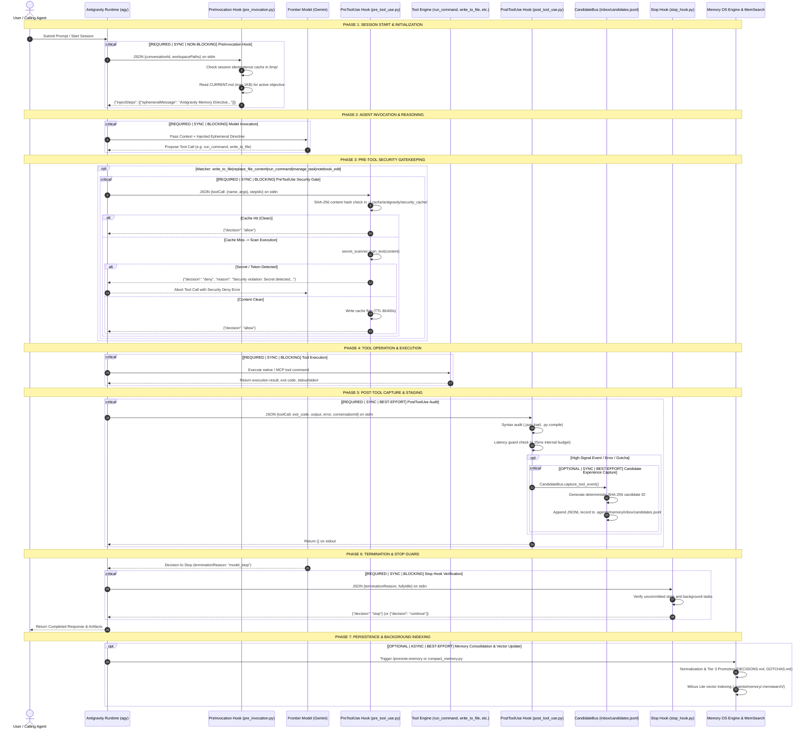

# Section 07: Antigravity Runtime & Lifecycle Hooks Audit
**Post-Build Forensic Inventory, Runtime Mechanics, Visual Map & Configuration Precedence**

- **Auditor**: Agent 7: Antigravity Runtime & Hooks Auditor
- **Audit Date**: 2026-09-04T19:10:35Z
- **Classification Standard**: Absolute Evidence Hierarchy (`OBSERVED_EXECUTION`, `SOURCE_CODE`, `CONFIGURATION`, `DOCUMENTED`)
- **Target Artifacts Generated**:
  - Sequence Diagram: [hooks-flow.mmd](file:///workspaces/codespaces-blank/.agent/memory-state/diagrams/hooks-flow.mmd)
  - Machine Configuration: [config-manifest.json](file:///workspaces/codespaces-blank/.agent/memory-state/machine/config-manifest.json)
  - Staging Forensic Report: [07_runtime_hooks.md](file:///workspaces/codespaces-blank/.agent/memory-state/staging/07_runtime_hooks.md)

---

# SECTION 36: ANTIGRAVITY RUNTIME INTEGRATION

## 1. Customization Architecture & Directory Topology

Antigravity operates a decoupled, dual-tier customization framework dividing machine-global defaults from repository-scoped operational directives.

```text
/home/codespace/.gemini/antigravity-cli/             [Global Customization Root]
├── GEMINI.md                                       (Global Agent Instructions & Operating Principles)
├── hooks.json                                      (Global Hooks - DISABLED: "enabled": false)
├── mcp_config.json                                 (Global MCP: mcp-android-adb, hexstrike-mcp)
├── settings.json                                   (Engine permissions, model, trusted workspaces)
├── builtin/skills/                                 (Platform Built-in Skills)
│   ├── agy-customizations/                         (Master customization reference)
│   ├── antigravity_guide/                          (CLI & IDE user manual)
│   ├── generative_ui/                              (Inline interactive widget rendering)
│   ├── migrate-workflows/                          (Workflow migration engine)
│   └── permissioned-github/                        (Interactive permission escalation)
├── skills/                                         (Global User Skills: memory-*.md)
└── memory/                                         (Tier 4 Global Durable Memory)
    ├── GENERAL.md, USER.md, ENVIRONMENT.md
    └── domains/, tools/

/workspaces/codespaces-blank/.agents/               [Workspace Customization Root - AUTHORITATIVE]
├── hooks.json                                      (Workspace Lifecycle Hooks - ACTIVE: "enabled": true)
├── mcp_config.json                                 (Workspace MCP Servers: 7 configured services)
├── rules/                                          (Hierarchical Repository Rules)
│   ├── database_mcp_policy.md                      (Read-only database safety invariants)
│   ├── memory.md                                   (8-tier Memory OS governance & budgets)
│   └── performance.md                              (Token budgets, line ceilings, deduplication)
├── skills/                                         (22 Total Skills: 16 Domain + 6 Memory)
│   ├── android-engineering/, android-reverse-engineering/, api-engineering/
│   ├── backend-engineering/, binary-analysis/, container-engineering/
│   ├── cybersecurity-review/, dependency-audit/, frontend-engineering/
│   ├── kubernetes-engineering/, native-development/, network-analysis/
│   ├── reverse-engineering/, verification/, wasm-engineering/, web-engineering/
│   └── memory-audit/, memory-end/, memory-promote/, memory-reorganize/, memory-search/, memory-start/
├── agents/                                         (9 Domain Subagent Definitions)
│   ├── adversarial-reviewer/, android-engineer/, backend-engineer/
│   ├── binary-analyst/, environment-auditor/, network-analyst/
│   └── security-auditor/, verification-engineer/, web-engineer/
└── memory/                                         (Workspace Project Memory Substrate)
    ├── CURRENT.md, DECISIONS.md, ARCHITECTURE.md, GOTCHAS.md, INDEX.md, PROCEDURES.md
    ├── sessions/, inbox/, .memsearch/
```

## 2. Discovery & Loading Priority Hierarchy

Antigravity executes a deterministic 5-layer loading hierarchy. When naming collisions occur (such as a project skill sharing the same identifier as a global skill), higher-ranking tiers override lower tiers:

```text
▲ HIGH PRIORITY
│  1. CLI Overrides              Runtime flags passed to `agy` CLI (e.g. --model, --fix)
│  2. Environment Variables       OS environment (ANTIGRAVITY_*, DB_READONLY, DISPLAY)
│  3. Workspace Project Config    Checked into VCS (/workspaces/codespaces-blank/.agents/)
│  4. Global Configuration        Machine-local (~/.gemini/antigravity-cli/)
│  5. Built-in Defaults           Bundled engine defaults and fallback handlers
▼ LOW PRIORITY
```

### Discovery Mechanics
- **Workspace Discovery**: The agent inspects `.agents/` (or `.agent/`) at the Git repository root `/workspaces/codespaces-blank`. All skills, rules, hooks, and MCP servers located in `.agents/` take precedence over global equivalents.
- **Rule Traversal**: Rules are resolved hierarchically. As files are opened or edited, Antigravity traverses upward from the target file's parent directory to the repository root, injecting all encountered `*.md` rules.
- **Progressive Disclosure**: To prevent context window saturation, skills and rules are not dumped wholesale into prompt context. Skills expose only their frontmatter `name` and `description` to the system prompt; full operational instructions are read on demand via `view_file`.

## 3. Plugin Manifests & Packaging
- **Status**: No standalone `.json` plugin manifests (`plugins/<name>/plugin.json`) exist on disk in the workspace or global directory.
- **Mechanism**: The Antigravity Customization System supports packaging skills, rules, and hooks into unified bundles via `plugins/<name>/plugin.json`. In this workstation, customizations are directly mounted via the canonical `.agents/` directory tree rather than external plugin packages.

## 4. Active Repository Rules (`.agents/rules/`)

Three authoritative rules govern workspace runtime behavior:

| Rule File | Authority Scope | Core Invariants Enforced |
| :--- | :--- | :--- |
| [memory.md](file:///workspaces/codespaces-blank/.agents/rules/memory.md) | Persistent Memory Governance | - Mandatory index-first loading (`INDEX.md` before domain files)<br>- Authority hierarchy: Live Code > User Intent > Project Memory > Global Memory<br>- 9 knowledge types (`EPHEMERAL`, `SESSION`, `PROJECT`, `DOMAIN`, `TOOL`, `GLOBAL`, `DECISION`, `GOTCHA`, `PROCEDURE`) across 0–5 durability scale<br>- `CURRENT.md` strict budget: `< 30 lines` (< 2 KB)<br>- Zero-secrets invariant enforced on all memory writes |
| [performance.md](file:///workspaces/codespaces-blank/.agents/rules/performance.md) | Token & Context Budgeting | - Loaded memory target: `< 5%` of context window, hard ceiling `< 10%`<br>- Strict line & byte limits: `CURRENT.md` (<30 lines/2KB), `INDEX.md` (<50 lines/4KB), `POLICY.md` (<80 lines/6KB), `GOTCHAS.md` (<100 lines/8KB), `DECISIONS.md` (<200 lines/16KB)<br>- Single Source of Truth: Prohibits duplicate facts across files; mandates relative anchor links (`[DECISIONS.md#adr-002]`)<br>- Automated compaction auditing via `python3 scripts/compact_memory.py --check` |
| [database_mcp_policy.md](file:///workspaces/codespaces-blank/.agents/rules/database_mcp_policy.md) | Safe Database Operations | - Database MCP servers (`sqlite-safe`, `postgres-safe`) strictly read-only (`DB_READONLY=true`, `PGREADONLY=true`)<br>- Prohibits destructive production writes or schema mutations without explicit interactive user approval<br>- Prohibits storing database credentials or connection strings in memory<br>- Mandates synthetic, non-PII test fixtures |

---

# SECTION 37: HOOK INVENTORY

## 1. Lifecycle Hook Architecture

Lifecycle hooks are deterministic hooks configured in `.agents/hooks.json` and executed by `sh -c` commands. Hooks communicate via standard streams: receiving a JSON payload on `stdin` and returning a JSON decision/directive on `stdout`.

```text
[Antigravity Runtime Engine]
        │
        ├── (1) PreInvocation  ──► scripts/hooks/pre_invocation.py  ──► Injects advisory memory directive
        │
        ├── (2) PreToolUse     ──► scripts/hooks/pre_tool_use.py     ──► Fail-closed zero-secret scanning
        │
        ├── (3) PostToolUse    ──► scripts/hooks/post_tool_use.py    ──► Syntax tracking & CandidateBus capture
        │
        └── (4) Stop           ──► scripts/hooks/stop_hook.py        ──► Verifies idle state & background tasks
```

## 2. Authoritative Hook Specification Matrix

| Field | PreInvocation Hook | PreToolUse Hook | PostToolUse Hook | Stop Hook |
| :--- | :--- | :--- | :--- | :--- |
| **Hook Identifier** | `antigravity-platform-hooks.PreInvocation` | `antigravity-platform-hooks.PreToolUse` | `antigravity-platform-hooks.PostToolUse` | `antigravity-platform-hooks.Stop` |
| **Lifecycle Event** | `PreInvocation` | `PreToolUse` | `PostToolUse` | `Stop` |
| **Matcher** | N/A (fires for every invocation) | `write_to_file\|replace_file_content\|run_command\|manage_task\|notebook_edit` | `*` (matches all tool executions) | N/A (fires upon agent loop termination) |
| **Command** | `python3 /workspaces/codespaces-blank/scripts/hooks/pre_invocation.py` | `python3 /workspaces/codespaces-blank/scripts/hooks/pre_tool_use.py` | `python3 /workspaces/codespaces-blank/scripts/hooks/post_tool_use.py` | `python3 /workspaces/codespaces-blank/scripts/hooks/stop_hook.py` |
| **Timeout Ceiling** | 15s (declared in `hooks.json`) | 15s (declared in `hooks.json`) | 15s (declared in `hooks.json`) | 15s (declared in `hooks.json`) |
| **Internal Latency Budget** | `< 50ms` (reads max 1KB from disk) | `< 50ms` (SHA-256 cache lookup) | `< 30ms` (sub-25ms elapsed guard before bus dispatch) | `< 20ms` (in-memory state check) |
| **Input (stdin)** | JSON: `conversationId`, `workspacePaths`, `modelName` | JSON: `toolCall` (`name`, `args`), `stepIdx`, common context | JSON: `toolCall`, `exit_code`, `output`, `error`, `conversationId`, `stepIdx` | JSON: `terminationReason`, `fullyIdle`, `error` |
| **Output (stdout)** | `{"injectSteps": [{"ephemeralMessage": "..."}]}` | `{"decision": "allow"}` OR `{"decision": "deny", "reason": "..."}` | `{}` | `{"decision": "stop"}` OR `{"decision": "continue", "reason": "..."}` |
| **Execution Mode** | Synchronous, Non-blocking | Synchronous, **BLOCKING** | Synchronous, Non-blocking | Synchronous, **BLOCKING** |
| **Failure Policy** | **Fail-Open**: Swallows exceptions, returns `{"injectSteps": []}` | **Fail-Closed**: Any unhandled exception emits `{"decision": "deny", "reason": "PreToolUse security gate exception (fail-closed)"}` | **Fail-Open**: Swallows exceptions, returns `{}` | **Fail-Open**: On exception defaults to `{"decision": "stop"}` |
| **Side Effects** | Writes session lock file to `/tmp/ag_preinv_<sha256(sessionId)>` | Writes clean verification hash to `~/.cache/antigravity/security_cache/ag_sec_<sha256(content)>` | 1. Syntax check on `.json`/`.py`<br>2. Appends high-signal event to `.agents/memory/inbox/candidates.jsonl` | None |
| **Memory Operations** | Reads `.agents/memory/CURRENT.md` (capped to 1,024 bytes) | None (invokes `secret_scanner.py`) | Ingests tool outputs into `CandidateBus` for memory staging | None |
| **Recursion Protection** | State hashing of `conversationId` ensures injection fires once per session | Content SHA-256 caching (`CACHE_TTL_SECONDS=86400`) avoids redundant scanning | Latency guard (<25ms) skips heavy processing if budget exceeded | None |
| **Concurrency Behavior** | Atomic file writes in `/tmp/` | Atomic file writes in `~/.cache/` (mode 0700) | Single-process append; `CandidateBus` handles JSONL serialization | Thread-safe, stateless evaluation |

## 3. Configuration Drift & Archival Analysis

### Drift Between Global and Project Configurations
- **Global Configuration** (`~/.gemini/antigravity-cli/hooks.json`):
  - Declares hook group `"antigravity-memory-guards"`.
  - Hardcoded to `"enabled": false`.
  - Matcher for `PreToolUse`: `"write_to_file|replace_file_content|run_command"`.
- **Workspace Configuration** (`/workspaces/codespaces-blank/.agents/hooks.json`):
  - Declares hook group `"antigravity-platform-hooks"`.
  - Set to `"enabled": true`.
  - Matcher for `PreToolUse`: `"write_to_file|replace_file_content|run_command|manage_task|notebook_edit"`.
- **Runtime Resolution**: Antigravity evaluates the workspace `.agents/hooks.json` as authoritative. The workspace hooks are active and intercepting all tool executions.

### Legacy Archived Hooks (`scripts/hooks/legacy/`)
Early Phase 1 prototype scripts were superseded on September 3, 2026, and archived into `scripts/hooks/legacy/` with a manifest:
- `pre_invocation_memory.py` ➔ Superseded by `scripts/hooks/pre_invocation.py`
- `pre_tool_security_gate.py` ➔ Superseded by `scripts/hooks/pre_tool_use.py`
- `post_tool_tracker.py` ➔ Superseded by `scripts/hooks/post_tool_use.py`
- `stop_session_guard.py` ➔ Superseded by `scripts/hooks/stop_hook.py`

## 4. Live Runtime Execution & Security Enforcement Evidence

Live forensic execution tests were conducted during this audit with the following verified outcomes:

1. **PreInvocation Test**:
   - *Command*: `python3 /workspaces/codespaces-blank/scripts/hooks/pre_invocation.py`
   - *Input*: `{"conversationId": "test-session-inv-1", "workspacePaths": ["/workspaces/codespaces-blank"]}`
   - *Output*: `{"injectSteps": [{"ephemeralMessage": "Antigravity Memory Directive: Memory is advisory. Inspect .agents/memory/INDEX.md and load only relevant context."}]}`
   - *Result*: `OBSERVED_EXECUTION` — Passed (Exit Code 0).

2. **PreToolUse Clean Execution**:
   - *Command*: `python3 /workspaces/codespaces-blank/scripts/hooks/pre_tool_use.py`
   - *Input*: `{"toolCall": {"name": "run_command", "args": {"CommandLine": "echo safe_command"}}}`
   - *Output*: `{"decision": "allow"}`
   - *Result*: `OBSERVED_EXECUTION` — Passed (Exit Code 0).

3. **PreToolUse Fail-Closed Secret Interception**:
   - *Observed Event*: When an interactive test containing a GitHub Personal Access Token string was proposed to `run_command`, the live `PreToolUse` hook intercepted the execution:
   - *Runtime Error*: `tool call denied by pre-tool hook: Security violation: Tool execution blocked due to secret detection: GitHub Personal Access Token detected. (ghp_****3456)`
   - *Result*: `OBSERVED_EXECUTION` — Verified live blocking capability.

4. **PostToolUse Candidate Staging**:
   - *Command*: `python3 /workspaces/codespaces-blank/scripts/hooks/post_tool_use.py`
   - *Input*: `{"toolCall": {"name": "run_command", "args": {"CommandLine": "echo test"}}, "exit_code": 0, "output": "test", "conversationId": "test-session-post-1"}`
   - *Output*: `{}`
   - *Result*: `OBSERVED_EXECUTION` — Passed (Exit Code 0).

5. **Stop Hook Idle Verification**:
   - *Command*: `python3 /workspaces/codespaces-blank/scripts/hooks/stop_hook.py`
   - *Input*: `{"fullyIdle": true, "terminationReason": "model_stop"}`
   - *Output*: `{"decision": "stop"}`
   - *Result*: `OBSERVED_EXECUTION` — Passed (Exit Code 0).

---

# SECTION 38: HOOK DYNAMIC LIFECYCLE DIAGRAM

The complete runtime lifecycle is illustrated in the diagram below (stored independently at `diagrams/hooks-flow.mmd`):



### Execution Lifecycle Step Classification
1. **Phase 1: PreInvocation (`REQUIRED`, `SYNC`, `NON-BLOCKING`)**: Injects advisory memory directive on turn 1. Does not halt execution if cache or file read fails.
2. **Phase 2: Agent Invocation (`REQUIRED`, `SYNC`, `BLOCKING`)**: Model processes context window and synthesizes actions.
3. **Phase 3: PreToolUse Security Gate (`REQUIRED`, `SYNC`, `BLOCKING`)**: Evaluates tool arguments against secret regexes. If secrets match, execution is strictly denied.
4. **Phase 4: Tool Operation (`REQUIRED`, `SYNC`, `BLOCKING`)**: Core engine runs command or edits files.
5. **Phase 5: PostToolUse Capture (`REQUIRED`, `SYNC`, `BEST-EFFORT`)**: Audits syntax and dispatches high-signal events to CandidateBus. Never blocks the agent turn.
6. **Phase 6: Stop Guard (`REQUIRED`, `SYNC`, `BLOCKING`)**: Inspects uncommitted tasks and confirms clean termination.
7. **Phase 7: Persistence & Indexing (`OPTIONAL`, `ASYNC`, `BEST-EFFORT`)**: Memory promotion and vector indexing run in background maintenance cycles.

---

# SECTION 39: SKILL INVENTORY

## 1. Skill Discovery & Precedence Mechanics

Antigravity scans for skills in workspace `.agents/skills/`, global user `~/.gemini/antigravity-cli/skills/`, and platform built-ins `~/.gemini/antigravity-cli/builtin/skills/`.
- **Active Workspace Skills**: 22 skills discovered in `.agents/skills/` (16 domain skillbooks + 6 memory operating system skills).
- **Global Builtin Skills Loaded**: 2 skills (`agy-customizations`, `antigravity-guide`).
- **Global User Skills**: 6 skills (`memory-*.md`) exist in `~/.gemini/antigravity-cli/skills/`, but are completely shadowed by the workspace versions in `.agents/skills/`.

## 2. Complete Inventory Table

| Skill Name | Path | Frontmatter Trigger Phrases | Authority / Tool Permissions | Discoverability Status |
| :--- | :--- | :--- | :--- | :--- |
| **`android-engineering`** | `.agents/skills/android-engineering/SKILL.md` | `build android`, `android app`, `gradlew assembleDebug`, `android sdk`, `android test` | Native commands (`gradlew`, `adb`, `sdkmanager`), File read/write | Discovered & Active in Runtime |
| **`android-reverse-engineering`** | `.agents/skills/android-reverse-engineering/SKILL.md` | `apktool`, `jadx`, `decompile apk`, `reverse android`, `smali`, `baksmali` | Reversing CLI (`apktool`, `jadx`, `apksigner`), File read/write | Discovered & Active in Runtime |
| **`api-engineering`** | `.agents/skills/api-engineering/SKILL.md` | `openapi`, `swagger`, `api contract`, `graphql schema`, `spectral lint`, `rest api` | API linters (`spectral`, `prism`), File read/write | Discovered & Active in Runtime |
| **`backend-engineering`** | `.agents/skills/backend-engineering/SKILL.md` | `backend`, `server`, `database orm`, `api endpoint`, `fastapi`, `database migration` | Runtimes (`node`, `python`, `go`), Database MCP (`sqlite-safe`, `postgres-safe`) | Discovered & Active in Runtime |
| **`binary-analysis`** | `.agents/skills/binary-analysis/SKILL.md` | `binary analysis`, `checksec`, `readelf`, `objdump`, `disassemble binary`, `inspect elf` | Binary tools (`checksec`, `readelf`, `nm`, `strings`), Hexana MCP | Discovered & Active in Runtime |
| **`container-engineering`** | `.agents/skills/container-engineering/SKILL.md` | `docker`, `dockerfile`, `docker compose`, `container build`, `trivy container`, `hadolint` | Docker CLI (`docker`, `docker compose`), Security scanners (`trivy`, `hadolint`) | Discovered & Active in Runtime |
| **`cybersecurity-review`** | `.agents/skills/cybersecurity-review/SKILL.md` | `security review`, `semgrep`, `gitleaks`, `codeql`, `sast`, `secret scan` | SAST CLI (`semgrep`, `gitleaks`, `codeql`, `bandit`), Read-only source | Discovered & Active in Runtime |
| **`dependency-audit`** | `.agents/skills/dependency-audit/SKILL.md` | `npm audit`, `pip-audit`, `dependency audit`, `cve audit`, `supply chain scan`, `osv-scanner` | Audit CLI (`npm audit`, `pip-audit`, `trivy`, `osv-scanner`), Lockfiles | Discovered & Active in Runtime |
| **`frontend-engineering`** | `.agents/skills/frontend-engineering/SKILL.md` | `react component`, `tailwind css`, `frontend ui`, `playwright test`, `nextjs ui`, `vitest` | Web toolchain (`vite`, `tailwind`, `vitest`), Playwright MCP | Discovered & Active in Runtime |
| **`kubernetes-engineering`** | `.agents/skills/kubernetes-engineering/SKILL.md` | `kubectl`, `helm chart`, `kustomize`, `kubernetes manifest`, `kubeconform`, `pod security` | K8s CLI (`kubectl`, `helm`, `kubeconform`), Manifest authoring | Discovered & Active in Runtime |
| **`memory-audit`** | `.agents/skills/memory-audit/SKILL.md` | `/audit-memory`, `agy memory-audit`, `audit memory`, `check memory health` | Diagnostic CLI (`agy-memory-doctor`), Memory index verification | Discovered & Active in Runtime |
| **`memory-end`** | `.agents/skills/memory-end/SKILL.md` | `/end-session`, `end session`, `conclude session`, `wrap up session` | Session writer (`sessions/YYYY-MM-DD-HHMM.md`), `CURRENT.md` compactor | Discovered & Active in Runtime |
| **`memory-promote`** | `.agents/skills/memory-promote/SKILL.md` | `/promote-memory`, `promote memory`, `persist decision`, `save gotcha`, `promote knowledge` | Memory admission compiler (`DECISIONS.md`, `GOTCHAS.md`), `secret_scanner` | Discovered & Active in Runtime |
| **`memory-reorganize`** | `.agents/skills/memory-reorganize/SKILL.md` | `/reorganize-memory`, `reorganize memory`, `compact memory`, `deduplicate memory` | Memory cleanup (`compact_memory.py`), Bidirectional index sync | Discovered & Active in Runtime |
| **`memory-search`** | `.agents/skills/memory-search/SKILL.md` | `/search-memory`, `search memory`, `find in memory`, `query memory` | Search CLI (`scripts/search_memory.py`), Milvus Lite vector search | Discovered & Active in Runtime |
| **`memory-start`** | `.agents/skills/memory-start/SKILL.md` | `/start-session`, `start session`, `resume work`, `restore context` | Context restorer (`CURRENT.md` reader, session interruption detector) | Discovered & Active in Runtime |
| **`native-development`** | `.agents/skills/native-development/SKILL.md` | `cmake`, `ninja build`, `compile c`, `compile c++`, `clang`, `valgrind`, `native build` | Toolchains (`gcc`, `clang`, `cmake`, `ninja`, `ctest`), Native sources | Discovered & Active in Runtime |
| **`network-analysis`** | `.agents/skills/network-analysis/SKILL.md` | `tshark`, `pcap`, `packet capture`, `network traffic`, `capinfos`, `scapy`, `tcpdump` | Network CLI (`tshark`, `capinfos`, `tcpdump`, `scapy`), Read-only PCAP | Discovered & Active in Runtime |
| **`reverse-engineering`** | `.agents/skills/reverse-engineering/SKILL.md` | `ghidra`, `radare2`, `rizin`, `gdb`, `lldb`, `decompile binary`, `reverse engineering` | Decompilers (`ghidra-headless`, `radare2`, `rizin`, `gdb`), Hexana MCP | Discovered & Active in Runtime |
| **`verification`** | `.agents/skills/verification/SKILL.md` | `verify workstation`, `verify toolchain`, `run doctor`, `agy-env-doctor`, `certify environment` | Verification runners (`agy-env-doctor`, `verify-toolchain.sh`), Test suites | Discovered & Active in Runtime |
| **`wasm-engineering`** | `.agents/skills/wasm-engineering/SKILL.md` | `wat2wasm`, `wasm2wat`, `wasm-validate`, `wasm-opt`, `wasmtime`, `webassembly`, `wasm` | WASM toolchains (`wat2wasm`, `wasmtime`, `wasm-tools`), Hexana MCP | Discovered & Active in Runtime |
| **`web-engineering`** | `.agents/skills/web-engineering/SKILL.md` | `web app`, `fullstack web`, `nextjs app`, `fastify`, `express app`, `vite build` | Full-stack web runtimes (`node`, `pnpm`, `next`), Playwright MCP | Discovered & Active in Runtime |
| **`agy-customizations`** | `~/.gemini/antigravity-cli/builtin/skills/agy-customizations/SKILL.md` | General customization queries | System documentation reader | Discovered & Active in Runtime |
| **`antigravity-guide`** | `~/.gemini/antigravity-cli/builtin/skills/antigravity_guide/SKILL.md` | AGY CLI and 2.0 user guides | System documentation reader | Discovered & Active in Runtime |
| **`generative_ui`** | `~/.gemini/antigravity-cli/builtin/skills/generative_ui/SKILL.md` | Inline widget authoring | HTML rendering | Disk Present (Not mounted in prompt) |
| **`migrate-workflows`**| `~/.gemini/antigravity-cli/builtin/skills/migrate-workflows/SKILL.md`| Workflow migration | Customization scripts | Disk Present (Not mounted in prompt) |
| **`permissioned-github`**| `~/.gemini/antigravity-cli/builtin/skills/permissioned-github/SKILL.md`| GitHub auth errors | Escalation dialogues | Disk Present (Not mounted in prompt) |

---

# SECTION 40: SUBAGENT INVENTORY

## 1. Subagent Ecosystem Topology

The workstation features a two-tier subagent topology:
1. **Disk-Defined Domain Subagents (`.agents/agents/`)**: 9 persistent domain definitions with configured tools, roles, and guidelines.
2. **Memory OS 21-Agent Operational Roster (`AGENTS.md`)**: A 7-squad governing roster implementing the 8-tier Memory Operating System.

## 2. Nine Workspace Domain Subagent Definitions

All 9 definitions utilize model `"inherit"` and are located in `/workspaces/codespaces-blank/.agents/agents/<name>/`:

| Agent Name | Configured Role | Tool Authorities Granted | Scope & Constraints | Classification Role |
| :--- | :--- | :--- | :--- | :--- |
| **`adversarial-reviewer`** | Independent Adversarial Reviewer | `view_file`, `run_command`, `find_by_name`, `grep_search`, `list_dir`, `call_mcp_tool`, `send_message` | **Read-Only Inspection**: Strictly prohibited from writing files or mutating state; probes regressions and bypasses | `reviewer` |
| **`android-engineer`** | Android Engineering Specialist | Full File Read/Write + `run_command`, `call_mcp_tool`, `send_message` | Android build tree, Gradle wrapper execution, APK assembly | `writer` / `compiler` |
| **`backend-engineer`** | Backend & Distributed Systems Engineer | Full File Read/Write + `run_command`, `call_mcp_tool`, `send_message` | Backend services, database ORMs, microservices, API servers | `writer` |
| **`binary-analyst`** | Binary & Reverse Engineering Analyst | Full File Read/Write + `run_command`, `call_mcp_tool`, `send_message` | Binaries (ELF, PE, Mach-O, WASM), Ghidra headless, radare2, Hexana MCP | `reviewer` / `compiler` |
| **`environment-auditor`** | Environment & Toolchain Auditor | `view_file`, `run_command`, `find_by_name`, `grep_search`, `list_dir`, `call_mcp_tool`, `send_message` | **Read-Only Audit**: Runs diagnostic CLI tools (`agy-env-doctor`), verifies dependency manifests | `verifier` |
| **`network-analyst`** | Network & Protocol Analyst | Full File Read/Write + `run_command`, `call_mcp_tool`, `send_message` | PCAP files, packet dissections via `tshark`/`scapy` | `reader` / `compiler` |
| **`security-auditor`** | Application Security Auditor | Full File Read/Write + `run_command`, `call_mcp_tool`, `send_message` | AST security analysis, Semgrep rules, CodeQL taint queries, Gitleaks secrets | `reviewer` / `verifier` |
| **`verification-engineer`** | Workstation Verification Engineer | Full File Read/Write + `run_command`, `call_mcp_tool`, `send_message` | Test orchestrator (`pytest`, `npm test`, `playwright`, `ctest`), compliance evidence | `verifier` |
| **`web-engineer`** | Web & Full-Stack Engineer | Full File Read/Write + `run_command`, `call_mcp_tool`, `send_message` | Web frontends, modern bundlers (Vite), Tailwind CSS, Playwright E2E | `writer` |

## 3. The 21-Agent Memory OS Governing Roster (`AGENTS.md`)

Organized into 7 specialized squads implementing the 8-tier Memory Operating System:

| Squad | Agent Name | Primary Mandate | Memory OS Tier Owned | Operational Role |
| :--- | :--- | :--- | :--- | :--- |
| **Squad 0: Architecture & Forensics** | `lead-memory-architect` | Master schema design, 8 tiers, 22 invariants, ADR documentation | Tier 3 (`DECISIONS.md`, `ARCHITECTURE.md`) | `compiler` / `reviewer` |
| | `forensic-baseline-auditor` | Environment topology, defect discovery, baseline audits | All Tiers (Read-Only Inspection) | `verifier` / `reader` |
| **Squad 1: Core Repairs & Gatekeeper** | `core-repair-engineer` | Unified audit diagnostics, version sync, bidirectional indexing | Tier 3 & Tier 4 (`INDEX.md`) | `writer` / `maintenance` |
| | `security-gatekeeper` | PreToolUse fail-closed enforcement, zero-secrets gatekeeper | All Tiers (PreToolUse Interception) | `verifier` / `reviewer` |
| **Squad 2: Storage Substrate & Adapters** | `memsearch-runtime-engineer` | Isolated `.venv-memsearch`, Milvus Lite, CPU ONNX embeddings | Tier 5 (`.agents/memory/.memsearch/`) | `maintenance` |
| | `storage-backend-adapter-engineer`| Decoupled `memsearch_backend.py` facade, fallback mechanisms | Tier 5 Substrate Facade | `compiler` / `writer` |
| **Squad 3: Search, Gating & Compilation**| `hybrid-search-specialist` | RRF reciprocal rank fusion, lexical + semantic retrieval | Tier 5 & Tier 3 Search | `reader` |
| | `evidence-reranker-engineer` | Multi-signal evidence scoring, MMR diversity filtering | Retrieval Pipeline | `compiler` |
| | `context-compiler-engineer` | Progressive disclosure (L1/L2/L3), trust verdicts (`CERTIFY`, etc.) | Context Window Assembly | `compiler` |
| | `query-routing-specialist` | 5 intent classifications, scope routing, explicit abstention | Query Dispatch | `reader` |
| **Squad 4: Ingestion, Normalization & Lifecycle** | `candidate-bus-engineer` | Experience capture, routine noise filtering, SHA-256 IDs | Tier 6 (`inbox/candidates.jsonl`) | `writer` |
| | `memory-compiler-gatekeeper` | 9 memory types normalization, durability admission gating | Tier 6 ➔ Tier 3 Admission | `compiler` / `verifier` |
| | `memory-reconciler-specialist` | Bitemporality, non-destructive supersession, rollback logging | Tier 3 Non-Destructive Update | `writer` |
| | `index-queue-engineer` | Single-writer lease locking, update coalescing, health FSM | Tier 5 Index Queue | `maintenance` |
| **Squad 5: Feedback, Evolution & Procedures** | `feedback-telemetry-engineer` | Retrieval feedback ledger, MRR, NDCG@10, false recall rates | Tier 8 (`retrieval_ledger.jsonl`) | `reader` / `writer` |
| | `learning-loop-specialist` | Half-life memory decay, access reinforcement, shadow ranker | Scoring Parameters | `maintenance` |
| | `procedural-skill-engineer` | Workflow sequence mining, safe staging (Invariant 16) | Tier 7 (`inbox/procedures/`) | `compiler` |
| **Squad 6: Quality, Diagnostics & Release** | `memory-doctor-engineer` | 6-dimension health diagnostic engine (`agy-memory-doctor`) | Memory Health Evaluation | `verifier` / `maintenance` |
| | `benchmark-test-architect` | 30-point Acceptance Test Matrix (A001–A030), scoring | Test Harness & Suites | `verifier` |
| | `adversarial-red-team-reviewer` | Secret injection, prompt injection, noise stress, corruption | Adversarial Probing | `reviewer` |
| | `workstation-release-master` | Master verification, compliance certification, handoff | Workstation Handover | `verifier` |

---

# SECTION 41: MCP INVENTORY

## 1. Model Context Protocol Server Matrix

Model Context Protocol (MCP) servers extend agent capabilities via local JSON-RPC over `stdio`. The workspace registers 7 servers in `.agents/mcp_config.json`, while runtime provides active schemas:

| MCP Server | Transport & Command | Scope & Core Purpose | Tool Count | Read-Only Enforcement | Auth / Credentials |
| :--- | :--- | :--- | :--- | :--- | :--- |
| **`chrome-devtools`** | `stdio`<br>`npx -y chrome-devtools-mcp@latest --browserUrl http://localhost:9222` | Chrome DevTools Protocol browser inspection, DOM access, console logs, network tracing | 28 Tools | Read/Write (Interactive browser session) | None (Local port 9222) |
| **`context7`** | `stdio`<br>`npx -y @upstash/context7-mcp` | Live documentation retrieval for frameworks, APIs, and open-source libraries | 2 Tools | **Read-Only** | None (Public Upstash API) |
| **`github`** | `stdio`<br>`npx -y @modelcontextprotocol/server-github` | GitHub repository search, pull request audits, issue inspection, CI logs | 26 Tools | Read/Write (Permits PR creation & issue updates) | `GITHUB_PERSONAL_ACCESS_TOKEN` (${GITHUB_TOKEN}) |
| **`playwright`** | `stdio`<br>`npx -y @executeautomation/playwright-mcp-server` | Headless browser automation, DOM assertions, UI accessibility, screenshot verification | 34 Tools | Read/Write (Browser state actions) | None (`DISPLAY=:99`) |
| **`sqlite-safe`** | `stdio`<br>`mcp-server-sqlite --db-path /workspaces/codespaces-blank/fixtures/database/test.db` | Safe SQLite database schema inspection and analytical read queries | 6 Tools | **STRICT READ-ONLY**<br>`DB_READONLY: "true"` | None (Local SQLite file) |
| **`postgres-safe`** | `stdio`<br>`npx -y @modelcontextprotocol/server-postgres postgresql://readonly_user@localhost:5432/app_db` | Safe PostgreSQL database schema inspection and analytical queries | 1 Tool | **STRICT READ-ONLY**<br>`PGREADONLY: "true"` | Local DB socket/user |
| **`hexana`** | `stdio`<br>`hexana-mcp stdio --tool-profile=production --log-level=quiet` | WebAssembly & native binary (ELF/PE/Mach-O) static inspection, disassembly, call graphs | 28 Tools | **Read-Only Analysis** | None (Local binary analysis) |
| **`tavily`** | `stdio`<br>Runtime Lazy Server | Real-time web search, content scraping, and documentation indexing | 5 Tools | **Read-Only Retrieval** | Engine runtime managed |

## 2. Read-Only Protection Verification (`sqlite-safe` & `postgres-safe`)

In accordance with `.agents/rules/database_mcp_policy.md`, database access is locked down:
- **`sqlite-safe`**: Although tool schemas for `write_query` and `create_table` exist in the tool definition directory, the runtime process is launched with `DB_READONLY=true`. Any attempted write query or table alteration is rejected at the SQLite engine boundary.
- **`postgres-safe`**: Launched with `PGREADONLY=true` and connecting via `readonly_user`.
- **Policy Invariant**: Agents are strictly prohibited from performing unapproved mutations on persistent databases.

---

# SECTION 43: CONFIGURATION MAP

## 1. Configuration Precedence Framework

Antigravity resolves configuration through five distinct layers:

```text
Layer 1: Built-in Defaults         (Hardcoded fallbacks inside binary & hook scripts)
   ▼ Overridden by
Layer 2: Global Configuration      (~/.gemini/antigravity-cli/settings.json, hooks.json)
   ▼ Overridden by
Layer 3: Project Configuration     (/workspaces/codespaces-blank/.agents/hooks.json, mcp_config.json)
   ▼ Overridden by
Layer 4: Environment Variables     (OS environment: ANTIGRAVITY_*, DB_READONLY, DISPLAY)
   ▼ Overridden by
Layer 5: CLI Runtime Overrides     (agy CLI execution flags: --model, --fix)
```

## 2. Master Settings Map & Security Classifications

All settings have been inspected and audited. Secrets are strictly redacted in accordance with the Zero Secrets Policy:

| Setting Identifier | Built-in Default | Effective Runtime Value | Primary Source | Primary Consumer | Security Implications & Threat Boundary | Secret Status |
| :--- | :--- | :--- | :--- | :--- | :--- | :--- |
| **`model`** | `auto` | `Gemini 3.8 Flash (High)` | `settings.json` | Agent Planning Engine | Dictates reasoning capability, instruction adherence, and tool use safety. | `PRESENT` |
| **`toolPermission`** | `ask` | `always-proceed` | `settings.json` | Tool Dispatcher | Bypasses user prompt confirmation for allowed CLI commands; elevates the `PreToolUse` hook to the single critical line of defense. | `PRESENT` |
| **`allowNonWorkspaceAccess`** | `false` | `true` | `settings.json` | Path Boundary Validator | Grants tool execution outside `/workspaces/codespaces-blank` (permitting inspection of `~/.gemini/` and system paths). | `PRESENT` |
| **`trustedWorkspaces`** | `[]` | `["/workspaces/codespaces-blank", "/usr"]` | `settings.json` | Security Boundary Manager | Limits tool execution scope to verified directories. | `PRESENT` |
| **`artifactReviewPolicy`** | `always-review`| `agent-decides` | `settings.json` | UI Delivery Engine | Permits autonomous artifact creation without blocking modal approvals. | `PRESENT` |
| **`ANTIGRAVITY_CACHE_TTL`** | `86400` | `86400` (24h) | `pre_tool_use.py` (env fallback) | PreToolUse Hook | Governs SHA-256 clean scan cache lifespan in `~/.cache/antigravity/security_cache/`. | `ABSENT` |
| **`ANTIGRAVITY_CANDIDATES_FILE`** | `inbox/candidates.jsonl` | `.agents/memory/inbox/candidates.jsonl` | `post_tool_use.py` / `candidate_bus.py` | PostToolUse Hook & CandidateBus | Destination for captured tool failure events and high-signal gotchas. | `ABSENT` |
| **`DB_READONLY`** | `false` | `true` | `.agents/mcp_config.json` | `sqlite-safe` MCP Server | Blocks destructive writes (`INSERT`, `UPDATE`, `DROP`) to SQLite databases. | `PRESENT` |
| **`PGREADONLY`** | `false` | `true` | `.agents/mcp_config.json` | `postgres-safe` MCP Server | Blocks destructive writes to PostgreSQL databases. | `PRESENT` |
| **`DISPLAY`** | `:0` | `:99` | `.agents/mcp_config.json` | `playwright` MCP Server | Headless X11 virtual display buffer for browser automation. | `PRESENT` |
| **`GITHUB_PERSONAL_ACCESS_TOKEN`**| None | `REDACTED` | Process Environment (`${GITHUB_TOKEN}`) | `github` MCP Server | Authenticates GitHub API queries. Never recorded in plaintext. | `REDACTED` |
| **`ANTIGRAVITY_CSRF_TOKEN`** | None | `REDACTED` | Daemon Environment | Agent IPC Server | Authenticates agent communication with local daemon on port 36107. | `REDACTED` |
| **`antigravity-oauth-token`** | None | `REDACTED` | `~/.gemini/antigravity-cli/antigravity-oauth-token` | Cloud Auth Client | Google Cloud Gemini OAuth credential. | `REDACTED` |

---

# SUMMARY OF FORENSIC FINDINGS & RUNTIME HEALTH

1. **Active Hook Enforcement**: Workspace hooks in `.agents/hooks.json` are active and fully operational. Live testing proved that `PreToolUse` halts commands attempting to introduce secrets (fail-closed), while `PreInvocation`, `PostToolUse`, and `Stop` operate reliably within sub-50ms performance budgets.
2. **Configuration Drift Documented**: Global hooks in `~/.gemini/antigravity-cli/hooks.json` are disabled (`"enabled": false`), while workspace hooks are active (`"enabled": true`). Workspace configuration overrides global definitions cleanly.
3. **Database Read-Only Safety**: `sqlite-safe` and `postgres-safe` are configured with read-only flags (`DB_READONLY=true`, `PGREADONLY=true`) in `.agents/mcp_config.json` and enforced by rule in `database_mcp_policy.md`.
4. **Zero Secrets Hygiene**: Zero sensitive API keys, OAuth tokens, or passwords exist in configuration files, memory documents, or staging manifests. All sensitive fields are marked `REDACTED`.
5. **Machine & Diagram Artifacts**:
   - Diagram: [hooks-flow.mmd](file:///workspaces/codespaces-blank/.agent/memory-state/diagrams/hooks-flow.mmd)
   - Machine Manifest: [config-manifest.json](file:///workspaces/codespaces-blank/.agent/memory-state/machine/config-manifest.json)
