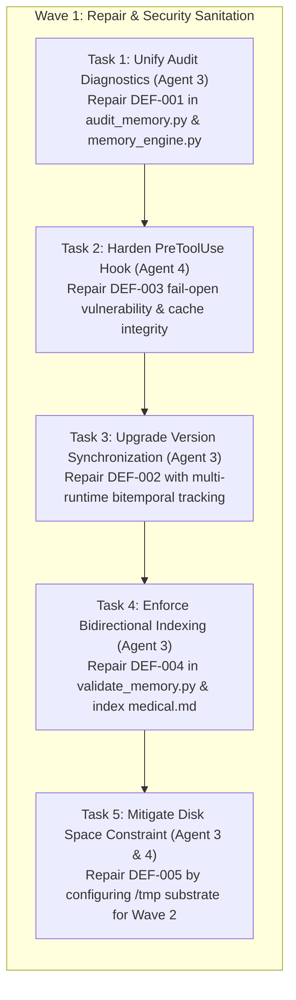

# Phase 0: Defect Matrix & Remediation Specification

**Document:** `DEFECT_MATRIX.md`  
**Auditor:** Agent 2 (Forensic Baseline Auditor)  
**Execution Date:** 2026-09-03  
**Target Repository:** `/workspaces/codespaces-blank`  
**Master Directives:** [`Instruction.md`](file:///workspaces/codespaces-blank/Instruction.md) (Sections 3 & 4), [`BASELINE.md`](file:///workspaces/codespaces-blank/.agents/memory-upgrade/audit/BASELINE.md)

---

## 1. Overview & Classification Schema

This Defect Matrix formalizes all architectural, behavioral, and diagnostic defects identified during the Phase 0 forensic baseline audit of the Antigravity persistent memory subsystem. 

Per **Invariant 2.2** (*"Live system beats stale documentation"*) and **Section 4** of `Instruction.md`, these defects must be repaired in **Phase 1** prior to constructing or activating any derived semantic indexing or MemSearch retrieval layers.

### Severity Levels
- **CRITICAL**: Security vulnerability, credential exposure risk, or silent data corruption.
- **HIGH**: Conflicting diagnostic results, false health reports, or unhandled exceptions that compromise system predictability.
- **MEDIUM**: Stale metadata, unindexed canonical files, or architectural divergence across duplicate implementations.
- **LOW**: Minor documentation drift or cosmetic log formatting issues.

---

## 2. Master Defect Matrix

| Defect ID | Severity | Category | Title | Affected Components | Root Cause Summary | Phase 1 Target Squad |
| :--- | :--- | :--- | :--- | :--- | :--- | :--- |
| **DEF-001** | **HIGH** | Diagnostics / Health | Audit Consistency Defect (Duplicates vs Zero Defects Mismatch) | `scripts/audit_memory.py`<br>`scripts/memory_engine.py` | Divergent duplicate detection algorithms, inconsistent inclusion of `sessions/`, and flawed `Overall status` calculation in `memory_engine.py`. | Squad 1 (Agent 3) |
| **DEF-002** | **MEDIUM** | State Synchronization | Stale Runtime & CLI Version Synchronization | `scripts/version_sync.py`<br>`~/.gemini/.../ENVIRONMENT.md` | Single-binary focus (`agy` only); Python, Node, Docker, Git versions unmanaged; no automatic hook trigger. | Squad 1 (Agent 3) |
| **DEF-003** | **CRITICAL** | Security / Gatekeeping | Security Gate Cache Failure & Fail-Open Vulnerability | `scripts/hooks/pre_tool_use.py`<br>`/tmp/.cache/antigravity` | Hook catches all exceptions and returns `decision: allow`; unvalidated cache lookup in world-writable `/tmp`. | Squad 1 (Agent 4) |
| **DEF-004** | **MEDIUM** | Index Governance | Unindexed Canonical Memory Artifacts | `~/.gemini/.../domains/medical.md`<br>`scripts/validate_memory.py` | `validate_memory.py` lacks bidirectional validation; `domains/medical.md` exists on disk but is absent from `INDEX.md`. | Squad 1 (Agent 3) |
| **DEF-005** | **HIGH** | Storage Infrastructure | Disk Budget Fragility & Loop-Device Capacity Exhaustion | `/workspaces` (`/dev/loop4`)<br>`tests/test_memory_system.py` | Codespace workspace mount at 96% utilization; ext4 reserved blocks trigger transient `[Errno 28] No space left on device`. | Squad 1 (Agent 3) |

---

## 3. Deep-Dive Forensic Defect Profiles

### DEF-001: Audit Consistency Defect (Duplicates vs Zero Defects Mismatch)

#### Forensic Summary & Symptoms
In historical exports and live execution:
- Executing `python3 scripts/audit_memory.py` yields:
  ```text
  ## MEMORY HEALTH
  Duplicates: 0
  Overall status: HEALTHY (Zero Defects)
  ```
- Executing `audit_memory()` via `python3 -c "import memory_engine; memory_engine.audit_memory()"` yields:
  ```text
  ## MEMORY HEALTH
  Duplicates: 5
  Overall status: HEALTHY
  ```
The system simultaneously claims `Duplicates: 0 (Zero Defects)` and `Duplicates: 5 (HEALTHY)`.

#### Root Cause Analysis
1. **Divergent File Scope**:
   - `scripts/audit_memory.py` (line 205) explicitly ignores episodic sessions:
     ```python
     if "sessions/" in file_path:
         continue
     ```
   - `scripts/memory_engine.py` (lines 272–285) collects all `.md` files without excluding `sessions/`.
2. **Divergent Line Matching & Normalization**:
   - `audit_memory.py` normalizes bullet points (`- ` or `* `) and strips date prefixes (`re.sub(r"^[-*]\s*(\[\d{4}-\d{2}-\d{2}\])?\s*", "", clean)`).
   - `memory_engine.py` does raw exact string matching for any line > 25 characters not starting with `#`, `|`, or `---`.
   - The 5 duplicates detected by `memory_engine.py` are standard episodic session log boilerplate shared between `sessions/2026-09-01-1617.md` and `sessions/2026-09-01-1546.md`:
     - `- **Workspace**: /workspaces/codespaces-blank`
     - `- Session goals completed and verified.`
     - `- Followed standard Antigravity persistent memory governance rules.`
     - `- Zero secrets rule validated; line budgets strictly respected.`
     - `1. Resume next phase in sequence.`
3. **Flawed Status Predicate**:
   - In `scripts/memory_engine.py` line 313:
     ```python
     print(f"Overall status: {'HEALTHY' if secret_violations == 0 and len(contradictions) == 0 and len(oversized) == 0 else 'NEEDS_MAINTENANCE'}")
     ```
     `duplicate_facts` is completely omitted from the condition! It declares `HEALTHY` regardless of whether duplicates are 0, 5, or 50.

#### Phase 1 Remediation Actions
1. Extract duplicate-detection logic into a shared, authoritative diagnostic module (`scripts/memory_diagnostics.py` or canonical `scripts/audit_memory.py`).
2. Make `memory_engine.py:audit_memory()` delegate directly to this authoritative diagnostic module instead of maintaining a divergent, duplicate copy.
3. Formally distinguish between **Episodic Repetition** (acceptable in chronological session snapshots) and **Durable Fact Duplication** (prohibited across canonical knowledge stores `GENERAL.md`, `DECISIONS.md`, `ARCHITECTURE.md`, `GOTCHAS.md`).
4. Ensure the `Overall status` predicate strictly evaluates all health dimensions (secrets, leakage, duplicates, contradictions, stale entries, oversized files). If any durable duplicate exists, the status must never be reported as `Zero Defects`.

---

### DEF-002: Stale Runtime & CLI Version Synchronization

#### Forensic Summary & Symptoms
- `~/.gemini/antigravity-cli/memory/ENVIRONMENT.md` records:
  - Antigravity CLI Version: `1.1.25`
  - Primary Language Runtimes: `Python 3.12.1, Node.js v24.14.0, GNU Bash 5.2` (recorded statically with date `2026-09-01`).
- `scripts/version_sync.py` only probes `agy --version`. If Python, Node.js, Docker, Git, or GCC are upgraded, `version_sync.py` will not detect or record the change.
- `version_sync.py` is not registered in `.agents/hooks.json`, meaning version drift can occur silently without automated synchronization.

#### Root Cause Analysis
- `scripts/version_sync.py` was implemented with single-binary scope targeting only `agy`.
- Regex parsing specifically targets `Antigravity CLI Version: ([0-9\.]+)` and lacks a generic runtime inventory schema.
- Lack of integration with `PreInvocation` hook.

#### Phase 1 Remediation Actions
1. Upgrade `scripts/version_sync.py` to maintain a multi-runtime inventory:
   - Antigravity CLI (`agy --version`)
   - Python runtime (`python3 --version` and sys.executable)
   - Node.js runtime (`node --version`)
   - Docker engine (`docker --version`)
   - C/C++ toolchains (`gcc --version`, `clang --version`, `cmake --version`)
2. For each tool, maintain bitemporal history:
   - `First Observed` date
   - `Detection Source`
   - `Previous Version`
   - Formal `## Superseded` block conforming to Axiom 7 of `POLICY.md`.
3. Integrate version validation into `scripts/hooks/pre_invocation.py` or `/start-session` workflow with lightweight (<10ms) cached checks.

---

### DEF-003: Security Gate Cache Failure & Fail-Open Vulnerability

#### Forensic Summary & Symptoms
In `scripts/hooks/pre_tool_use.py`:
1. Tool arguments (`CodeContent`, `ReplacementContent`, `CommandLine`) are concatenated and SHA-256 hashed.
2. The hook checks:
   ```python
   secure_cache_dir = os.path.expanduser("~/.cache/antigravity/security_cache")
   os.makedirs(secure_cache_dir, mode=0o700, exist_ok=True)
   cache_file = os.path.join(secure_cache_dir, f"ag_sec_{content_hash}")
   if os.path.exists(cache_file):
       print(json.dumps({"decision": "allow"}))
       return
   ```
3. If an unhandled exception occurs (e.g. disk failure, regex crash, import error, malformed input payload), lines 70–72 execute:
   ```python
   except Exception as e:
       print(json.dumps({"decision": "allow", "reason": f"Hook exception handled gracefully: {str(e)}"}))
   ```
4. `/home/codespace/.cache` is a symlink to `/tmp/.cache`, a world-writable directory.

#### Root Cause Analysis
- **Fail-Open Design**: By catching generic `Exception` and defaulting to `{"decision": "allow"}`, any failure in the security scanner permits potentially malicious or credential-bearing tool calls to execute unchecked.
- **Trivial Cache Poisoning**: The cache only tests for the existence of `ag_sec_{hash}`. It does not store signed verification metadata, content length, or timestamp. If an adversary or faulty script creates an empty file in `/tmp/.cache/antigravity/security_cache/ag_sec_<hash>`, the tool execution is permitted without scanning.

#### Phase 1 Remediation Actions
1. **Enforce Fail-Closed / Synchronous Fallback**:
   - If an exception occurs in the caching layer, the hook must fall back to direct, in-process synchronous secret regex scanning.
   - If the scanner itself fails critically on candidate content, the tool call must be **DENIED** (`decision: deny`), never allowed.
2. **Secure Cache Architecture**:
   - Store cache files in a private, non-shared location (e.g. `0700` directory owned exclusively by the user, verified not to be world-writable).
   - Cache payload must store structured JSON containing `{hash, scanned_at, is_clean: true, scanner_version}`.
   - Any corrupt or empty cache file must be treated as a cache miss and trigger a full re-scan.

---

### DEF-004: Unindexed Canonical Memory Artifacts

#### Forensic Summary & Symptoms
- On disk: `/home/codespace/.gemini/antigravity-cli/memory/domains/medical.md` exists (size: 56 bytes, content: `# Medical Domain\nThis file contains medical guidelines.`).
- In `~/.gemini/antigravity-cli/memory/INDEX.md`:
  - `domains/frontend.md` is indexed.
  - `domains/database.md` is indexed.
  - `domains/medical.md` is **completely absent**.
- Running `python3 scripts/validate_memory.py ~/.gemini/antigravity-cli/memory` reports:
  `VALIDATION PASSED: All 10 memory file(s) are structurally valid and coherent.`
  It does not detect that `medical.md` is unreachable via the index.

#### Root Cause Analysis
- `scripts/validate_memory.py` walks the directory and verifies that markdown links in existing files resolve to real disk targets.
- It lacks **bidirectional index validation**: it does NOT verify that every `.md` file discovered on disk is registered in `INDEX.md`.
- Consequently, orphaned or unindexed memory files can exist indefinitely without detection.

#### Phase 1 Remediation Actions
1. Add bidirectional index reconciliation to `scripts/validate_memory.py`:
   - For every `.md` file in `memory_root` (excluding `sessions/`, `README.md`, or temporary staging dirs), assert that an entry exists in `INDEX.md`.
   - If an unindexed file is found, report `FAIL: Unindexed canonical file: <path>` with exit code 1.
2. Add `domains/medical.md` to `~/.gemini/antigravity-cli/memory/INDEX.md` with appropriate scope, description, and date.
3. Verify project `INDEX.md` similarly covers all project canonical stores.

---

### DEF-005: Disk Budget Fragility & Loop-Device Capacity Exhaustion

#### Forensic Summary & Symptoms
- Filesystem inspection:
  - `/dev/loop4` mounted at `/workspaces` has a total capacity of 32 GB, with 30 GB used and only 1.4 GB available (96% utilization).
  - `/tmp` on `/dev/sda1` has 118 GB total, 7.5 GB used, and 105 GB available (7% utilization).
- During test runs, `test_memory_system.py` threw `OSError: [Errno 28] No space left on device` when disk writes temporarily breached ext4's 1% reserved block margin (83,886 blocks / ~327 MB).

#### Root Cause Analysis
- The GitHub Codespace container isolates the repository on a 32 GB loop-device backed disk image (`/mnt/cloudenvdata/dockerlib`).
- Multiple heavy toolchains (Android SDK, CodeQL databases, Gradle caches, Node packages) consume the bulk of the 30 GB.
- Allocating virtual environments, large embedding models, or build caches under `/workspaces` quickly exhausts remaining blocks.

#### Phase 1 Remediation Actions
1. Locate the MemSearch virtual environment (`.venv-memsearch`) and ONNX model cache in `/tmp` (e.g. `/tmp/antigravity/venv-memsearch` or symlinked), leveraging the 105 GB available partition on `/dev/sda1`.
2. Implement automated cleaning of obsolete test fixtures and build directories in `tests/` and `fixtures/`.
3. Add a lightweight disk space pre-flight check in `agy-env-doctor` and test harnesses warning when available disk space in `/workspaces` drops below 1 GB.

---

## 4. Phase 1 Action Plan & Squad Assignments

The following sequential action plan defines the execution roadmap for **Wave 1 (Squad 1)**:



### Specific Task Specifications

#### Task 1: Audit Engine Unification (Agent 3)
- **Files**: `scripts/audit_memory.py`, `scripts/memory_engine.py`
- **Specification**:
  - Unify duplicate detection into `MemoryAuditor.audit_duplicates()`.
  - Distinguish session boilerplate from durable facts.
  - Update `memory_engine.py:audit_memory()` to invoke `MemoryAuditor` directly.
  - Fix status predicate: `Zero Defects` requires `duplicates == 0 and secrets == 0 and contradictions == 0 and stale == 0 and oversized == 0 and leakage == 0`.

#### Task 2: Security Gate Hardening (Agent 4)
- **Files**: `scripts/hooks/pre_tool_use.py`, `scripts/secret_scanner.py`
- **Specification**:
  - Replace `except Exception: allow` with fail-closed or synchronous regex scan fallback.
  - Add cache payload validation (prevent trivial empty file bypass).
  - Ensure security gate unit tests (`tests/test_secret_scanner.py` and `tests/test_lifecycle_hooks.py`) explicitly test fail-closed behavior on corrupted cache and mock exceptions.

#### Task 3: Comprehensive Version Sync (Agent 3)
- **Files**: `scripts/version_sync.py`, `~/.gemini/antigravity-cli/memory/ENVIRONMENT.md`
- **Specification**:
  - Probe `agy`, `python3`, `node`, `docker`, `gcc`, `clang`, `cmake`, `git`.
  - Maintain historical rows in `ENVIRONMENT.md` with `First Observed`, `Previous Version`, `Detection Source`, and formal `## Superseded` block.

#### Task 4: Bidirectional Memory Validation (Agent 3)
- **Files**: `scripts/validate_memory.py`, `~/.gemini/antigravity-cli/memory/INDEX.md`
- **Specification**:
  - Update `validate_memory.py` to compare disk file list against indexed link list.
  - Add missing entry for `domains/medical.md` to global `INDEX.md`.

#### Task 5: Storage Allocation Policy (Squad 1)
- **Specification**:
  - Document and configure substrate directories under `/tmp` for the upcoming MemSearch runtime (Wave 2, Agent 5).

---

## 5. Acceptance Verification Criteria

Wave 1 completion requires all of the following criteria to be met with exit code 0:
1. `python3 scripts/audit_memory.py` outputs `Overall status: HEALTHY (Zero Defects)` with `Duplicates: 0`.
2. `python3 -c "import memory_engine; assert memory_engine.audit_memory()"` outputs identical duplicate count and status as `audit_memory.py`.
3. `python3 scripts/validate_memory.py` passes bidirectional checks across both global and project roots.
4. Simulated corrupted cache entry or hook exception in `pre_tool_use.py` blocks or falls back to synchronous scan, never blindly allowing tainted payloads.
5. All 42 tests in `tests/test_memory_system.py` pass cleanly.
