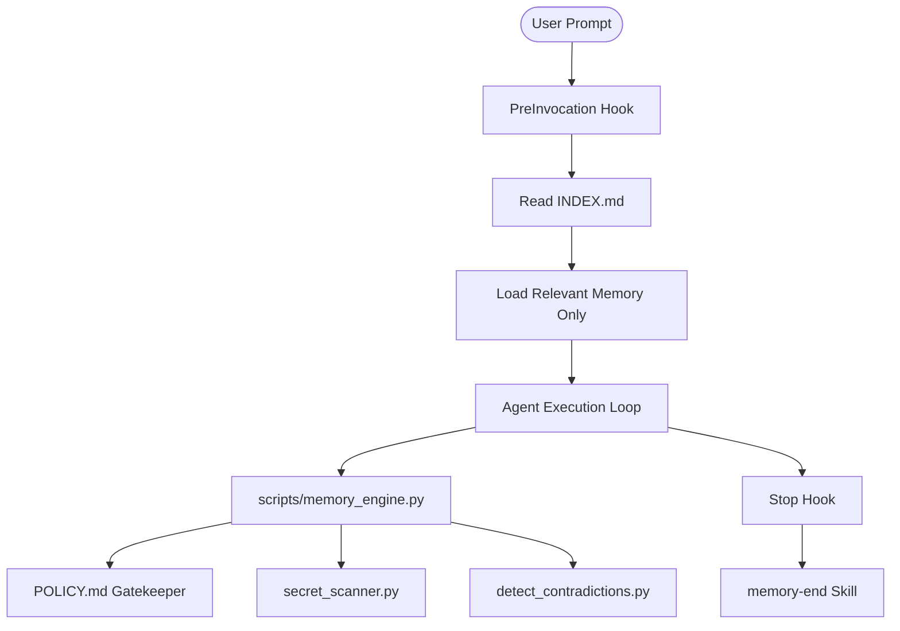

# Project System Architecture
Last Updated: 2026-10-07

## System Overview
The Antigravity Persistent Memory System provides long-term retention, contextual retrieval, and session lifecycle management for the Antigravity CLI (`agy`).

## Directory Partitioning
- `~/.gemini/antigravity-cli/memory/`: Machine-wide durable memory (Tiers 4 & 5).
- `.agents/memory/`: Repository-scoped project memory (Tiers 1, 2, 3, 6, 7, 8).
- `.agents/rules/`: Directory and project behavior enforcement rules.
- `.agents/skills/`: On-demand workflow guides.
- `.agents/hooks.json`: Lifecycle event automation.

## Memory OS Substrates & Invariants
- **Local Persistence Authority**: Markdown files in `.agents/memory/` remain canonical; vector indices are derived.
- **Single-Writer Lease Locking**: Index queues and write operations employ single-writer lease locks (`.lock` files).
- **Progressive Disclosure**: Information disclosure is staged across L1 (Summary), L2 (Contextual pointers), and L3 (Full text).
- **Hybrid Search**: Hybrid reciprocal rank fusion (RRF) couples lexical BM25 with dense semantic embeddings via Milvus Lite and CPU ONNX (`bge-m3`).
- **Native Build Architecture**: Native C/C++ builds utilize CMake with Ninja generator and `CMAKE_BUILD_TYPE=RelWithDebInfo` to balance stack symbol diagnostics with execution throughput.
