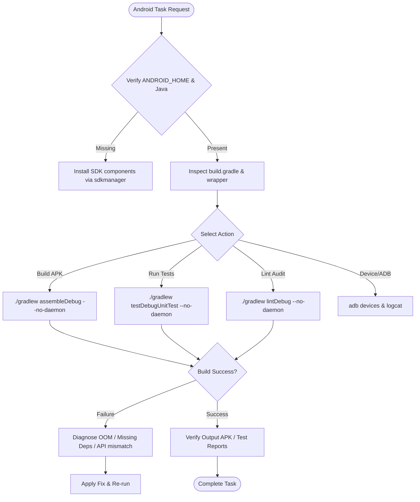

# Android Engineering Skill

## 1. Purpose & Scope
This skill provides comprehensive instructions for building, configuring, linting, testing, packaging, and debugging Android applications and libraries in headless Linux and CI/CD environments. It governs Gradle wrapper execution, SDK/NDK management, unit testing, and headless emulator workflows.

## 2. Activation Triggers
Activate this skill when:
- Configuring or troubleshooting Android SDK, NDK, or build tools.
- Compiling, assembling, or signing debug or release APKs/AABs using Gradle (`./gradlew`).
- Running Android unit tests (`testDebugUnitTest`) or Android Lint (`lintDebug`).
- Diagnosing Android build failures, memory issues, or dependency conflicts.
- Connecting to headless ADB instances, running logcat, or installing packages.

## 3. Prerequisites & Environment Verification
Verify that required Android SDK paths and core toolchains are available:
```bash
# Check Android environment variables
echo "ANDROID_HOME: ${ANDROID_HOME:-/usr/local/lib/android/sdk}"
echo "JAVA_HOME: ${JAVA_HOME:-/usr/lib/jvm/java-17-openjdk-amd64}"

# Verify core toolchain binaries
sdkmanager --version
adb version
javac -version
```

Accept SDK licenses before triggering first builds:
```bash
yes | sdkmanager --licenses >/dev/null 2>&1 || true
```

## 4. Decision Tree & Workflow Routing


## 5. Actionable Workflows & Procedures

### Workflow 1: Project Discovery & Configuration
1. Inspect project structure for `build.gradle`, `build.gradle.kts`, `settings.gradle`, and `gradle/wrapper/gradle-wrapper.properties`.
2. Inspect `compileSdk`, `targetSdk`, `minSdk`, and Java version compatibility:
   ```bash
   ./gradlew --version
   ```

### Workflow 2: Compilation & Packaging
Execute deterministic Gradle build tasks with `--no-daemon` to prevent memory exhaustion in container environments:
```bash
# Clean build
./gradlew clean --no-daemon

# Assemble debug APK
./gradlew assembleDebug --no-daemon

# Verify output artifact
ls -la app/build/outputs/apk/debug/*.apk
```

### Workflow 3: Unit Testing & Android Lint
```bash
# Execute local JVM unit tests
./gradlew testDebugUnitTest --no-daemon

# Execute static analysis via Android Lint
./gradlew lintDebug --no-daemon

# Inspect HTML / XML test reports
cat app/build/reports/tests/testDebugUnitTest/index.html | head -n 30
```

### Workflow 4: Headless ADB & Device Interaction
```bash
# Enumerate connected physical or virtual devices
adb devices -l

# Install debug APK
adb install -r app/build/outputs/apk/debug/app-debug.apk

# Capture runtime error stack traces from Logcat
adb logcat -d -s AndroidRuntime:E *:S
```

## 6. Verification & Validation Steps
- **APK Generation**: Ensure target APK exists and is non-empty (`app/build/outputs/apk/debug/app-debug.apk`).
- **Test Results**: Check test execution summary for zero failures in `app/build/reports/tests/`.
- **Lint Integrity**: Ensure no `Fatal` or `Error` severity lint issues in `app/build/reports/lint-results-debug.xml`.
- **Package Inspection**: Inspect APK package name and version with `aapt dump badging <apk>` or `apkanalyzer`.

## 7. Failure Recovery & Troubleshooting
- **Missing SDK Platforms or Build Tools**:
  ```bash
  sdkmanager "platforms;android-34" "build-tools;34.0.0"
  ```
- **Gradle Daemon Out of Memory / Container Kill**:
  Add explicit heap limits to `gradle.properties`:
  ```properties
  org.gradle.jvmargs=-Xmx2048m -XX:MaxMetaspaceSize=512m
  ```
- **Virtualization / KVM Unavailable in Headless Container**:
  Avoid launching hardware-accelerated QEMU emulators; rely on Robolectric/Roborazzi JVM-based tests or mock runners.
- **Dependency Resolution Failure**:
  Run `./gradlew build --refresh-dependencies --no-daemon` or inspect offline cache.

## 8. Security Boundaries & Operational Guardrails
- **Keystore Isolation**: Never hardcode production release keystore passwords, private aliases, or secrets into `build.gradle`. Always use environment variables or debug keystores for local testing.
- **Manifest Audit**: Review `AndroidManifest.xml` for dangerous exported components (`android:exported="true"`) without permission checks.
- **Clean Execution**: Use `--no-daemon` to avoid orphaned Java processes lingering in background.
