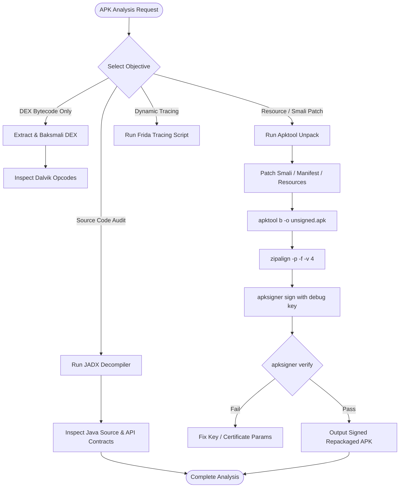

# Android Reverse Engineering Skill

## 1. Purpose & Scope
This skill provides comprehensive instructions for static and dynamic analysis, decompilation, bytecode disassembly, manifest analysis, patching, repackaging, and instrumentation of Android application packages (`.apk`, `.aar`, `.dex`).

## 2. Activation Triggers
Activate this skill when:
- Decompiling APKs to human-readable Java source via JADX.
- Unpacking APK resources and Dalvik bytecode into Smali via Apktool.
- Modifying Smali instructions or `AndroidManifest.xml` and repacking.
- Aligning and signing modified APKs with `zipalign` and `apksigner`.
- Performing dynamic instrumentation or API tracing via Frida on Android targets.

## 3. Prerequisites & Toolchain Verification
Verify that required reverse engineering binaries and Java runtimes are present:
```bash
# Verify reverse engineering binaries
apktool -version
jadx --version
zipalign --version || true
apksigner --version || true
baksmali --version || true
frida --version || true
```

## 4. Decision Tree & Workflow Routing


## 5. Actionable Workflows & Procedures

### Workflow 1: Java Decompilation with JADX
Decompile compiled Dalvik bytecode into high-level Java source for vulnerability and logic inspection:
```bash
# Decompile APK to Java sources without GUI
jadx -d jadx_decompiled target.apk --show-bad-code --no-res

# Search for sensitive API endpoints, hardcoded credentials, or URLs
grep -rnE "https?://|api_key|token|secret|password" jadx_decompiled/sources/
```

### Workflow 2: Disassembly to Smali & Resources with Apktool
```bash
# Decompile resources and Dalvik bytecode into smali
apktool d target.apk -o unpacked_apk -f

# Inspect AndroidManifest.xml
cat unpacked_apk/AndroidManifest.xml | head -n 40
```

### Workflow 3: Bytecode Disassembly with Baksmali
```bash
# Extract DEX files directly from zip archive
unzip -q target.apk -d apk_extracted/
baksmali d apk_extracted/classes.dex -o smali_classes/
```

### Workflow 4: Repackaging, Aligning, and Signing
After modifying Smali or manifest configurations within `unpacked_apk/`:
```bash
# 1. Rebuild APK
apktool b unpacked_apk -o modified_unsigned.apk

# 2. 4-byte page align ZIP boundaries
zipalign -p -f -v 4 modified_unsigned.apk modified_aligned.apk

# 3. Sign with Android debug keystore
apksigner sign \
  --ks ~/.android/debug.keystore \
  --ks-pass pass:android \
  --key-pass pass:android \
  --out modified_signed.apk \
  modified_aligned.apk
```

### Workflow 5: Dynamic Instrumentation with Frida
```bash
# Enumerate target processes
frida-ps -U

# Trace specific API invocations (e.g., crypto, file IO, network)
frida-trace -U -i "open*" -i "SSL*" com.example.targetapp

# Execute custom injection script
frida -U -l hook_agent.js -f com.example.targetapp --no-pause
```

## 6. Verification & Validation Steps
- **Signature Integrity**: Verify cryptographic validity of repacked package:
  ```bash
  apksigner verify --verbose modified_signed.apk
  ```
- **Zipalign Verification**:
  ```bash
  zipalign -c -v 4 modified_signed.apk
  ```
- **Manifest Validation**: Confirm that edited permissions and activities conform to valid XML syntax without parse errors.

## 7. Failure Recovery & Troubleshooting
- **Apktool Resource Decoding Errors (`-r` flag fallback)**:
  If a complex resource table causes `apktool d` to fail, decompile with `--no-res` to extract Smali bytecode only:
  ```bash
  apktool d target.apk -r -o unpacked_smali_only
  ```
- **Apktool Rebuild Framework Failure**:
  Clear existing framework caches:
  ```bash
  rm -rf ~/.local/share/apktool/framework/
  ```
- **Missing Debug Keystore**:
  Generate a new standard debug keystore if absent:
  ```bash
  keytool -genkey -v -keystore ~/.android/debug.keystore -storepass android -alias androiddebugkey -keypass android -keyalg RSA -keysize 2048 -validity 10000 -dname "CN=Android Debug,O=Android,C=US"
  ```

## 8. Security Boundaries & Operational Guardrails
- **Authorized Targets Only**: Execute reverse engineering workflows only on authorized sample binaries, open-source packages, or security evaluation fixtures.
- **Zero Credentials Persistence**: Never commit decompiled proprietary secrets, API keys, or private certificates discovered during analysis into durable repositories or memory.
- **Isolated Sandboxing**: Perform dynamic instrumentation within isolated headless emulators or non-production test harnesses.
