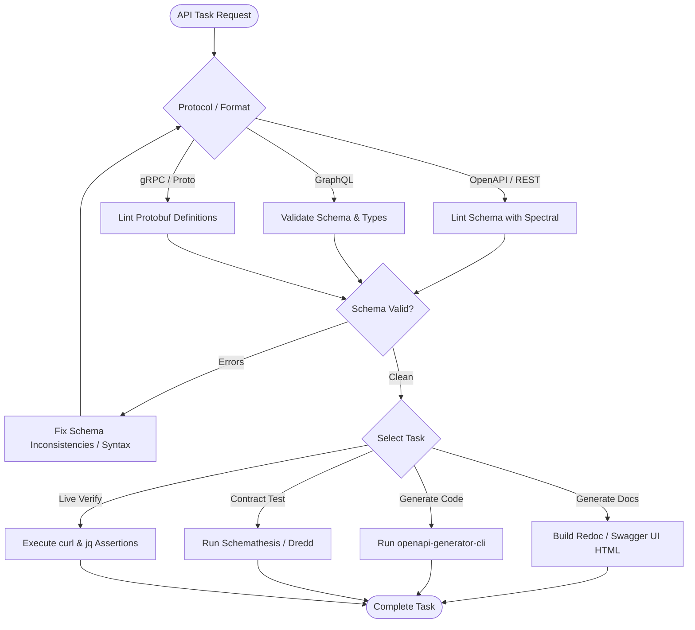

# API Engineering Skill

## 1. Purpose & Scope
This skill provides structured procedures for designing, authoring, validating, mocking, testing, documenting, and securing modern web APIs (REST, GraphQL, gRPC) and machine-readable API specifications (OpenAPI 3.0/3.1, JSON Schema, Protobuf).

## 2. Activation Triggers
Activate this skill when:
- Designing or editing OpenAPI/Swagger specifications (`openapi.yaml`, `swagger.json`).
- Validating API contracts, linting schemas with Spectral or Redocly.
- Generating client SDKs or server stubs from OpenAPI or GraphQL specifications.
- Performing automated schema-conformance testing via Schemathesis, Dredd, or curl.
- Hardening API security headers, authentication middleware, CORS policies, or rate limits.

## 3. Prerequisites & Toolchain Verification
Verify that required API tooling, linters, and CLI utilities are installed:
```bash
# Verify Node and CLI linters
node --version
npx --version
curl --version
jq --version

# Verify Python contract testing tools (optional)
schemathesis --version || true
```

## 4. Decision Tree & Workflow Routing


## 5. Actionable Workflows & Procedures

### Workflow 1: OpenAPI Schema Validation & Linting
Validate OpenAPI 3.0 / 3.1 definitions against standard style rules:
```bash
# Lint OpenAPI schema with Spectral
npx @stoplight/spectral-cli lint openapi.yaml

# Generate static HTML reference documentation
npx @redocly/cli build-docs openapi.yaml -o docs/api-reference.html
```

### Workflow 2: Automated Contract Conformance Testing
Execute schema-based property testing to discover edge cases and contract regressions:
```bash
# Run automated API contract tests with Schemathesis against live local service
schemathesis run openapi.yaml --base-url http://localhost:8000 --checks all
```

### Workflow 3: Live Endpoint Validation with `curl` and `jq`
```bash
# Test GET endpoint with header assertion
curl -s -i -H "Accept: application/json" http://localhost:8000/api/v1/healthz | grep "HTTP/1.1 200"

# Test POST request with JSON payload and response validation
curl -s -X POST http://localhost:8000/api/v1/resources \
  -H "Content-Type: application/json" \
  -d '{"name": "test_resource", "enabled": true}' | jq -e '.id != null'
```

### Workflow 4: Security Headers & CORS Auditing
Audit HTTP response headers against OWASP API security guidelines:
- **Transport**: Strict-Transport-Security (`max-age=31536000; includeSubDomains`)
- **Content Types**: `X-Content-Type-Options: nosniff`
- **Framing**: `X-Frame-Options: DENY`
- **CORS**: `Access-Control-Allow-Origin` strictly configured (avoid `*` with credentials).

## 6. Verification & Validation Steps
- **Spectral Zero Errors**: Ensure `npx @stoplight/spectral-cli lint` returns exit code `0`.
- **Response Schema Alignment**: Validate that API JSON responses strictly match declared JSON Schema response definitions.
- **Status Codes**: Confirm error responses use appropriate 4xx/5xx status codes with standard error payload formats (`{ "error": { "code": "...", "message": "..." } }`).

## 7. Failure Recovery & Troubleshooting
- **Spectral Rule Violations**: Resolve missing `operationId`, missing 4xx/5xx responses, or unreferenced `$ref` components.
- **CORS Preflight Failures (`OPTIONS 405/403`)**: Ensure server-side middleware handles `OPTIONS` methods and returns `Access-Control-Allow-Headers`.
- **Schema Drift**: When backend models change, update `openapi.yaml` and regenerate types before modifying endpoint implementations.

## 8. Security Boundaries & Operational Guardrails
- **Authentication Enforcement**: Ensure all non-public endpoints enforce bearer token or API key authentication middleware.
- **Input Sanitization**: Never interpolate unvalidated query parameters or request body parameters into raw database queries or shell commands.
- **Zero Secrets in URLs**: Never pass API tokens, passwords, or personal identifiable information (PII) in query strings.
