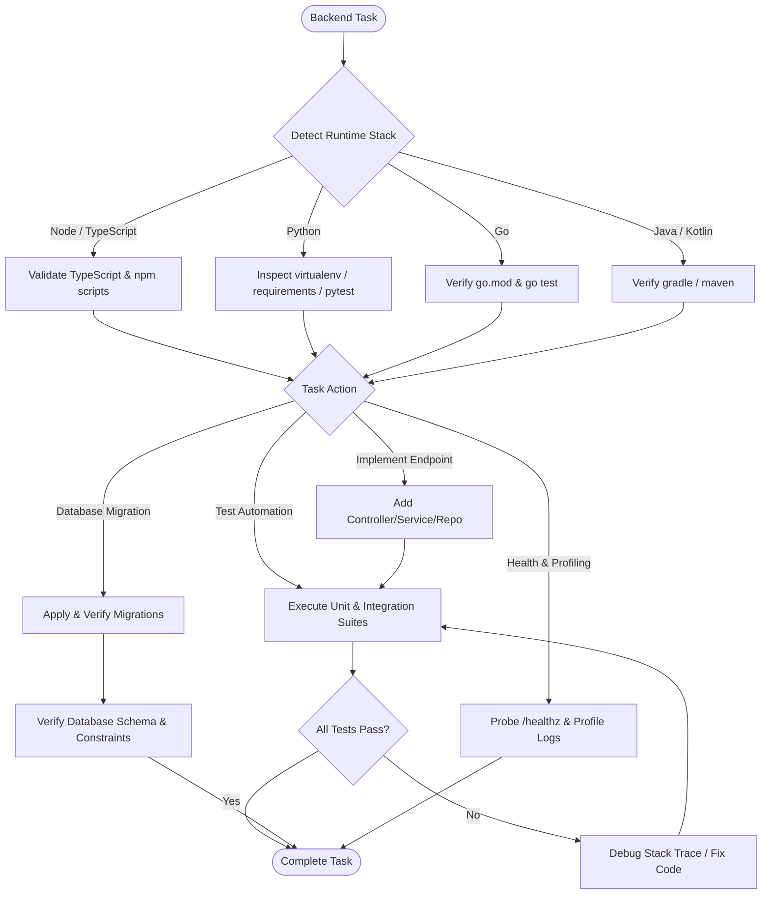

# Backend Engineering Skill

## 1. Purpose & Scope
This skill governs backend service development, server-side architectures, database access layers (ORMs, query builders), microservices, caching mechanisms, asynchronous background jobs, and test automation across Node.js/TypeScript, Python, Go, and Java.

## 2. Activation Triggers
Activate this skill when:
- Designing or implementing server-side API endpoints, controllers, or service layers.
- Writing or executing database migrations (Prisma, Alembic, Flyway, Knex).
- Implementing database queries, connection pools, and caching layers (Redis).
- Running backend unit, integration, and contract tests.
- Troubleshooting backend runtime errors, unhandled rejections, deadlocks, or performance bottlenecks.

## 3. Prerequisites & Environment Verification
Verify language runtimes and database client CLI tools:
```bash
# Verify language environments
node --version
python3 --version
go version || true
javac -version || true

# Verify curl and database exploration tools
curl --version
jq --version
```

## 4. Decision Tree & Workflow Routing


## 5. Actionable Workflows & Procedures

### Workflow 1: Architectural Layering & Schema Validation
Maintain strict separation of concerns across service layers:
1. **Transport Layer**: Handle HTTP/gRPC parsing and status codes.
2. **Validation Layer**: Enforce runtime schema validation (e.g., Zod for TypeScript, Pydantic for Python).
3. **Domain/Service Layer**: Encapsulate core business logic independently of HTTP frameworks.
4. **Data Access Layer**: Isolate database queries, transactions, and ORM entities.

### Workflow 2: Safe Database Migrations & Exploration
- Always generate idempotent and reversible migration scripts.
- When inspecting local or test databases, use safe read-only MCP tools (`sqlite-safe`, `postgres-safe`).
```bash
# Example: Prisma migration
npx prisma migrate dev --name init_tables

# Example: Python Alembic migration
alembic upgrade head
```

### Workflow 3: Multi-Ecosystem Test Execution
```bash
# Node.js / TypeScript test execution
npm test
npm run test:integration || true

# Python pytest execution with coverage
pytest tests/ -v --cov=app

# Go test suite with race detector
go test -v -race ./...
```

### Workflow 4: Health Probing & Structured Logging
- Implement `/healthz` (liveness) and `/readyz` (readiness with DB connectivity checks).
- Output structured JSON logs containing correlation IDs, timestamps, and log levels.
```bash
# Verify health endpoint locally
curl -s http://localhost:8000/healthz | jq .
```

## 6. Verification & Validation Steps
- **Zero Test Failures**: Ensure all unit and integration test suites exit with code `0`.
- **Type Safety**: Enforce strict type checks (`tsc --noEmit` or `mypy app/`).
- **Linter Compliance**: Run project linters (ESLint, Ruff, Flake8, golangci-lint).
- **Graceful Error Responses**: Validate that invalid inputs return structured 400 Bad Request with field-level details.

## 7. Failure Recovery & Troubleshooting
- **Database Connection Refused**: Verify database container status or environment connection string (`DATABASE_URL`).
- **Unhandled Promise Rejections / Panics**: Ensure global error-handling middleware is attached to the HTTP server instance.
- **N+1 Query Bottlenecks**: Use eager loading (`include` / `joinedload`) or batch loaders (DataLoader).
- **Port In Use (EADDRINUSE)**: Terminate dangling server processes or change `PORT` variable.

## 8. Security Boundaries & Operational Guardrails
- **SQL Injection Prevention**: Never construct raw SQL queries via string concatenation; always use parameterized queries or ORM abstractions.
- **Zero Secrets in Code**: Read credentials and API tokens strictly from environment variables or secure secret managers.
- **Read-Only Inspection**: MCP database tools must operate in read-only mode to prevent accidental data destruction.
