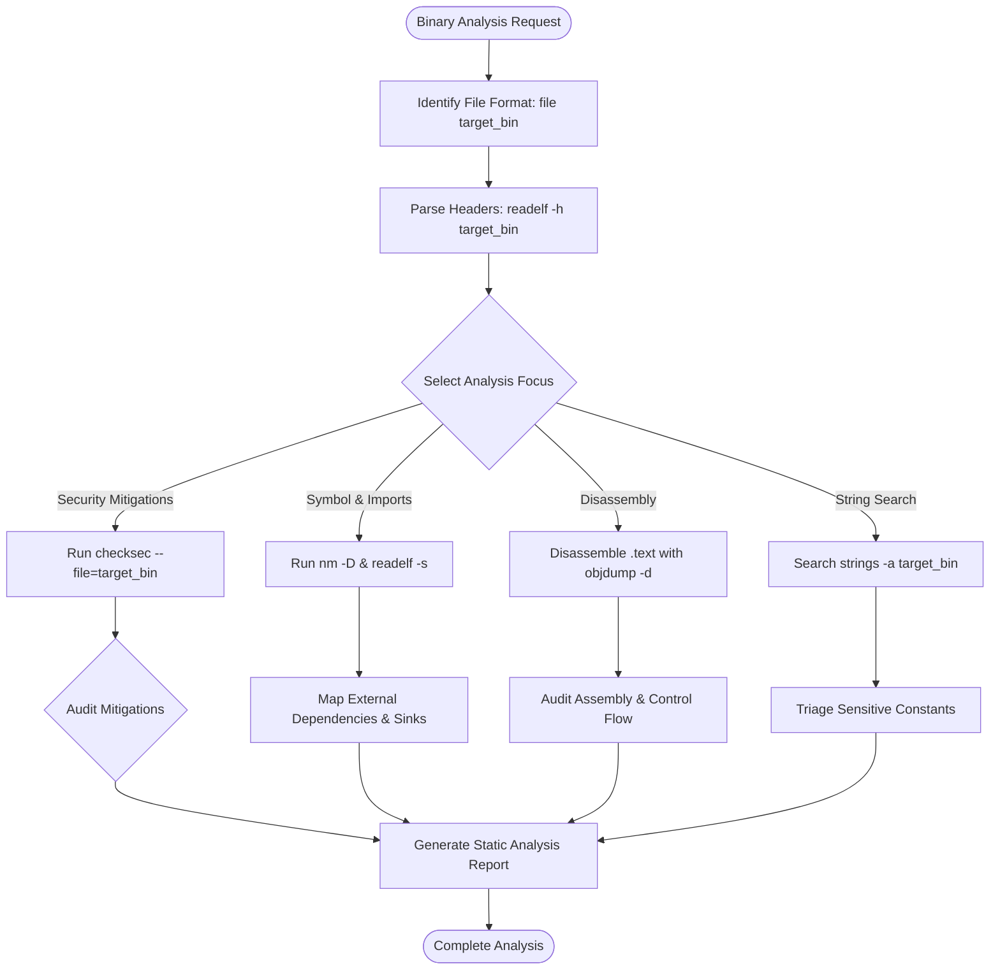

# Binary Analysis Skill

## 1. Purpose & Scope
This skill provides comprehensive static inspection procedures for compiled binary executables and shared libraries (ELF, PE, Mach-O). It guides header analysis, compiler security mitigation auditing, symbol extraction, disassembly, and dynamic dependency mapping.

## 2. Activation Triggers
Activate this skill when:
- Identifying unknown binary architectures, file formats, or build attributes.
- Auditing binary compilation mitigations (Canary, NX, PIE, RELRO, ASLR) via `checksec`.
- Extracting exported, imported, or dynamic symbols using `nm` or `readelf`.
- Disassembling binary sections (`.text`, `.plt`, `.got`) using `objdump`.
- Searching for embedded strings, credentials, or URLs in binary payloads.

## 3. Prerequisites & Toolchain Verification
Verify availability of GNU Binutils, LLVM tools, and security auditing utilities:
```bash
# Verify binary inspection binaries
file --version
readelf --version
objdump --version
nm --version
strings --version
checksec --version || true
```

## 4. Decision Tree & Workflow Routing


## 5. Actionable Workflows & Procedures

### Workflow 1: File Identification & Header Parsing
```bash
# Determine binary architecture, endianness, and ABI
file target_binary

# Parse ELF Header (entry point, machine type, flags)
readelf -h target_binary

# Inspect program headers and section headers
readelf -l target_binary
readelf -S target_binary
```

### Workflow 2: Security Mitigations Audit (`checksec`)
Check for standard defensive compiler flags:
```bash
checksec --file=target_binary
```
Target Mitigations Checklist:
- **Full RELRO**: Protects Global Offset Table (`.got`) from overwrite attacks.
- **Stack Canary**: Prevents stack buffer overflow exploitation.
- **NX / DEP**: Disallows code execution on the stack and heap.
- **PIE**: Position Independent Executable for full ASLR randomization.
- **FORTIFY_SOURCE**: Replaces unsafe string/memory functions with bounds-checked variants.

### Workflow 3: Symbol Extraction & Linker Analysis
```bash
# Extract dynamic symbols (exported APIs and imported symbols)
nm -D target_binary
readelf --dyn-syms target_binary

# List shared library dependencies
ldd target_binary || true
readelf -d target_binary
```

### Workflow 4: Disassembly & String Triage
```bash
# Disassemble .text section with Intel disassembly syntax
objdump -d -M intel --no-show-raw-insn target_binary | head -n 120

# Search for sensitive strings, API endpoints, or credentials
strings -a -t x target_binary | grep -E "https?://|api|key|secret|token|password"
```

## 6. Verification & Validation Steps
- **Format Integrity**: Verify the binary header is intact and matches the expected host or target architecture.
- **Checksec Validation**: Ensure all mitigation flags are explicitly documented in analysis logs.
- **Symbol Cross-Reference**: Cross-reference imported libc functions (`system`, `execve`, `strcpy`, `memcpy`) to identify potential vulnerability sinks.

## 7. Failure Recovery & Troubleshooting
- **Stripped Binaries (`no symbols`)**:
  When `nm` reports `no symbols`, inspect the dynamic symbol table (`readelf --dyn-syms`) or rely on disassembly (`objdump -d` or radare2/Ghidra).
- **Corrupt ELF Headers**:
  Use `hexdump -C -n 64 target_binary` to inspect raw magic bytes (`7f 45 4c 46`).
- **Dynamic Linker Missing (`ldd fails`)**:
  Use `readelf -l target_binary | grep interpreter` to determine the expected dynamic loader path.

## 8. Security Boundaries & Operational Guardrails
- **Static Inspection Only**: Perform analysis using static inspection tools (`readelf`, `objdump`, `strings`) without executing untrusted binaries directly.
- **Sandbox Isolation**: If dynamic execution or debugging is required, operate exclusively inside an isolated container sandbox.
- **No Secret Commit**: Never commit discovered binary credentials or confidential keys to repository files.
