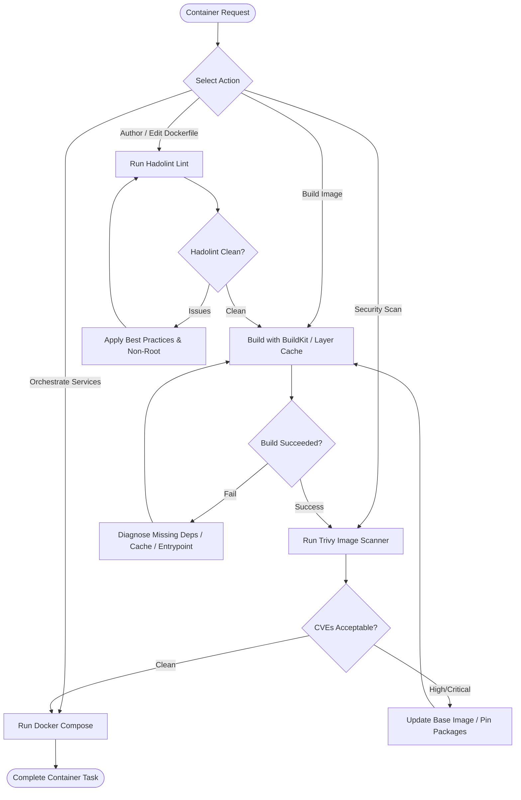

# Container Engineering Skill

## 1. Purpose & Scope
This skill governs the authoring, optimization, linting, vulnerability scanning, building, and orchestration of Dockerfiles, multi-stage container images, and Docker Compose development/test environments.

## 2. Activation Triggers
Activate this skill when:
- Authoring or refactoring `Dockerfile` or `compose.yaml` / `docker-compose.yml`.
- Linting Dockerfiles with `hadolint` for security and efficiency best practices.
- Building container images and optimizing build layer caching.
- Scanning container images for CVEs using `trivy`.
- Diagnosing container runtime crashes, entrypoint issues, or network connectivity faults.

## 3. Prerequisites & Toolchain Verification
Verify container runtimes, linters, and scanning utilities:
```bash
# Verify Docker CLI, Compose, and security scanners
docker --version
docker compose version || true
hadolint --version || true
trivy --version || true
```

## 4. Decision Tree & Workflow Routing


## 5. Actionable Workflows & Procedures

### Workflow 1: Dockerfile Authoring & Hardening Standards
1. **Multi-Stage Builds**: Separate build-time compilers from the minimal production runtime.
2. **Non-Root Execution**: Always configure a dedicated non-root user (`USER nonroot:nonroot` or `USER 10001`).
3. **Deterministic Layer Caching**: Copy dependency definitions before copying source trees to leverage layer caching.
4. **Clean `.dockerignore`**: Exclude `.git`, `.agents/memory/`, secrets, logs, and local caches.

### Workflow 2: Dockerfile Linting with Hadolint
```bash
# Lint Dockerfile against standard rules
hadolint Dockerfile
```

### Workflow 3: Building & Optimizing Images
```bash
# Build image with explicit tag
docker build -t myapp:test -f Dockerfile .

# Inspect image size and layer breakdown
docker history myapp:test
```

### Workflow 4: Security Vulnerability Scanning with Trivy
```bash
# Scan image for High and Critical vulnerabilities
trivy image --severity HIGH,CRITICAL --no-progress myapp:test
```

### Workflow 5: Multi-Container Orchestration with Docker Compose
```bash
# Validate Compose configuration syntax
docker compose config

# Launch services in detached mode
docker compose up -d

# Check service status and health
docker compose ps
docker compose logs --tail=50
```

## 6. Verification & Validation Steps
- **Build Success**: Verify `docker images` shows the freshly created tag with expected size.
- **User Validation**: Ensure container runs as non-root:
  ```bash
  docker run --rm myapp:test id
  ```
- **Health Check**: Probe running container endpoint (`curl -f http://localhost:8080/healthz`).
- **Clean Exit**: Verify containers stop cleanly on `SIGTERM`.

## 7. Failure Recovery & Troubleshooting
- **Build Context Too Large**: Check `.dockerignore` to ensure `node_modules`, `.git`, or build outputs are not sent to daemon.
- **Permission Denied in Non-Root Container**: Ensure application directories have proper ownership (`COPY --chown=nonroot:nonroot`).
- **Network Resolution Failure between Compose Services**: Verify services share the same Compose network and use service names as DNS hosts.

## 8. Security Boundaries & Operational Guardrails
- **Zero Secrets in Images**: Never use `ENV` or `ARG` to pass long-lived API tokens or credentials into images. Use secret mounts (`RUN --mount=type=secret`).
- **Rootless Defaults**: Refuse to run production containers as `root` (`UID 0`).
- **Cleanup Policy**: Always remove dangling test containers and intermediate build layers (`docker system prune -f`).
