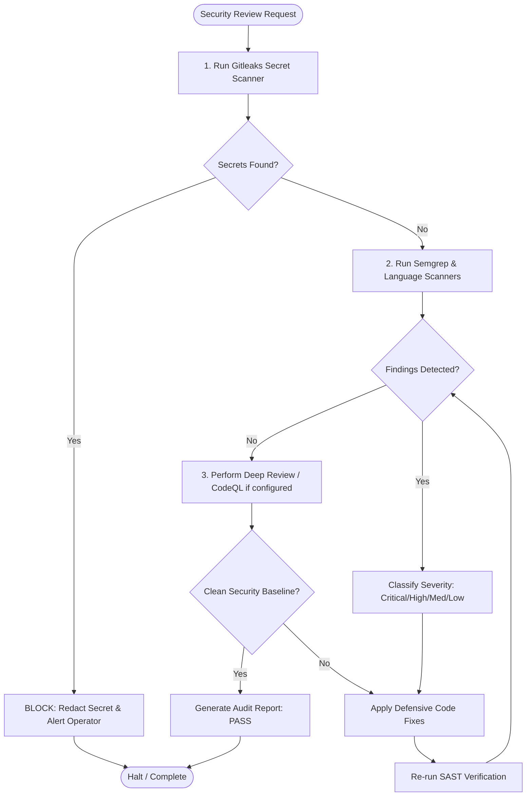

# Cybersecurity Review Skill

## 1. Purpose & Scope
This skill provides comprehensive procedures for static application security testing (SAST), secret detection, taint analysis, source code auditing, and defensive vulnerability remediation across software repositories.

## 2. Activation Triggers
Activate this skill when:
- Performing defensive security reviews on pull requests, commits, or source files.
- Running automated secret detection via `gitleaks`.
- Executing AST and taint-based SAST rulesets via `semgrep` or `bandit`.
- Performing deep semantic queries with `codeql`.
- Triaging and remediating security findings (OWASP Top 10, CWEs, injection flaws).

## 3. Prerequisites & Toolchain Verification
Verify availability of static analysis and secret scanning binaries:
```bash
# Verify security scanners
semgrep --version
gitleaks version || true
bandit --version || true
codeql --version || true
trivy --version || true
```

## 4. Decision Tree & Workflow Routing


## 5. Actionable Workflows & Procedures

### Workflow 1: Secret Scanning with Gitleaks
```bash
# Scan repository tree without git history
gitleaks detect --source . --verbose --no-git || true

# Scan staged git changes prior to commit
gitleaks protect --staged --verbose || true
```

### Workflow 2: Static Application Security Testing (Semgrep)
```bash
# Standard auto-config SAST scan
semgrep scan --config=auto --error

# Comprehensive security audit with JSON output
semgrep scan \
  --config="p/security-audit" \
  --config="p/secrets" \
  --config="p/owasp-top-ten" \
  --json -o /tmp/semgrep_report.json .
```

### Workflow 3: Python Security Review with Bandit
```bash
# Scan Python source directory for security issues
bandit -r app/ -ll -ii -f json -o /tmp/bandit_report.json
```

### Workflow 4: Deep Semantic Taint Analysis with CodeQL
```bash
# 1. Initialize CodeQL database
codeql database create /tmp/codeql-db --language=javascript --source-root=.

# 2. Analyze database against standard query suite
codeql database analyze /tmp/codeql-db \
  javascript-security-and-quality.qls \
  --format=sarif-latest \
  --output=codeql_results.sarif
```

### Workflow 5: Triage & Defensive Remediation
1. **Categorize Findings**: Group by CWE / OWASP categories.
2. **Apply Verified Patterns**:
   - **SQL Injection**: Parameterize queries or use typed ORM criteria.
   - **Command Injection**: Replace `shell=True` with array-based execution arguments.
   - **XSS**: Use context-aware auto-escaping templates and strict CSP headers.
   - **Path Traversal**: Validate canonical paths against authorized base directories (`os.path.realpath`).

## 6. Verification & Validation Steps
- **Zero Critical / High Findings**: Verify that `semgrep scan --error` and `gitleaks detect` complete with exit code `0`.
- **Regression Testing**: Execute test suites to ensure security fixes do not introduce functional regressions.
- **Evidence Archival**: Save SARIF / JSON audit reports in `.environment-audit/reports/` or `docs/test_reports/`.

## 7. Failure Recovery & Troubleshooting
- **False Positive Suppression**: If a finding is verified as an intentional safe pattern, add inline nosemgrep comments (`# nosemgrep: rule-id`) with explicit rationale.
- **Semgrep Out of Memory / Timeout**: Limit scan scope using `--exclude` flags for generated files, third-party libraries, and build artifacts.
- **CodeQL Database Creation Failure**: Verify build command succeeds cleanly for compiled languages (Java, C/C++, Go).

## 8. Security Boundaries & Operational Guardrails
- **Zero Secrets Disclosure**: Never display or write detected plaintext secrets in conversation logs or reports. Always mask them (`sk-***`).
- **Defensive Integrity**: Never introduce insecure workarounds or disable security linters globally to pass checks.
- **Read-Only / Safe Fixes**: Security remediation must preserve existing application semantics and pass all verification tests.
