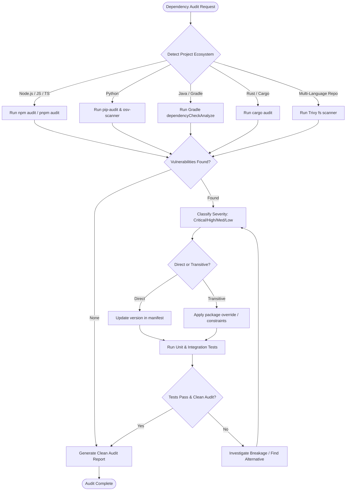

# Dependency Audit Skill

## 1. Purpose & Scope
This skill provides structured procedures for Software Composition Analysis (SCA), vulnerability detection, dependency resolution, lockfile verification, and supply-chain risk mitigation across multi-language ecosystems.

## 2. Activation Triggers
Activate this skill when:
- Auditing dependencies for known CVEs before releases or builds.
- Running `npm audit`, `pip-audit`, `osv-scanner`, or `trivy fs`.
- Resolving vulnerable transitive dependencies or pin conflicts.
- Updating package lockfiles (`package-lock.json`, `pnpm-lock.yaml`, `poetry.lock`, `Cargo.lock`).
- Verifying supply-chain integrity and license compliance.

## 3. Prerequisites & Toolchain Verification
Verify package managers and SCA vulnerability scanners:
```bash
# Verify ecosystem tools and scanners
npm --version
pip --version || true
pip-audit --version || true
trivy --version || true
osv-scanner --version || true
```

## 4. Decision Tree & Workflow Routing


## 5. Actionable Workflows & Procedures

### Workflow 1: Node.js / JavaScript Auditing & Remediation
```bash
# Audit package dependencies
npm audit --audit-level=high

# Safe automated fix for non-breaking semver patches
npm audit fix --only=prod

# Export full JSON report for triage
npm audit --json > /tmp/npm_audit.json
```

### Workflow 2: Python (pip / requirements.txt / pyproject.toml)
```bash
# Scan active environment or requirements file
pip-audit -r requirements.txt --format json -o /tmp/pip_audit.json

# Scan workspace with OSV-Scanner
osv-scanner -r .
```

### Workflow 3: Java / Gradle Dependency Scanning
```bash
# Check dependency updates and known vulnerabilities
./gradlew dependencyCheckAnalyze --no-daemon || ./gradlew dependencyUpdates --no-daemon
```

### Workflow 4: Multi-Language Filesystem SCA (Trivy)
```bash
# Run Trivy filesystem scan for high and critical CVEs
trivy fs --severity HIGH,CRITICAL --scanners vuln .
```

### Workflow 5: Transitive Dependency Override Strategy
- **npm**: Use `"overrides": { "vulnerable-pkg": "^x.y.z" }` in `package.json`.
- **pnpm**: Use `"pnpm": { "overrides": { "vulnerable-pkg": "^x.y.z" } }`.
- **pip**: Add pinned version to `constraints.txt`.
- **Cargo**: Use `[patch.crates-io]` in `Cargo.toml`.

## 6. Verification & Validation Steps
- **Zero Critical/High CVEs**: Ensure `npm audit` or `trivy fs` exits with code `0`.
- **Lockfile Consistency**: Verify lockfile is committed and clean (`git diff --stat package-lock.json`).
- **Regression Pass**: Execute full test suite to guarantee no breaking API changes occurred.

## 7. Failure Recovery & Troubleshooting
- **Breaking API Changes in Major Version Bumps**: Do not blindly bump major versions. If a patch is not available, investigate alternative packages or apply security wrappers.
- **Peer Dependency Conflicts (`ERESOLVE`)**: Use `--legacy-peer-deps` only as a temporary diagnostic step; resolve root conflict in manifest before shipping.
- **Transitive Pin Refusal**: Ensure lockfile is regenerated after updating overrides (`npm install --package-lock-only`).

## 8. Security Boundaries & Operational Guardrails
- **Deterministic Lockfiles**: Never delete lockfiles indiscriminately; always perform controlled updates.
- **Zero Insecure Registries**: Only fetch dependencies from verified official registries over HTTPS.
- **Pre-Install Scripts**: Inspect third-party packages for suspicious `preinstall` or `postinstall` scripts before adding new dependencies.
