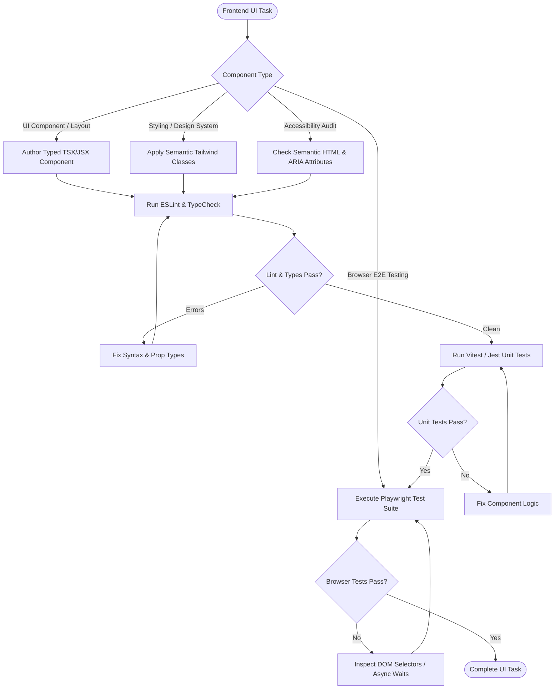

# Frontend Engineering Skill

## 1. Purpose & Scope
This skill guides the design, implementation, styling, accessibility compliance (a11y), responsive layout optimization, and browser-level testing of modern web user interfaces across React, Next.js, Vue, Svelte, and Tailwind CSS.

## 2. Activation Triggers
Activate this skill when:
- Creating, refactoring, or styling client-side UI components and page layouts.
- Implementing responsive design systems with Tailwind CSS or CSS Modules.
- Enforcing web accessibility standards (WCAG 2.1 AA, semantic HTML, ARIA roles).
- Writing and executing end-to-end browser tests or DOM assertions using Playwright.
- Diagnosing client-side rendering bugs, hydration mismatches, or layout shifts.

## 3. Prerequisites & Toolchain Verification
Verify frontend build engines, browsers, and testing tools:
```bash
# Verify Node and browser automation
node --version
npx --version
npx playwright --version || true
```

## 4. Decision Tree & Workflow Routing


## 5. Actionable Workflows & Procedures

### Workflow 1: Component Authoring & Accessibility Standards
1. **Typed Props**: Define strict TypeScript interfaces for all component props.
2. **Semantic HTML**: Use native semantic tags (`<header>`, `<nav>`, `<main>`, `<article>`, `<button>`) instead of generic `<div>` elements.
3. **Accessibility (a11y)**: Add `aria-label`, `aria-expanded`, and keyboard listeners (`onKeyDown`) for custom interactive controls.

### Workflow 2: Code Quality, Linting & Formatting
```bash
# Run ESLint across frontend sources
npx eslint src/**/*.{ts,tsx,js,jsx} --max-warnings=0

# Verify formatting with Prettier
npx prettier --check "src/**/*.{ts,tsx,css,json}"
```

### Workflow 3: Component Unit Testing (Vitest / Jest)
```bash
# Run component tests with code coverage
npm test -- --coverage
```

### Workflow 4: Headless Browser E2E Testing with Playwright
```bash
# Run headless browser test suite
npx playwright test

# Run specific test file with trace recording
npx playwright test tests/e2e/login.spec.ts --trace on
```

### Workflow 5: Responsive Layout Validation
Validate responsive layouts across standard breakpoints:
- **Mobile**: `375x812` (iPhone X/12 standard)
- **Tablet**: `768x1024` (iPad portrait)
- **Desktop**: `1920x1080` (Full HD standard)

## 6. Verification & Validation Steps
- **TypeScript Clean**: Ensure `npx tsc --noEmit` exits with code `0`.
- **Zero Console Errors**: Confirm no unhandled runtime warnings or React errors in browser console logs.
- **Playwright DOM Assertions**: Verify visible text, accessibility roles, and interactive states pass assertions.

## 7. Failure Recovery & Troubleshooting
- **React Hydration Mismatch**:
  Ensure server and client render identical trees. Move browser-only APIs (`window`, `localStorage`, `navigator`) inside `useEffect` or use dynamic imports with `ssr: false`.
- **CSS Specificity / Layer Overrides**:
  Inspect Tailwind layer hierarchy (`@tailwind base; @tailwind components; @tailwind utilities;`) to avoid style collisions.
- **Flaky Playwright Tests**:
  Replace hardcoded `sleep` calls with explicit locator assertions (`await expect(locator).toBeVisible({ timeout: 5000 })`).

## 8. Security Boundaries & Operational Guardrails
- **XSS Prevention**: Never use `dangerouslySetInnerHTML` with unsanitized user-generated markup. Always use DOMPurify if HTML rendering is required.
- **No Sensitive Data in Web Storage**: Never persist authentication tokens, passwords, or encryption keys in `localStorage` or `sessionStorage`. Use `httpOnly` secure cookies.
- **Isolated Browser Contexts**: Browser test automation must execute in isolated guest profiles without loading personal user profiles or cookies.
