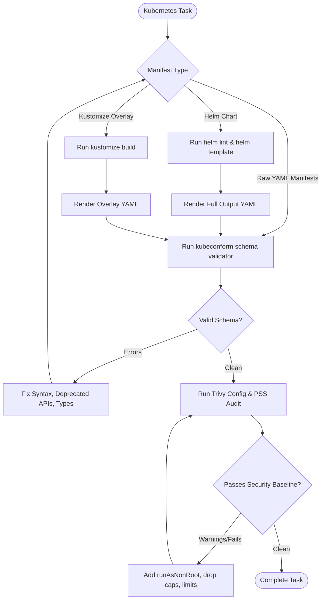

# Kubernetes Engineering Skill

## 1. Purpose & Scope
This skill provides comprehensive instructions for designing, templating, linting, validating, securing, and deploying cloud-native Kubernetes manifests, Helm charts, Kustomize overlays, and Pod Security Standards (PSS).

## 2. Activation Triggers
Activate this skill when:
- Authoring or editing Kubernetes resource definitions (`Deployment`, `StatefulSet`, `Service`, `Ingress`, `NetworkPolicy`).
- Linting and testing Helm charts (`helm lint`, `helm template`).
- Building and validating Kustomize overlays across environments (dev, staging, prod).
- Validating YAML schemas against official Kubernetes API specifications via `kubeconform`.
- Hardening Pod security contexts and enforcing resource limits.

## 3. Prerequisites & Toolchain Verification
Verify Kubernetes CLI tools, chart engines, and schema validators:
```bash
# Check client binaries
kubectl version --client || true
helm version || true
kustomize version || true
kubeconform -v || true
trivy --version || true
```

## 4. Decision Tree & Workflow Routing


## 5. Actionable Workflows & Procedures

### Workflow 1: Schema Validation with Kubeconform
Validate Kubernetes resource files against official API version schemas:
```bash
# Validate manifests in directory against Kubernetes 1.30 schema
kubeconform -strict -summary -kubernetes-version 1.30.0 k8s/
```

### Workflow 2: Helm Chart Linting & Rendering
```bash
# Lint Helm chart directory for structural errors
helm lint charts/myapp

# Render Helm template with custom values and validate with kubeconform
helm template myapp charts/myapp --values charts/myapp/values.yaml > /tmp/rendered.yaml
kubeconform -strict /tmp/rendered.yaml
```

### Workflow 3: Kustomize Overlay Builds
```bash
# Build environment-specific overlay
kustomize build overlays/staging/ > /tmp/staging-rendered.yaml
kubeconform -strict /tmp/staging-rendered.yaml
```

### Workflow 4: Pod Security Standards (PSS) Hardening
Enforce restricted Pod Security Standards across all workload containers:
```yaml
spec:
  securityContext:
    runAsNonRoot: true
    runAsUser: 10001
    fsGroup: 10001
    seccompProfile:
      type: RuntimeDefault
  containers:
    - name: app
      image: myapp:1.0.0
      securityContext:
        allowPrivilegeEscalation: false
        readOnlyRootFilesystem: true
        capabilities:
          drop:
            - ALL
      resources:
        requests:
          cpu: 100m
          memory: 128Mi
        limits:
          cpu: 500m
          memory: 512Mi
```

### Workflow 5: Security Configuration Scanning (Trivy Config)
```bash
# Scan Kubernetes manifests for misconfigurations and security violations
trivy config k8s/
```

## 6. Verification & Validation Steps
- **Zero Schema Errors**: Verify `kubeconform -strict` returns exit code `0`.
- **Helm Lint Clean**: Confirm `helm lint` returns zero errors and zero warnings.
- **Resource Constraints**: Confirm all pods declare `resources.requests` and `resources.limits`.
- **Security Context Checked**: Ensure no containers run with `privileged: true` or as root.

## 7. Failure Recovery & Troubleshooting
- **API Version Deprecation (`apiVersion: extensions/v1beta1`)**:
  Update to current stable APIs (`apps/v1` for Deployments, `networking.k8s.io/v1` for Ingress).
- **Missing Custom Resource Definitions (CRDs)**:
  Use `kubeconform -ignore-missing-schemas` when validating third-party CRDs without local schemas.
- **Helm Template Variable Nil Pointer**:
  Provide default values in `values.yaml` or use `{{ .Values.myKey | default "defaultValue" }}`.

## 8. Security Boundaries & Operational Guardrails
- **Restricted Pod Security**: Reject privileged containers and root users (`runAsUser: 0`).
- **Read-Only Root Filesystems**: Require ephemeral volumes (`emptyDir: {}`) for temporary files.
- **Zero Secrets in Plaintext**: Never commit raw unencrypted `Secret` manifests into git. Use SealedSecrets, External Secrets Operator, or Vault references.
