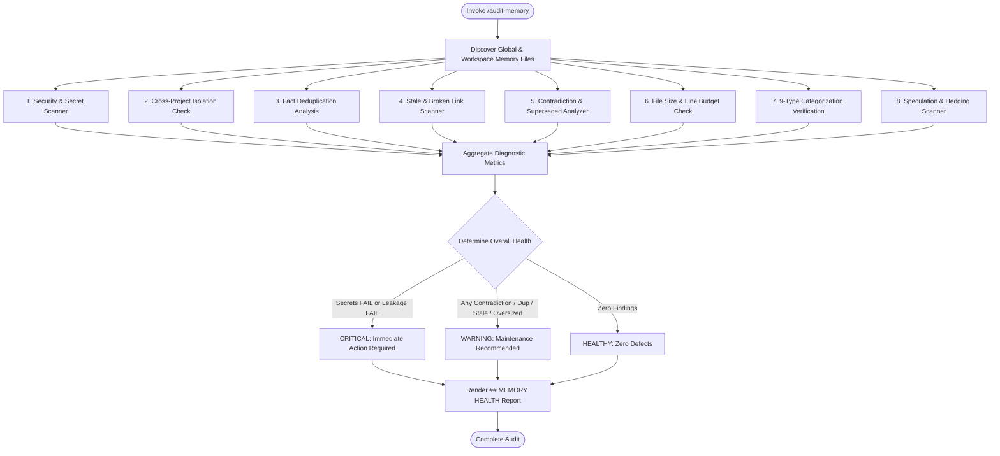

# Workspace Skill: Memory Health Audit (`memory-audit`)

## 1. Purpose & Scope
This skill defines the operational workflow for auditing, diagnosing, and verifying the health, security, and integrity of Antigravity persistent memory across the active workspace (`.agents/memory/`) and global memory tier (`~/.gemini/antigravity-cli/memory/`) in compliance with Phase 7 & Phase 13 specifications.

## 2. Activation Triggers
Activate this skill when:
- Executing `/audit-memory` or running `agy memory-audit`.
- Performing pre-commit or end-of-session memory integrity checks.
- Investigating potential secret leaks or cross-project contamination in memory.
- Resolving memory contradictions, duplicate assertions, or oversized memory files.

## 3. Prerequisites & Environment Verification
Verify Python runtime and memory audit helper scripts:
```bash
# Verify Python runtime
python3 --version

# Verify existence of memory audit script
test -f /workspaces/codespaces-blank/scripts/audit_memory.py || true
```

## 4. Diagnostic Vectors & Quality Dimensions
The audit process evaluates memory files against 8 quality and compliance dimensions:

| # | Diagnostic Dimension | Inspection Scope | Target Rule | Standard Result |
|---|---|---|---|---|
| **1** | **Secret Leakage** | API keys (OpenAI, Anthropic, Google, AWS, GitHub, GitLab, Slack, Stripe, HuggingFace), passwords, bearer tokens, JWTs, private keys, cookies, auth headers. | Phase 16 & Policy #1 | `PASS` / `FAIL` |
| **2** | **Cross-Project Leakage** | Workspace-specific paths (`/workspaces/...`), repo names, and private internal artifacts leaking into global memory. | Principle #1 & Phase 5 | `PASS` / `FAIL` |
| **3** | **Duplicated Facts** | Identical or redundant durable facts stored across multiple memory files or duplicate assertions within a file. | Policy #8 & Phase 15 | Count (`0`, `1`, ...) |
| **4** | **Stale Entries** | References to deleted files, non-existent workspace targets, obsolete commands, or unmaintained headers. | Policy #3 & Phase 8 | Count (`0`, `1`, ...) |
| **5** | **Contradictory Entries** | Conflicting requirements, opposing technical decisions, or incompatible facts without `## Superseded` tags. | Phase 11 & Policy #13 | Count (`0`, `1`, ...) |
| **6** | **Oversized Files** | Files violating context budget limits (`CURRENT.md` > 50 lines, `INDEX.md` > 120 lines, durable files > 250 lines). | Phase 15 (Context Efficiency) | Count (`0`, `1`, ...) |
| **7** | **Bad Categorization** | Misplaced facts across the 9 knowledge types (e.g. temporary notes in `DECISIONS.md` or user preferences in `ARCHITECTURE.md`). | Phase 10 | Count (`0`, `1`, ...) |
| **8** | **Unsupported Assumptions** | Speculative or hedging claims ("maybe", "probably", "seems like", "might be", "guess") recorded as durable facts. | Policy #2 (Fact vs Speculation) | Count (`0`, `1`, ...) |

## 5. Decision Tree & Workflow Routing


## 6. Actionable Workflows & Procedures

### Operational Steps:
1. **Discover Files**: Enumerate all markdown files under `.agents/memory/` and `~/.gemini/antigravity-cli/memory/`.
2. **Execute Diagnostic Suite**: Run the automated audit tool:
   ```bash
   python3 /workspaces/codespaces-blank/scripts/audit_memory.py
   ```
3. **Analyze Findings**: Check against severity criteria:
   - **CRITICAL**: Any secret leakage or cross-project contamination.
   - **WARNING**: Any duplicate fact, un-superseded contradiction, stale reference, oversized file, or speculative assertion.
   - **HEALTHY**: Zero findings across all categories.
4. **Format & Publish Report**: Produce the standardized `## MEMORY HEALTH` markdown report.
5. **Remediate Violations**: Follow remediation protocols to restore full health.

## 7. Standardized Report Format
When executing `/audit-memory`, output must adhere to the exact format below:

```markdown
## MEMORY HEALTH
Secrets: PASS/FAIL
Duplicates: <count>
Stale entries: <count>
Contradictions: <count>
Oversized files: <count>
Cross-project leakage: PASS/FAIL
Overall status: <HEALTHY (Zero Defects) | WARNING (Maintenance Recommended) | CRITICAL (Immediate Action Required)>

### Detailed Diagnostics
- **Secrets**: <PASS (Zero credentials detected) | List of violations with file:line>
- **Cross-project leakage**: <PASS (No project contamination in global memory) | List of leaked entries>
- **Duplicates**: <0 | List of repeated facts and source files>
- **Stale entries**: <0 | List of broken file paths or obsolete entries>
- **Contradictions**: <0 | List of conflicting statements and file pairs>
- **Oversized files**: <0 | List of files exceeding line or byte limits>
- **Bad categorization**: <0 | List of misclassified memory items>
- **Unsupported assumptions**: <0 | List of speculative statements>

### Recommended Remediation Actions
1. <Specific actionable remediation step>
2. <Specific actionable remediation step>
```

## 8. Failure Recovery & Remediation Protocols
- **Secret Leakage (`FAIL`)**:
  - Immediately delete or redact the secret value.
  - Rotate any compromised credentials in external providers.
  - Re-run `/audit-memory` to verify clean status.
- **Cross-Project Contamination (`FAIL`)**:
  - Move workspace-specific configurations, paths, or names out of `~/.gemini/antigravity-cli/memory/` and into `.agents/memory/`.
- **Contradictions (`count > 0`)**:
  - Inspect repository ground truth.
  - Apply `## Superseded` blocks with `Previous`, `Current`, `Reason`, and `Date`.
- **Duplicates (`count > 0`)**:
  - Consolidate duplicates into a single canonical file and reference it via markdown links.
- **Oversized Files (`count > 0`)**:
  - Run `scripts/compact_memory.py` or partition topics into dedicated files under `.agents/memory/` or `memory/domains/`.
- **Unsupported Assumptions (`count > 0`)**:
  - Remove speculative assertions or verify them with empirical test executions before re-adding.

## 9. Security Boundaries & Operational Guardrails
- **Zero Credentials Policy**: Absolute prohibition against writing credentials into memory.
- **Isolated Memory Tiers**: Global durable memory must remain project-agnostic.
- **Authoritative Repo State**: Live code always supersedes stale memory.
