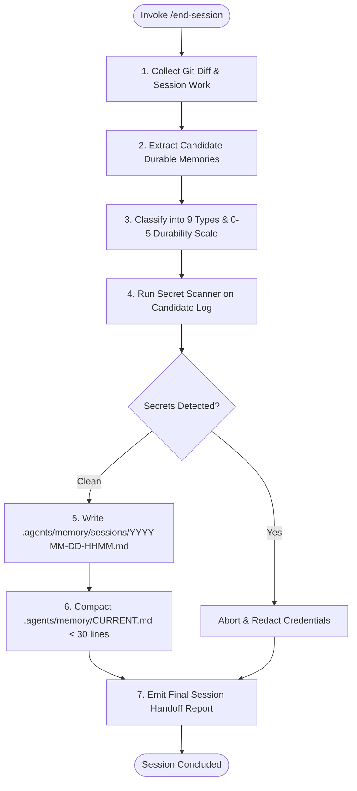

# Project Skill: End Session (`/end-session`)

## 1. Purpose & Scope
This skill cleanly concludes an Antigravity working session, distills acquired insights, records a timestamped episodic session log, compacts `CURRENT.md` to under 30 lines, scans candidate memory for secrets, and classifies candidate durable memories across the 9 knowledge types and 0–5 durability scale.

## 2. Activation Triggers
Activate this skill when:
- Executing the `/end-session` command.
- Concluding an engineering milestone or active work turn.
- Persisting session context and handoff state before switching tasks or disconnecting.

## 3. Prerequisites & Environment Verification
Verify environment state and helper utilities:
```bash
# Verify git status and root directory
git status --porcelain
test -d .agents/memory/sessions || mkdir -p .agents/memory/sessions
```

## 4. Decision Tree & Workflow Routing


## 5. Actionable Workflows & Procedures

### Workflow 1: Synthesize Session Activities
- Collect modified files, executed tests, resolved blockers, and architectural decisions.
- Inspect git status:
  ```bash
  git diff --stat
  ```

### Workflow 2: Extract & Classify Candidate Durable Memories
Evaluate all insights across the 9 knowledge types and 0–5 durability scale:
- `0–1`: Discard immediately (ephemeral/speculative).
- `2`: Session log only (`.agents/memory/sessions/`).
- `3`: Project memory (`.agents/memory/DECISIONS.md`, `ARCHITECTURE.md`, `GOTCHAS.md`).
- `4`: Domain/Tool memory (`~/.gemini/antigravity-cli/memory/domains/` or `tools/`).
- `5`: Global durable memory (`~/.gemini/antigravity-cli/memory/GENERAL.md`, `USER.md`, `ENVIRONMENT.md`).

### Workflow 3: Secret Scanning (Phase 16)
```bash
python3 /workspaces/codespaces-blank/scripts/secret_scanner.py || true
```
Ensure no API keys, tokens, credentials, or private keys are written to session logs or memory files.

### Workflow 4: Generate Timestamped Session Log
Write to `.agents/memory/sessions/YYYY-MM-DD-HHMM.md` containing:
- Completed Work Summary
- Unresolved Issues & Active Blockers
- Architectural Decisions Made
- Discoveries & Gotchas
- Candidate Durable Memories Table
- Recommended Next Steps

### Workflow 5: Compact `CURRENT.md`
Overwrite `.agents/memory/CURRENT.md` with active concise state (strictly < 30 lines).

## 6. Verification & Validation Steps
- **Session Log Exists**: Verify that the new session markdown log was successfully created under `.agents/memory/sessions/`.
- **Line Count Enforced**: Verify `wc -l .agents/memory/CURRENT.md` is strictly less than 30 lines.
- **Clean Secrets Scan**: Verify secret scanner returns `PASS`.

## 7. Failure Recovery & Troubleshooting
- **Secrets Detected in Draft Log**:
  Immediately redact the detected string before writing the file to disk. Replace with masked placeholders (`[REDACTED]`).
- **`CURRENT.md` Exceeds 30 Lines**:
  Prune completed historical items, retaining only active objective, blockers, and next steps.
- **Uncommitted Git Changes**:
  Note pending uncommitted changes in the session log under "Last Known State".

## 8. Security Boundaries & Operational Guardrails
- **Zero Secrets Persistence**: Absolute rejection of any candidate memory containing credentials.
- **Memory Isolation**: Do not push workspace-specific data into global memory.
- **No Speculative Promotion**: Unverified theories are capped at score `1` and discarded.
