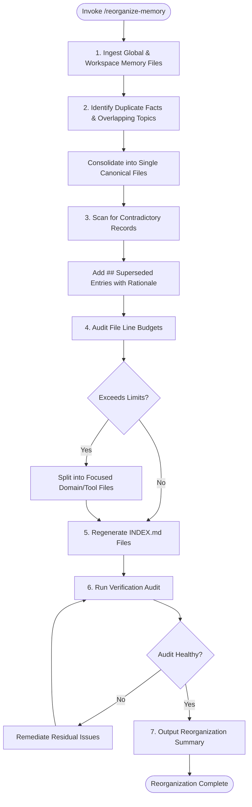

# Workspace Skill: Memory Reorganization (`/reorganize-memory`)

## 1. Purpose & Scope
This skill provides structured procedures to clean, deduplicate, merge, compact, and partition persistent memory files across workspace (`.agents/memory/`) and global (`~/.gemini/antigravity-cli/memory/`) tiers, while maintaining strict context line budgets and index synchronization.

## 2. Activation Triggers
Activate this skill when:
- Executing `/reorganize-memory`.
- Memory files exceed recommended line budgets (`CURRENT.md` > 30 lines, durable files > 250 lines).
- Duplicate assertions or fragmented notes are identified during memory audits.
- Archiving older session logs into quarterly bundles or consolidating topic notes.

## 3. Prerequisites & Environment Verification
Verify Python runtime and memory compaction utilities:
```bash
# Verify environment tools
python3 --version
test -d .agents/memory || mkdir -p .agents/memory
```

## 4. Decision Tree & Workflow Routing


## 5. Actionable Workflows & Procedures

### Workflow 1: Memory Ingestion & Parsing
Read all `.md` files in `~/.gemini/antigravity-cli/memory/` and `.agents/memory/`, extracting topic headings, timestamps, and factual assertions.

### Workflow 2: Deduplication & Fact Merging
1. Group assertions by domain, tool, or component.
2. Consolidate redundant statements into the single authoritative file.
3. Replace fragmented duplicates with explicit markdown links to canonical records.

### Workflow 3: Contradiction Resolution & Superseded Records
When conflicting statements exist:
1. Verify live repository ground truth.
2. Mark outdated statements as `## Superseded` (never silently delete historical architectural choices):
```markdown
### Superseded Entry
- **Previous**: [Old Fact / Policy]
- **Current**: [New Fact / Policy]
- **Reason**: [Why the change occurred]
- **Date**: YYYY-MM-DD
```

### Workflow 4: Line Budget Enforcement & Compaction
Enforce context budget limits:
- `CURRENT.md`: Max 30 lines.
- `INDEX.md`: Max 100 lines.
- `POLICY.md`: Max 60 lines.
- Topic files (`ARCHITECTURE.md`, `DECISIONS.md`, `GOTCHAS.md`): Max 250 lines.
If a file exceeds 250 lines, partition into subtopics under `.agents/memory/` or `memory/domains/`.

### Workflow 5: Index Synchronization
Regenerate or update `.agents/memory/INDEX.md` and `~/.gemini/antigravity-cli/memory/INDEX.md` with:
- Accurate relative file links
- Last modified dates
- Clear 1-line descriptions

## 6. Verification & Validation Steps
- **Line Count Compliance**: Verify all memory files are within declared line budgets.
- **No Broken Links**: Verify all links inside `INDEX.md` resolve to existing files.
- **Audit Verification**: Run `python3 /workspaces/codespaces-blank/scripts/audit_memory.py` and confirm `Overall status: HEALTHY`.

## 7. Failure Recovery & Troubleshooting
- **Accidental Deletion of Historical Decisions**:
  Always retain historical decision context by using `## Superseded` instead of removing past ADRs.
- **Broken Markdown References**:
  Run link verification to ensure split files are properly linked in `INDEX.md`.

## 8. Security Boundaries & Operational Guardrails
- **Zero Secrets**: Ensure compaction and merging do not expose or leak sensitive values.
- **Workspace Isolation**: Workspace-specific knowledge must remain strictly within `.agents/memory/`.
- **Authoritative Precedence**: Live repository state always supersedes conflicting memory.
