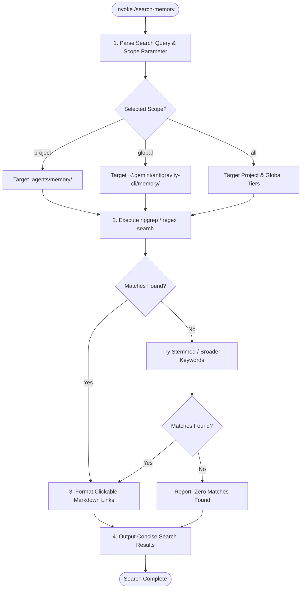

# Workspace Skill: Memory Search (`/search-memory`)

## 1. Purpose & Scope
This skill enables fast, selective, keyword and semantic search across workspace (`.agents/memory/`) and global (`~/.gemini/antigravity-cli/memory/`) persistent memory tiers. It provides targeted file paths, line numbers, and concise snippets without polluting or bloating the active conversation context.

## 2. Activation Triggers
Activate this skill when:
- Executing `/search-memory <query> [--scope all|global|project]`.
- Retrieving specific architectural decisions, past gotchas, or tooling procedures.
- Looking up previously established conventions before implementing new components.

## 3. Prerequisites & Environment Verification
Verify CLI search tools and Python runtime:
```bash
# Verify ripgrep or Python
rg --version || true
python3 --version
```

## 4. Decision Tree & Workflow Routing


## 5. Actionable Workflows & Procedures

### Workflow 1: Parse Scope & Command Flags
Supported scopes:
- `project` (default for workspace tasks): Searches `.agents/memory/`.
- `global`: Searches `~/.gemini/antigravity-cli/memory/`.
- `all`: Searches both workspace and global memory directories.

### Workflow 2: Execute Targeted Memory Search
```bash
# Example ripgrep search in project memory
rg -in --heading -C 1 "target_keyword" .agents/memory/

# Example search across all memory tiers
rg -in --heading -C 1 "target_keyword" .agents/memory/ ~/.gemini/antigravity-cli/memory/
```

### Workflow 3: Output Formatting Standards
Render search results using clickable markdown links with line numbers:
```markdown
### Memory Search Results for: "<query>" (Scope: <scope>)
- [`DECISIONS.md`:L45](file:///workspaces/codespaces-blank/.agents/memory/DECISIONS.md#L45): Accepted Tailwind CSS utility architecture.
- [`GOTCHAS.md`:L22](file:///workspaces/codespaces-blank/.agents/memory/GOTCHAS.md#L22): Gradle daemon OOM in headless container.
```

## 6. Verification & Validation Steps
- **Accurate Line Ranges**: Ensure line numbers in the output correspond exactly to live memory file lines.
- **Clickable File Links**: Verify all file paths use absolute `file:///` URI syntax.
- **Context Efficiency**: Ensure search output presents only relevant snippets and does not dump entire files into context.

## 7. Failure Recovery & Troubleshooting
- **Zero Matches Found**:
  Broaden the search terms, search related synonyms, or consult `INDEX.md` directly.
- **Regex Syntax Error**:
  Escape special characters (e.g. `\(`, `\)`, `\[`, `\]`) or use fixed string matching (`rg -F`).

## 8. Security Boundaries & Operational Guardrails
- **No Secret Disclosure**: Ensure search snippets do not display sensitive tokens or credentials.
- **Context Preservation**: Avoid loading full memory trees into active prompt context; use index-first selective retrieval.
