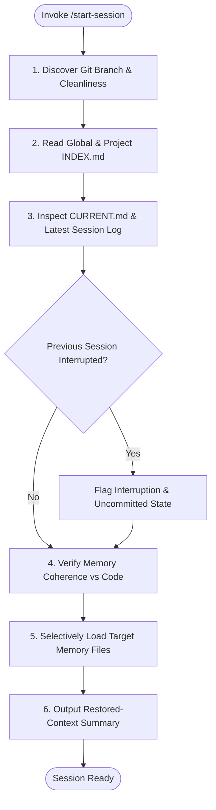

# Project Skill: Start Session (`/start-session`)

## 1. Purpose & Scope
This skill restores project context at the beginning of an Antigravity working session. It conducts automated discovery of repository state, validates memory against live codebase facts, detects whether the previous session was interrupted, checks for stale or contradictory entries, selectively loads relevant memory files, and delivers a concise restored-context briefing.

## 2. Activation Triggers
Activate this skill when:
- Initializing a new pair-programming or subagent execution turn.
- Executing `/start-session` command.
- Resuming work after an interruption or IDE reload.

## 3. Prerequisites & Environment Verification
Verify workspace root and git repository availability:
```bash
# Verify workspace root and git status
pwd
git status --porcelain
test -f .agents/memory/CURRENT.md || touch .agents/memory/CURRENT.md
```

## 4. Decision Tree & Workflow Routing


## 5. Actionable Workflows & Procedures

### Workflow 1: Workspace & Git Discovery
1. Confirm workspace root (`/workspaces/codespaces-blank`).
2. Retrieve active branch, latest commit hash, and uncommitted changes:
   ```bash
   git branch --show-current
   git status --short
   ```

### Workflow 2: Index-First Memory Inspection
1. Read global instructions `~/.gemini/GEMINI.md` and global index `~/.gemini/antigravity-cli/memory/INDEX.md`.
2. Read project index [`INDEX.md`](file:///workspaces/codespaces-blank/.agents/memory/INDEX.md).

### Workflow 3: Inspect Active State & Interruption Detection
1. Read [`CURRENT.md`](file:///workspaces/codespaces-blank/.agents/memory/CURRENT.md).
2. Inspect latest session log from `.agents/memory/sessions/`.
3. Check if previous session ended abruptly with incomplete tasks.

### Workflow 4: Selective Memory Loading
Based on active objective in `CURRENT.md`:
- Load [`DECISIONS.md`](file:///workspaces/codespaces-blank/.agents/memory/DECISIONS.md) if architectural choices are relevant.
- Load [`GOTCHAS.md`](file:///workspaces/codespaces-blank/.agents/memory/GOTCHAS.md) if environment quirks apply.
- Load [`ARCHITECTURE.md`](file:///workspaces/codespaces-blank/.agents/memory/ARCHITECTURE.md) if modifying component boundaries.
- **Anti-Bloat Rule**: Do not load irrelevant memory files.

### Workflow 5: Restored-Context Output Format
Emit structured summary to the user:
```markdown
## Restored Context
- **Project**: <project-name> (`<project-path>`)
- **Current Objective**: <objective from CURRENT.md>
- **Last Known State**: <git-branch, clean/dirty, interruption-status>
- **Relevant Decisions**: <pertinent ADRs or architectural constraints>
- **Known Blockers**: <blockers or "None">
- **Relevant Gotchas**: <applicable quirks from GOTCHAS.md>
- **Open Tasks**:
  1. <Task 1>
  2. <Task 2>
- **Memory Confidence**: <HIGH | MEDIUM | LOW> — <Rationale>
```

## 6. Verification & Validation Steps
- **Branch Coherence**: Confirm live git branch matches the branch recorded in `CURRENT.md`.
- **File Existence**: Ensure files referenced in `CURRENT.md` exist on disk.
- **Context Size**: Ensure context initialization loads only strictly relevant files.

## 7. Failure Recovery & Troubleshooting
- **Missing `CURRENT.md`**:
  Initialize a fresh `CURRENT.md` with active git status and prompt for objective.
- **Contradiction with Live Code**:
  Treat live code as authoritative ground truth and flag the discrepancy for update.
- **Interrupted Session Detected**:
  Review uncommitted `git diff` and prompt user to confirm or discard incomplete in-flight work.

## 8. Security Boundaries & Operational Guardrails
- **Zero Secrets**: Verify no secrets or credentials exist in loaded memory files.
- **Selective Retrieval**: Never load the entire memory tree into prompt context indiscriminately.
- **Authoritative Repo State**: Live code always overrides contradictory memory.
