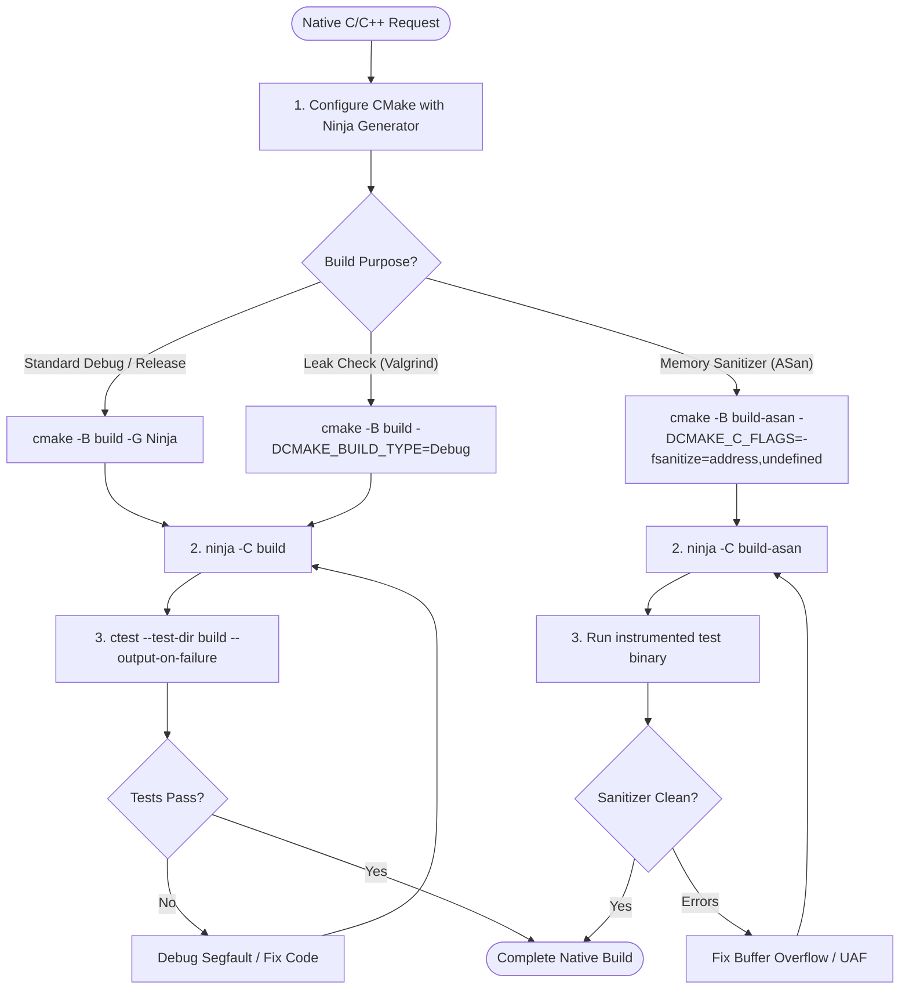

# Native Development Skill

## 1. Purpose & Scope
This skill provides comprehensive procedures for C and C++ systems programming, modern build generation via CMake and Ninja, compiler hardening, memory error sanitization (ASan, UBSan, TSan), dynamic memory leak detection with Valgrind, and unit test execution via CTest.

## 2. Activation Triggers
Activate this skill when:
- Configuring, generating, or compiling C/C++ projects using CMake and Ninja.
- Applying compiler security flags (`-fstack-protector-strong`, `-D_FORTIFY_SOURCE=2`, `-fPIE`).
- Building and executing test binaries with LLVM/GCC sanitizers.
- Profiling memory allocations or hunting memory leaks with Valgrind.
- Debugging native crashes, segmentation faults, or undefined behavior.

## 3. Prerequisites & Toolchain Verification
Verify compiler toolchains, build generators, and debuggers:
```bash
# Check compiler toolchains
gcc --version
g++ --version
clang --version
clang++ --version
cmake --version
ninja --version
valgrind --version || true
```

## 4. Decision Tree & Workflow Routing


## 5. Actionable Workflows & Procedures

### Workflow 1: CMake Configuration & Build
```bash
# Configure build directory with Ninja and compilation database export
cmake -B build -G Ninja \
  -DCMAKE_BUILD_TYPE=Debug \
  -DCMAKE_EXPORT_COMPILE_COMMANDS=ON

# Compile targets in parallel
ninja -C build

# Run unit tests via CTest
ctest --test-dir build --output-on-failure
```

### Workflow 2: Hardened Compilation Flags
When configuring production or release builds, enforce modern security flags:
```cmake
set(CMAKE_C_FLAGS "${CMAKE_C_FLAGS} -Wall -Wextra -Werror -D_FORTIFY_SOURCE=2 -fstack-protector-strong -fPIE")
set(CMAKE_CXX_FLAGS "${CMAKE_CXX_FLAGS} -Wall -Wextra -Werror -D_FORTIFY_SOURCE=2 -fstack-protector-strong -fPIE")
set(CMAKE_EXE_LINKER_FLAGS "${CMAKE_EXE_LINKER_FLAGS} -Wl,-z,relro,-z,now -pie")
```

### Workflow 3: Memory Error Sanitization (ASan & UBSan)
```bash
# Configure build with AddressSanitizer and UndefinedBehaviorSanitizer
cmake -B build-asan -G Ninja \
  -DCMAKE_BUILD_TYPE=Debug \
  -DCMAKE_C_FLAGS="-fsanitize=address,undefined -fno-omit-frame-pointer" \
  -DCMAKE_CXX_FLAGS="-fsanitize=address,undefined -fno-omit-frame-pointer"

ninja -C build-asan
./build-asan/bin/my_target
```

### Workflow 4: Memory Leak Detection with Valgrind
```bash
# Execute binary under Valgrind
valgrind --leak-check=full \
  --show-leak-kinds=all \
  --track-origins=yes \
  ./build/bin/my_target
```

## 6. Verification & Validation Steps
- **CTest Zero Failures**: Ensure `ctest` completes with `100% tests passed`.
- **Zero Sanitizer Reports**: Verify no `AddressSanitizer: heap-buffer-overflow` or `use-after-free` warnings during execution.
- **Valgrind Clean**: Confirm `0 errors from 0 contexts` and `all heap blocks were freed`.

## 7. Failure Recovery & Troubleshooting
- **Undefined Reference Linker Error (`ld: undefined reference to 'foo'`)**:
  Check `target_link_libraries` in `CMakeLists.txt` to ensure implementation libraries are linked.
- **ASan Stack Buffer Overflow**:
  Inspect array index calculations and bounds checks at the source line reported by ASan.
- **Missing CMake Dependency**:
  Install required dev packages via `apt-get` or check `find_package()` names.

## 8. Security Boundaries & Operational Guardrails
- **Bounds Checking**: Enforce bounds checks on all buffers; disallow unsafe functions (`gets`, `strcpy`, `sprintf`).
- **Compiler Warnings as Errors**: Maintain `-Wall -Wextra -Werror` to catch uninitialized variables and type mismatches early.
- **Safe Sandboxing**: Run untrusted native test executions inside container boundaries.
