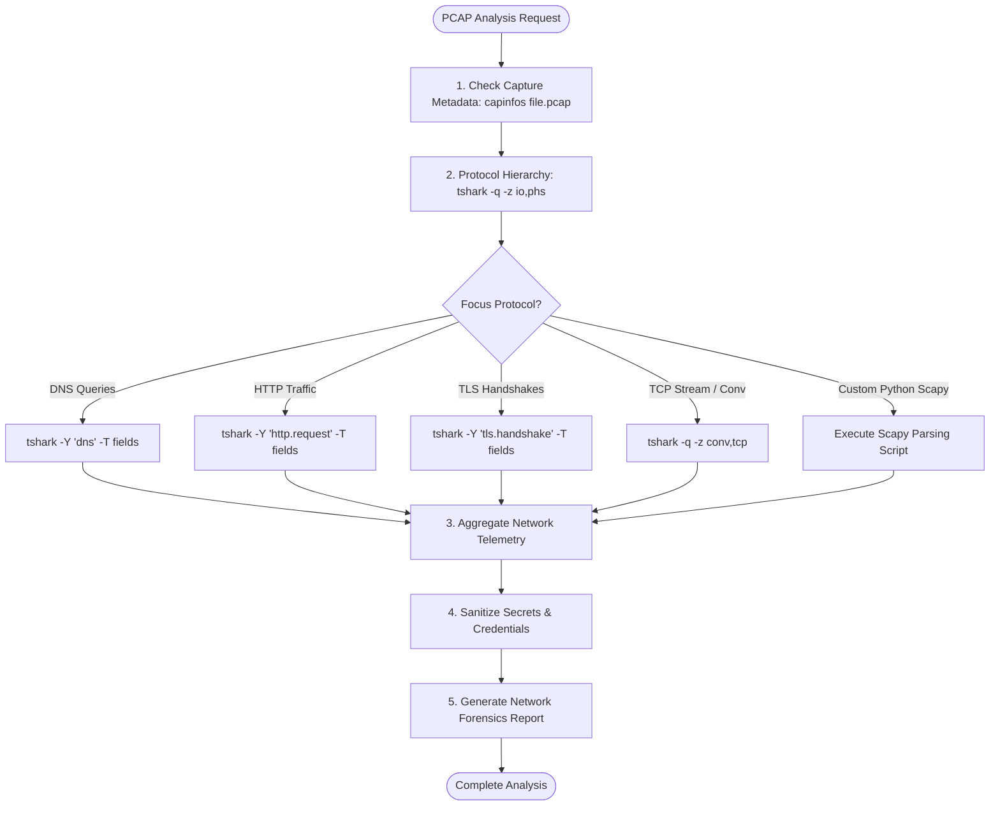

# Network Analysis Skill

## 1. Purpose & Scope
This skill provides step-by-step procedures for packet analysis, PCAP/PCAPNG trace inspection, protocol filtering (DNS, HTTP, TLS, TCP), network diagnostics, packet manipulation with Scapy, and network forensics in headless Linux environments.

## 2. Activation Triggers
Activate this skill when:
- Analyzing packet capture files (`.pcap`, `.pcapng`).
- Inspecting capture metadata, packet counts, duration, and bitrates via `capinfos`.
- Filtering traffic flows with Wireshark/TShark display filters.
- Extracting TLS handshakes (SNI), HTTP headers, or DNS queries.
- Authoring Python scripts using Scapy for automated packet parsing or synthesis.

## 3. Prerequisites & Toolchain Verification
Verify network inspection and analysis binaries:
```bash
# Verify network CLI binaries and Python Scapy
tshark -v
capinfos -v || true
editcap -v || true
mergecap -v || true
tcpdump --version || true
python3 -c "import scapy; print('Scapy version:', scapy.__version__)"
```

## 4. Decision Tree & Workflow Routing


## 5. Actionable Workflows & Procedures

### Workflow 1: Capture Metadata & Statistics
```bash
# Capture file summary (packet count, duration, bitrate, encapsulation)
capinfos sample.pcap

# Protocol hierarchy analysis
tshark -r sample.pcap -q -z io,phs
```

### Workflow 2: Protocol Dissection & Filtering with TShark
```bash
# Extract DNS queries and resolved IP addresses
tshark -r sample.pcap -Y "dns" -T fields \
  -e frame.number -e ip.src -e ip.dst -e dns.qry.name -e dns.a

# Extract HTTP requests, hostnames, and URIs
tshark -r sample.pcap -Y "http.request" -T fields \
  -e ip.src -e ip.dst -e http.host -e http.request.uri

# Extract TLS Server Name Indication (SNI)
tshark -r sample.pcap -Y "tls.handshake.type == 1" -T fields \
  -e ip.src -e ip.dst -e tls.handshake.extensions_server_name

# TCP Conversation Statistics
tshark -r sample.pcap -q -z conv,tcp
```

### Workflow 3: Programmatic Packet Manipulation with Scapy
```python
#!/usr/bin/env python3
from scapy.all import rdpcap, IP, TCP, DNS

packets = rdpcap("sample.pcap")
print(f"Total packets loaded: {len(packets)}")

for pkt in packets:
    if pkt.haslayer(IP) and pkt.haslayer(TCP):
        flags = pkt[TCP].flags
        print(f"{pkt[IP].src}:{pkt[TCP].sport} -> {pkt[IP].dst}:{pkt[TCP].dport} [flags={flags}]")
```

### Workflow 4: Splitting, Merging, and Sanitizing PCAPs
```bash
# Extract packet range using editcap
editcap -r sample.pcap slice.pcap 1-100

# Merge multiple captures chronologically
mergecap -w merged.pcap capture1.pcap capture2.pcap
```

## 6. Verification & Validation Steps
- **Filter Syntax Validation**: Ensure TShark display filters execute without dfilter parse errors.
- **Packet Integrity**: Verify `capinfos` reports `File size`, `Data size`, and valid packet counts.
- **Sanitized Output**: Ensure no unmasked authorization headers or session tokens appear in reports.

## 7. Failure Recovery & Troubleshooting
- **Corrupt PCAP Format / Trailing Bytes**:
  Repair packet capture timestamps and frames via `editcap -E 0.0 sample.pcap repaired.pcap`.
- **Display Filter Parse Error**:
  Check Wireshark display filter field names (`tshark -G fields | grep <keyword>`).
- **Scapy Memory Exhaustion on Large Files**:
  Use `PcapReader` (streaming generator) instead of `rdpcap` for multi-gigabyte captures.

## 8. Security Boundaries & Operational Guardrails
- **Offline Analysis Standard**: Perform network analysis offline on existing capture files; do not run promiscuous live packet capture without authorization.
- **Zero Credential Exposure**: Redact passwords, bearer tokens, and sensitive query strings extracted from HTTP/TLS traces before logging.
- **Privacy Protection**: Mask internal employee PII and IP ranges in shared documentation.
