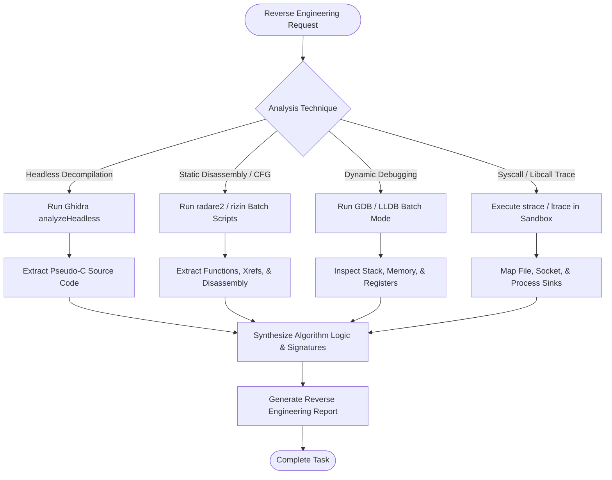

# Reverse Engineering Skill

## 1. Purpose & Scope
This skill provides advanced workflows for decompiling, analyzing control-flow graphs, reversing algorithmic logic, inspecting execution traces, and performing dynamic debugging across compiled applications and shared libraries using Ghidra, radare2, rizin, GDB, LLDB, and tracing utilities.

## 2. Activation Triggers
Activate this skill when:
- Executing headless decompilation of native binaries with Ghidra.
- Performing static disassembly, function cross-referencing, or call-graph extraction via `radare2` / `rizin`.
- Debugging binary crashes, setting breakpoints, or inspecting registers with GDB/LLDB in batch mode.
- Tracing system calls (`strace`) or dynamic library calls (`ltrace`).
- Reverse engineering proprietary formats, protocol encodings, or obfuscated algorithms.

## 3. Prerequisites & Toolchain Verification
Verify availability of reverse engineering platforms and debuggers:
```bash
# Check reverse engineering toolchains
radare2 -v || r2 -v
rizin -v || true
gdb --version
lldb --version
strace -V
echo "GHIDRA_HOME: ${GHIDRA_HOME:-/opt/ghidra}"
```

## 4. Decision Tree & Workflow Routing


## 5. Actionable Workflows & Procedures

### Workflow 1: Ghidra Headless Decompilation
Execute headless decompilation without requiring a graphical display:
```bash
${GHIDRA_HOME:-/opt/ghidra}/support/analyzeHeadless \
  /tmp/ghidra_projects TempProject \
  -import target_binary \
  -postScript Decompile.java \
  -log /tmp/ghidra_analysis.log \
  -deleteProject
```

### Workflow 2: Static Analysis with Radare2 / Rizin
```bash
# Analyze all functions, flags, and references in batch mode
r2 -q -c "aaa; afl; pdf @main" target_binary

# Search for cross-references to sensitive imports
r2 -q -c "aaa; axt sym.imp.system; axt str.*" target_binary

# Export decompiled pseudo-C
r2 -q -c "aaa; pdc @main" target_binary
```

### Workflow 3: Dynamic Debugging with GDB in Batch Mode
```bash
# Execute scripted GDB inspection
gdb -q -batch \
  -ex "file target_binary" \
  -ex "break main" \
  -ex "run" \
  -ex "info registers" \
  -ex "x/10i \$pc" \
  -ex "quit"
```

### Workflow 4: System Call & Library Call Tracing
```bash
# Trace file, network, and process system calls with timestamps
strace -f -tt -e trace=file,network,process target_binary

# Trace dynamic library calls
ltrace -f target_binary
```

## 6. Verification & Validation Steps
- **Decompilation Completeness**: Confirm decompiled functions cover key entry points (`main`, exported symbols).
- **Symbol Cross-Reference**: Verify recovered function signatures against standard ABI conventions.
- **Trace Integrity**: Ensure syscall logs capture return codes and error numbers (`ENOENT`, `EACCES`).

## 7. Failure Recovery & Troubleshooting
- **Ghidra Java Heap Exhaustion**:
  Increase Ghidra JVM memory in `support/analyzeHeadless`: `-max-cpu 4 -vmargs -Xmx4096M`.
- **GDB `ptrace: Operation not permitted`**:
  Ensure process runs inside container with `SYS_PTRACE` capability or run analysis statically.
- **Stripped Binary Function Boundaries**:
  Use `r2` analysis level 3 (`aaaa`) or Ghidra's symbol recovery heuristics to locate unexported functions.

## 8. Security Boundaries & Operational Guardrails
- **Sandbox Isolation**: Execute dynamic binaries exclusively within isolated test containers.
- **Authorized Scope**: Reverse engineer only authorized binaries, test fixtures, or open-source software.
- **Zero Secrets Leakage**: Do not commit reverse-engineered proprietary secrets or API keys into memory or public docs.
