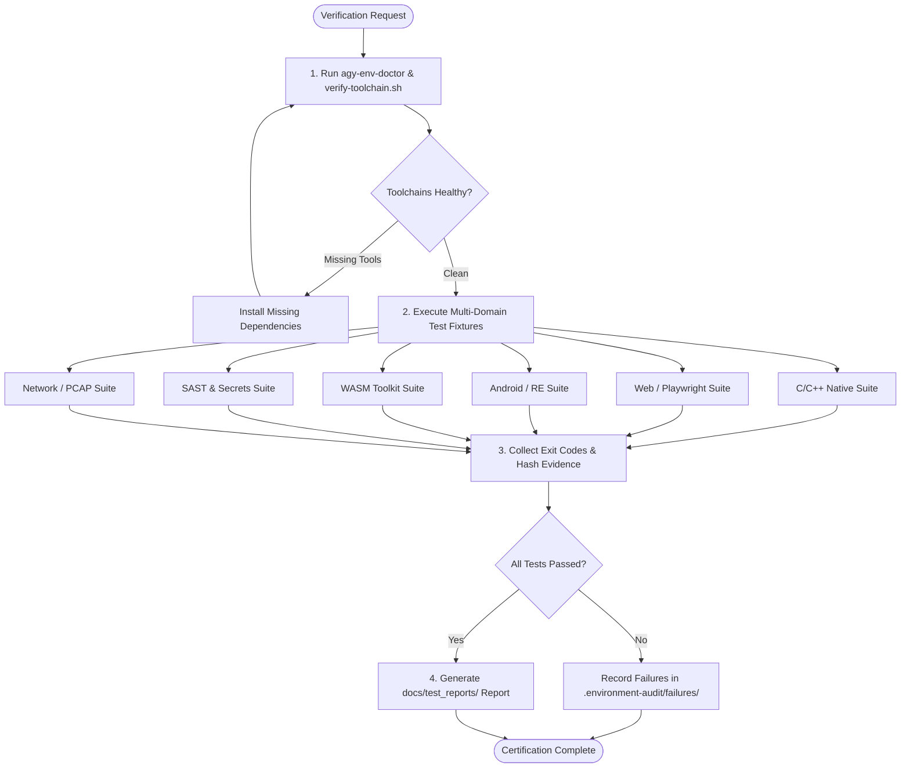

# Verification Skill

## 1. Purpose & Scope
This skill governs holistic multi-domain test orchestration, automated platform health diagnostics, end-to-end test suite execution across all workstation domains, cryptographic evidence collection, and Definition of Done (DoD) compliance certification.

## 2. Activation Triggers
Activate this skill when:
- Running comprehensive platform diagnostics with `agy-env-doctor`.
- Verifying devcontainer toolchain readiness via `.devcontainer/scripts/verify-toolchain.sh`.
- Executing cross-domain integration test fixtures (Android, C/C++, Web, WASM, Security, Network).
- Collecting test logs, SHA-256 evidence checksums, and authoring compliance reports in `docs/test_reports/`.
- Certifying workstation readiness against the Definition of Done.

## 3. Prerequisites & Toolchain Verification
Verify core diagnostic utilities and test runners:
```bash
# Verify diagnostic CLI tools
which agy-env-doctor || true
test -f .devcontainer/scripts/verify-toolchain.sh || true
python3 --version
bash --version
```

## 4. Decision Tree & Workflow Routing


## 5. Actionable Workflows & Procedures

### Workflow 1: Unified Environment & Diagnostic Verification
```bash
# Execute unified environment doctor CLI
agy-env-doctor

# Execute devcontainer automated verification script
bash .devcontainer/scripts/verify-toolchain.sh
```

### Workflow 2: Multi-Domain Test Execution
Execute test fixtures across each engineering domain:
1. **C/C++ Native**:
   ```bash
   cmake -B build -G Ninja && ninja -C build && ctest --test-dir build
   ```
2. **Web & Frontend**:
   ```bash
   npm test && npx playwright test
   ```
3. **Android & Reverse Engineering**:
   ```bash
   apktool -version && jadx --version && apksigner --version
   ```
4. **WebAssembly**:
   ```bash
   wasm-validate fixtures/wasm/sample.wasm && wasmtime fixtures/wasm/sample.wasm
   ```
5. **Security & Secrets**:
   ```bash
   semgrep scan --config=auto --error && gitleaks detect --source . --no-git
   ```
6. **Network Forensics**:
   ```bash
   tshark -r fixtures/network/sample.pcap -q -z io,phs
   ```

### Workflow 3: Cryptographic Evidence Collection & Reporting
1. Compute SHA-256 hashes of test fixtures and generated binary outputs:
   ```bash
   sha256sum fixtures/**/* | head -n 30
   ```
2. Save structured markdown test reports under `docs/test_reports/YYYY-MM-DD-test-report.md`.

## 6. Verification & Validation Steps
- **Definition of Done Compliance**:
  - Code compiles without warnings/errors.
  - All test suites exit with code `0`.
  - Zero Critical/High vulnerabilities reported by SAST/secret scanners.
  - Live execution evidence recorded with timestamps and command outputs.

## 7. Failure Recovery & Troubleshooting
- **Toolchain Gap / Missing Binary**:
  Inspect `agy-env-doctor` output and install required packages via `apt-get` or package managers.
- **Partial Test Failure**:
  Isolate failing test domain, inspect stderr logs, and apply targeted fixes before re-running the full suite.
- **Flaky Playwright Test**:
  Verify display server / headless browser flags (`--headless --no-sandbox`).

## 8. Security Boundaries & Operational Guardrails
- **Read-Only Verification**: Test verification scripts must not modify production configurations or delete persistent data.
- **Zero Secrets in Test Evidence**: Ensure test reports do not log environment variables containing tokens or private keys.
- **Hermetic Test Fixtures**: Test runs must rely exclusively on self-contained local fixtures.
