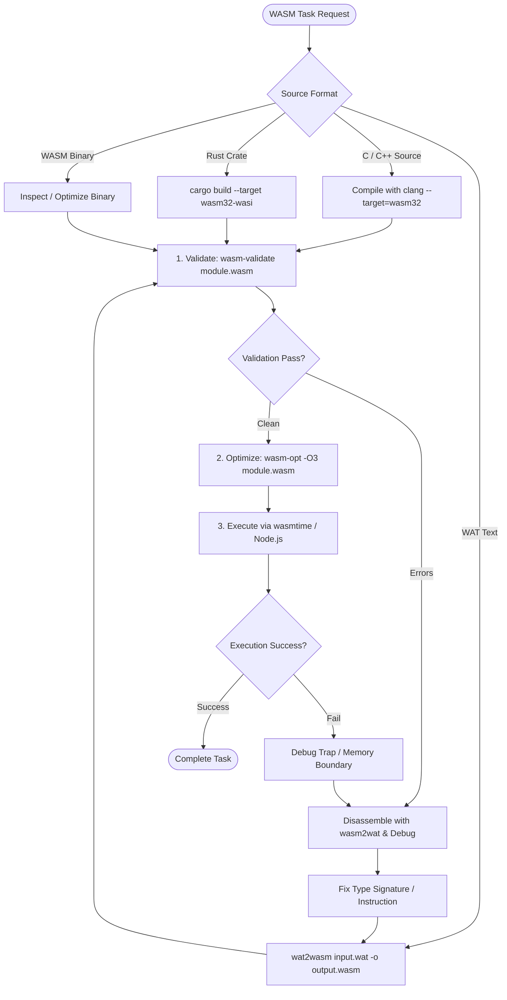

# WebAssembly (WASM) Engineering Skill

## 1. Purpose & Scope
This skill governs WebAssembly module compilation, text-format disassembly, structural validation, optimization, and runtime execution across the WebAssembly Binary Toolkit (WABT), Binaryen, Clang, Rust, and WASI runtimes (Wasmtime, Wasmer, Node.js).

## 2. Activation Triggers
Activate this skill when:
- Compiling C, C++, or Rust to standalone `.wasm` binaries.
- Converting between binary `.wasm` and WebAssembly Text format (`.wat`) via `wat2wasm` / `wasm2wat`.
- Validating WASM binary integrity and type safety with `wasm-validate`.
- Optimizing WASM binary size and execution speed with `wasm-opt` (Binaryen).
- Executing WASI modules with `wasmtime` or running WASM within Node.js.

## 3. Prerequisites & Toolchain Verification
Verify WebAssembly toolchains and runtimes:
```bash
# Verify WABT utilities
wat2wasm --version
wasm2wat --version
wasm-validate --version
wasm-objdump --version

# Verify optimizers and runtimes
wasm-opt --version || true
wasmtime --version || true
wasmer --version || true
node --version
```

## 4. Decision Tree & Workflow Routing


## 5. Actionable Workflows & Procedures

### Workflow 1: Compilation to WebAssembly
```bash
# Compile C directly to standalone WebAssembly target with Clang
clang --target=wasm32 -nostdlib \
  -Wl,--no-entry -Wl,--export-all \
  -O3 -o module.wasm module.c

# Compile Rust to WASI WebAssembly
cargo build --target wasm32-wasi --release
```

### Workflow 2: Disassembly & Text Manipulation (WABT)
```bash
# Convert binary WASM to readable WebAssembly Text (.wat)
wasm2wat module.wasm -o module.wat

# Assemble .wat back to binary .wasm
wat2wasm module.wat -o module_rebuilt.wasm

# Inspect section headers, imports, and exports
wasm-objdump -x module.wasm
```

### Workflow 3: Validation & Optimization (Binaryen)
```bash
# Validate structural integrity and type consistency
wasm-validate module.wasm

# Optimize binary size and runtime performance
wasm-opt -O3 module.wasm -o module.opt.wasm
```

### Workflow 4: Runtime Execution with Wasmtime & Node.js
```bash
# Run standalone WASI module with Wasmtime
wasmtime run module.wasm

# Execute WASM module in Node.js test harness
node -e "
const fs = require('fs');
const bytes = fs.readFileSync('module.wasm');
WebAssembly.instantiate(bytes).then(results => {
  console.log('Exports:', Object.keys(results.instance.exports));
});
"
```

## 6. Verification & Validation Steps
- **Validation Exit Code**: Ensure `wasm-validate module.wasm` returns exit code `0`.
- **Export Verification**: Verify all intended function exports are present in `wasm-objdump -x`.
- **Runtime Execution**: Confirm `wasmtime` or Node.js executes without traps (`unreachable`, `out of bounds memory access`).

## 7. Failure Recovery & Troubleshooting
- **Type Mismatch During Validation (`type mismatch: expected i32, got f32`)**:
  Disassemble to `.wat` via `wasm2wat` and inspect stack parameter types for the failing instruction.
- **Unreachable Trap Encountered**:
  Check division by zero, null pointer dereferences, or explicit `unreachable` opcodes in decompiled WAT.
- **Linear Memory Out of Bounds**:
  Ensure module memory size is properly declared or allow memory growth (`(memory 1 10)`).

## 8. Security Boundaries & Operational Guardrails
- **Linear Memory Sandboxing**: Ensure WASM modules cannot read or write outside their allocated linear memory boundaries.
- **Restricted Host Imports**: Audit imported host functions to prevent untrusted WASM code from invoking arbitrary system calls.
- **Determinism**: Disallow non-deterministic floating point NaN bit patterns in security-critical routines.
