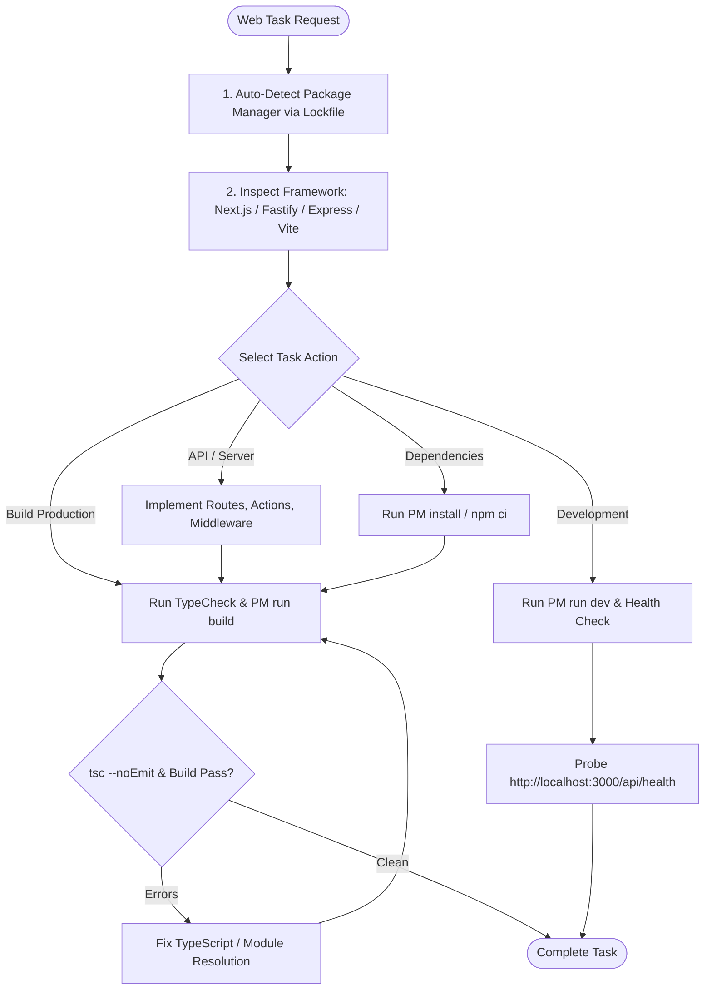

# Web Engineering Skill

## 1. Purpose & Scope
This skill governs full-stack web application development, server-side frameworks (Node.js, Express, Fastify, Next.js), web architecture, bundling systems (Vite, Webpack, Turbopack), package managers, and production build pipelines.

## 2. Activation Triggers
Activate this skill when:
- Creating or configuring full-stack web applications, SSR frameworks, or static sites.
- Detecting and utilizing canonical package managers (`pnpm`, `yarn`, `bun`, `npm`).
- Implementing server-side routes, API handlers, middleware, and server actions.
- Running TypeScript compilation, typechecks, and bundler production builds.
- Integrating Context7 MCP documentation queries for evolving framework APIs.

## 3. Prerequisites & Toolchain Verification
Verify Node runtimes and package manager CLI utilities:
```bash
# Verify Node and package managers
node --version
npm --version
pnpm --version || true
yarn --version || true
bun --version || true
```

## 4. Decision Tree & Workflow Routing


## 5. Actionable Workflows & Procedures

### Workflow 1: Automatic Package Manager Detection
Detect and adopt the project's canonical package manager:
```bash
if [ -f "pnpm-lock.yaml" ]; then
    PM="pnpm"
elif [ -f "yarn.lock" ]; then
    PM="yarn"
elif [ -f "bun.lockb" ]; then
    PM="bun"
else
    PM="npm"
fi
echo "Canonical package manager: $PM"
```

### Workflow 2: Standard Dependency & Lifecycle Commands
- **Install Dependencies**: `$PM install` (or `npm ci` in CI)
- **Start Dev Server**: `$PM run dev`
- **Build Production**: `$PM run build`
- **Execute Tests**: `$PM test`
- **Lint Code**: `$PM run lint`

### Workflow 3: Full-Stack Architecture & API Routes
- **Next.js App Router**: Co-locate route handlers (`app/api/.../route.ts`), server components, and client components (`'use client'`).
- **Fastify / Express**: Structure into `/controllers`, `/services`, `/middleware`, and `/routes`.
- **Context7 Integration**: When referencing changing or modern APIs (Next.js 14+ Server Actions, Fastify plugins, Tailwind v4), invoke the `context7` MCP tool to retrieve authoritative live documentation.

### Workflow 4: Production Build Validation
```bash
# 1. Enforce strict TypeScript compilation
npx tsc --noEmit

# 2. Execute production bundling
$PM run build

# 3. Verify bundle output directory (e.g., .next/, dist/, build/)
ls -la dist/ || ls -la .next/ || true
```

## 6. Verification & Validation Steps
- **TypeScript Clean**: Confirm `npx tsc --noEmit` exits with `0` errors.
- **Production Asset Generation**: Ensure build artifacts are created without bundle errors or missing asset references.
- **HTTP Probe Response**: Verify server responds with `200 OK` and expected JSON / HTML content.

## 7. Failure Recovery & Troubleshooting
- **Node Engine Mismatch**:
  Check `package.json` `engines` field and verify against active `node -v`.
- **Corrupt `node_modules` or Lockfile Drift**:
  Run `rm -rf node_modules package-lock.json && $PM install`.
- **Port Conflict (`EADDRINUSE: 3000`)**:
  Check active listeners via `lsof -i :3000` or run on custom port: `PORT=3001 $PM run dev`.

## 8. Security Boundaries & Operational Guardrails
- **Input Validation**: Enforce runtime schema validation (Zod, TypeBox) on all request bodies and query parameters.
- **Client Bundle Safety**: Never import server-only modules, database clients, or environment variables containing private secrets into client-rendered components.
- **CORS & CSRF**: Enforce strict Origin checks and CSRF protection on mutation endpoints.
