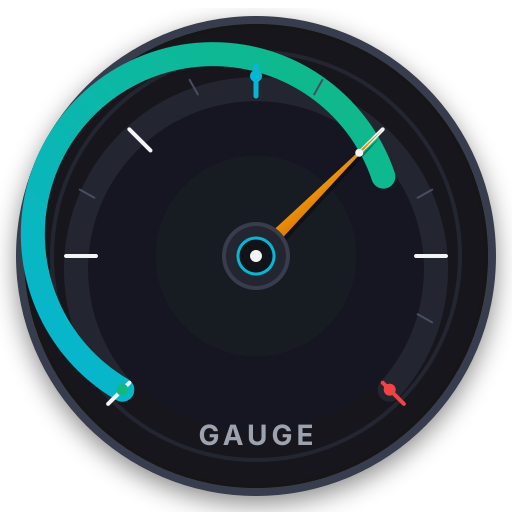

# GAUGE: System Monitor (Native Android)

<div align="center">
  
  <p><strong>Truthful, Offline System Telemetry for Android 10+ (API 29–35)</strong></p>
  <p><em>Engineered with Kotlin 1.9, Jetpack Compose 1.5, Room 2.6, and Zero Snake-Oil.</em></p>
</div>

---

## 1. Executive Summary & Core Philosophy

**GAUGE: System Monitor** (`com.androidactivity.guage`) is an engineering-grade system diagnostic instrument for Android. It was built from the ground up to counter the pervasive epidemic of deceptive mobile "utility" apps—fake "RAM boosters", bogus "CPU coolers", and invasive battery trackers.

### The Four Truthful Principles
1. **Zero Snake-Oil "RAM Cleaners"**: Modern Android automatically manages memory through kernel Low Memory Killers (LMK). Force-killing cached background apps degrades battery life and causes restart loops. GAUGE refuses to provide fake "kill" buttons; instead, it provides deep links directly to native Android App Info settings.
2. **100% Offline & Private by Design**: GAUGE **does not declare** `android.permission.INTERNET`. Zero sockets can be created. No analytics, ads, or telemetry ever leave your device.
3. **Truthful Platform Boundaries**: Android SELinux policies strictly block untrusted apps from reading `/proc/stat` and other apps' private memory since Android 7/8. GAUGE never fakes metrics; it transparently discloses OS security boundaries.
4. **Audited Design System**: Free of generic AI-slop palettes and strictly compliant with the 8-forbidden-color prohibition.

---

## 2. Telemetry Subsystems & Implemented Features

| Subsystem | Underlying Android APIs | Truthful Telemetry Features |
| :--- | :--- | :--- |
| **System Memory** | `ActivityManager.getMemoryInfo`, `Debug.MemoryInfo` | Total RAM, Available RAM, Used RAM, Real-time RAM Pressure %, Low-Memory Threshold warning flag, Self-App PSS and Java heap memory. |
| **Application Activity** | `UsageStatsManager.queryUsageStats`, `PackageManager` | Real foreground screen time today, last active timestamp, application package identifier, user vs system app filtering, deep links to native App Info. |
| **Storage Subsystem** | `StatFs`, `StorageStatsManager`, `StorageManager` | Primary volume total/used/free space, category breakdown (Applications, Images, Video, Audio, System Firmware), mounted external SD card detection. |
| **Battery & Power** | `Intent.ACTION_BATTERY_CHANGED`, `BatteryManager` | Charge level %, temperature (°C), voltage (mV), charging state, power source (AC, USB, Wireless), health status, cycle count on Android 14+. |
| **Thermal Subsystem** | `PowerManager.OnThermalStatusChangedListener` | Real-time thermal status (`NONE`, `LIGHT`, `MODERATE`, `SEVERE`, `CRITICAL`), active throttling indicator, thermal headroom forecast (API 30+). |
| **Network Throughput** | `TrafficStats`, `ConnectivityManager` | Real-time download/upload rate calculation (KB/s), cumulative RX/TX bytes, active connection interface (Wi-Fi, Cellular, Ethernet). |
| **Hardware & Sensors** | `android.os.Build`, `/sys/devices/system/cpu`, `SensorManager` | SoC manufacturer and model, physical/logical CPU core count, 64-bit ABIs, display resolution/refresh rate/DPI, Linux kernel release, complete physical sensor enumeration. |
| **Local History & SAF Export** | Android Room 2.6, Storage Access Framework | Local SQLite time-series recording, configurable 7/30/90 day automatic retention pruning, streaming RFC 4180 CSV and JSON data export. |
| **Threshold Alerts** | `NotificationManager`, `ThresholdAlertManager` | Truthful diagnostic notifications when system RAM pressure exceeds 85% or battery temperature exceeds 43°C. |

---

## 3. Architecture & Repository Structure

```text
app/src/main/java/com/androidactivity/guage/
├── GaugeApp.kt                         # Application entrypoint & repository initialization
├── MainActivity.kt                     # ComponentActivity hosting Edge-to-Edge Compose
├── core/
│   ├── alert/
│   │   └── ThresholdAlertManager.kt    # Notification channels & pressure thresholds
│   ├── capability/
│   │   └── CapabilityProbe.kt          # SELinux & runtime permission discovery
│   ├── model/
│   │   └── TelemetryModels.kt          # Domain data models & invariants
│   └── provider/
│       ├── AppActivityProvider.kt      # UsageStatsManager & PackageManager queries
│       ├── BatteryProvider.kt          # BatteryManager broadcast inspection
│       ├── HardwareProvider.kt         # SoC, Display, and Sensor enumeration
│       ├── MemoryProvider.kt           # ActivityManager.MemoryInfo provider
│       ├── NetworkProvider.kt          # TrafficStats throughput rate calculations
│       ├── StorageProvider.kt          # StatFs & StorageStatsManager breakdown
│       └── ThermalProvider.kt          # PowerManager thermal status & headroom
├── data/
│   ├── export/
│   │   └── ExportService.kt            # Streaming RFC 4180 CSV and JSON writer
│   ├── local/
│   │   ├── GaugeDatabase.kt            # Room SQLite database with WAL
│   │   ├── MetricSampleDao.kt          # Time-series querying & retention pruning
│   │   └── MetricSampleEntity.kt       # Indexed telemetry entity
│   └── repository/
│       └── MetricsRepository.kt        # Central coroutine StateFlow orchestrator
└── ui/
    ├── components/
    │   ├── AppUsageRow.kt              # App item with deep link to settings
    │   ├── GaugeMascot.kt              # Canvas-drawn animated "Gaugey" dial mascot
    │   ├── HonestDisclosureBanner.kt   # SELinux & sandboxing disclosure banner
    │   ├── MemoryPressureDial.kt       # Canvas-drawn circular instrument meter
    │   ├── MetricCard.kt               # Laboratory instrument card
    │   └── StatusBadge.kt              # Status pills (Normal, Warning, Critical)
    ├── navigation/
    │   ├── GaugeNavHost.kt             # Bottom navigation scaffold & transitions
    │   └── Screen.kt                   # Route definitions & icons
    ├── screens/
    │   ├── appactivity/                # AppActivityScreen, ViewModel & Detail Sheet
    │   ├── hardware/                   # HardwareScreen & ViewModel
    │   ├── history/                    # HistoryScreen, ViewModel & Trend Chart
    │   ├── onboarding/                 # OnboardingScreen (Privacy & Principles)
    │   ├── overview/                   # OverviewScreen & ViewModel
    │   ├── settings/                   # SettingsScreen & ViewModel
    │   └── storage/                    # StorageScreen & ViewModel
    └── theme/
        ├── Color.kt                    # Audited color palette (0 banned colors)
        ├── Theme.kt                    # Laboratory dark-mode-first theme
        └── Type.kt                     # Technical typography with monospace readouts
```

---

## 4. Build & Verification Commands

### Build Requirements
- **Java Development Kit**: OpenJDK 17 (`/usr/lib/jvm/java-17-openjdk-amd64`)
- **Android SDK**: Compile SDK 34, Min SDK 29 (Android 10), Target SDK 34
- **Gradle**: 8.7 wrapper (`./gradlew`)

### Build Debug APK
```bash
JAVA_HOME=/usr/lib/jvm/java-17-openjdk-amd64 ./gradlew assembleDebug --no-daemon
```
The compiled debug APK will be located at:
```text
app/build/outputs/apk/debug/app-debug.apk
```

### Build & Sign Production Release APK
```bash
# 1. Generate release keystore (if not present)
keytool -genkeypair -v -keystore release.keystore -alias gauge-release -keyalg RSA -keysize 2048 -validity 10000

# 2. Build release APK with Gradle
JAVA_HOME=/usr/lib/jvm/java-17-openjdk-amd64 ./gradlew assembleRelease --no-daemon

# 3. Align and sign the APK with apksigner
zipalign -v -p 4 app/build/outputs/apk/release/app-release-unsigned.apk app-release-aligned.apk
apksigner sign --ks release.keystore --ks-key-alias gauge-release --out app-release-signed.apk app-release-aligned.apk
apksigner verify -v --print-certs app-release-signed.apk
```
The signed production release APK is generated at:
```text
app-release-signed.apk
```

### Execute Unit Test Suite
```bash
JAVA_HOME=/usr/lib/jvm/java-17-openjdk-amd64 ./gradlew testDebugUnitTest --no-daemon
```

### Run Forbidden Color Audit
```bash
grep -rnEi "0b0d11|14171d|1c2029|222733|2a303e|343b4d|252a36|12151b" app/ assets/ docs/design/
```

---

## 5. Master Documentation Index

- **Architecture Guide**: [`docs/gauge-architecture.md`](docs/gauge-architecture.md)
- **Permissions & Privacy**: [`docs/permissions-and-privacy.md`](docs/permissions-and-privacy.md)
- **Platform Feasibility Matrix (25 Features)**: [`docs/capability-matrix.md`](docs/capability-matrix.md)
- **Testing Architecture & Strategy**: [`docs/testing.md`](docs/testing.md)
- **Known Limitations & Disclosures**: [`docs/known-limitations.md`](docs/known-limitations.md)
- **Master Verification Matrix**: [`docs/verification-matrix.md`](docs/verification-matrix.md)
- **Architecture Decisions (ADRs)**: [`docs/decisions/`](docs/decisions/)
- **Research Ledger (95 Actions)**: [`docs/research/research-ledger.csv`](docs/research/research-ledger.csv)
- **Figma Design Tokens & Specification**: [`docs/design/`](docs/design/)
