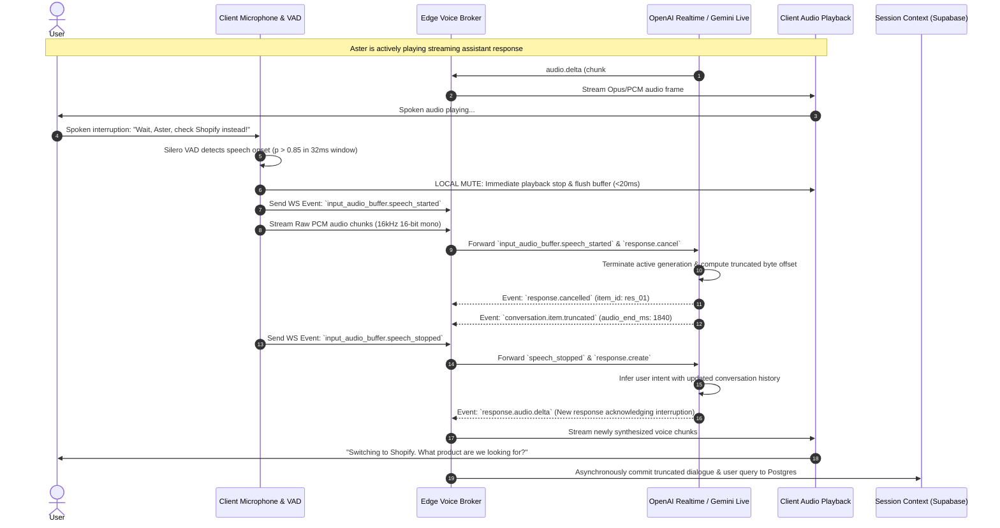
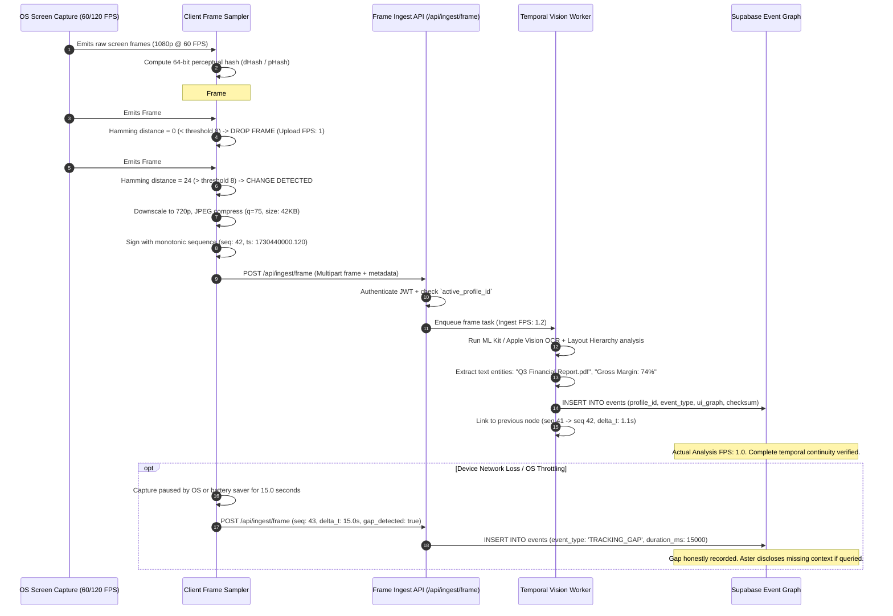
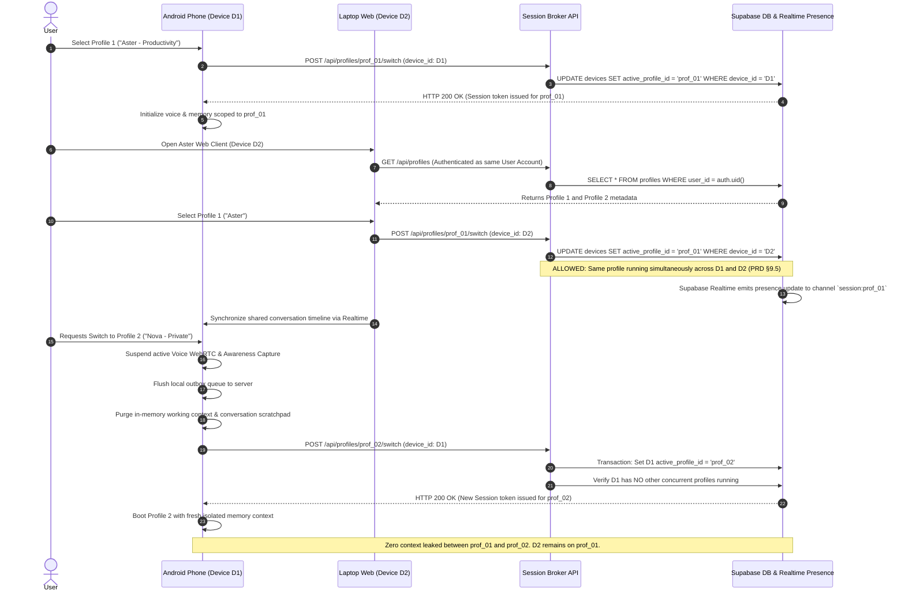
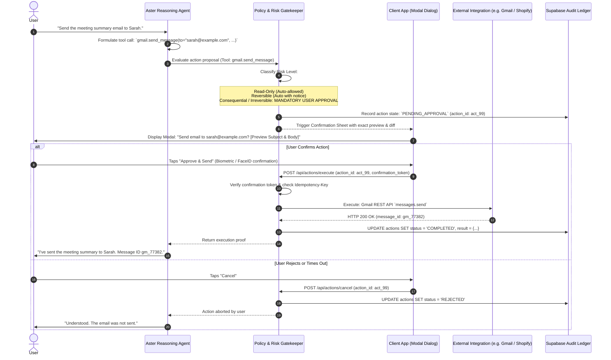

# Aster Companion: Master Architecture Specification (v1.1)

---

## 1. Executive Summary & Brand Identity

**Aster Companion** is an autonomous, multimodal, cross-device digital companion and agent platform designed natively for Android (Kotlin / Jetpack Compose), iOS (Swift 6 / SwiftUI), and Laptop (React 18 / TypeScript / Vite). The entire ecosystem is powered by a high-performance Supabase PostgreSQL 16 backend, an ultra-low-latency WebRTC/WebSocket real-time voice broker, an adaptive continuous visual frame ingestion pipeline, and a modular reasoning engine.

### 1.1 Brand & Persona Definition
- **Permanent Product Brand**: Aster Companion
- **Default AI Companion Name**: Aster (fully configurable per profile)
- **Secondary Companion Name**: Nova (by default in Profile B, fully user-editable)
- **Core Personality**: Warm, capable, honest, emotionally sensitive, intellectually rigorous, transparent about limitations and uncertainties. Aster never claims human experiences, never simulates emotions deceptively, and never claims to have observed or executed tasks outside verified telemetry.
- **Visual Design Identity**:
  - **Ground**: Deep Graphite/Black base (`#121110`)
  - **Elevated Surfaces**: Dark Charcoal Card Surfaces (`#1C1A18`, `#22201E`)
  - **Borders & Dividers**: Subdued Warm Bronze Outlines (`#2E2A27`)
  - **Primary Warm Accent**: Luminous Amber / Tangerine (`#E59843`, `#F5A623`)
  - **Secondary Voice Accent**: Restrained Violet / Indigo (`#7966F3`) for user speech bubbles
  - **Typography**: Warm Cream Ink (`#FAF8F5`) for headlines; Muted Charcoal (`#A09E9B`) for metadata
  - **Avatar Character**: Realistic 3D human companion with customizable physical traits and ambient luminous halo glow (`rgba(229, 152, 67, 0.15)`).

---

## 2. Full 8-Tier System Architecture

Aster Companion abandons monolithic black-box AI designs in favor of an **8-tier decoupled pipeline**, where each tier maintains strict interfaces, isolated security boundaries, and independent telemetry monitoring.

```text
┌─────────────────────────────────────────────────────────────────────────────────────────┐
│                          TIER 1: CLIENT APPLICATION LAYER                                │
│   ┌───────────────────────────┐ ┌──────────────────────────┐ ┌────────────────────────┐ │
│   │ Android Native (Compose)  │ │   iOS Native (SwiftUI)   │ │  Laptop Desktop (React) │ │
│   │ Kotlin 2.0, Room SQLite   │ │  Swift 6, SwiftData/Core │ │  Vite, Dexie IndexedDB   │ │
│   └─────────────┬─────────────┘ └────────────┬─────────────┘ └───────────┬────────────┘ │
└─────────────────┼────────────────────────────┼───────────────────────────┼──────────────┘
                  │                            │                           │
                  ▼                            ▼                           ▼
┌─────────────────────────────────────────────────────────────────────────────────────────┐
│                    TIER 2: REALTIME PERCEPTION & LOCAL CAPTURE LAYER                    │
│   • Screen: MediaProjection (Android) | ReplayKit (<50MB, iOS) | getDisplayMedia (Web)  │
│   • Audio: 16kHz PCM / Opus 20ms | Hardware AEC / NS / AGC | Client-side Silero VAD      │
│   • Contextual Control Panel: Floating status pill, 1-tap pause/stop/mute controls      │
│   • Monotonic Local Outbox: Sequence number generator, SHA-256 integrity hash staging  │
└──────────────────────────────────────────────┬──────────────────────────────────────────┘
                                               │ Encrypted Transport (TLS 1.3 / DTLS-SRTP)
                                               ▼
┌─────────────────────────────────────────────────────────────────────────────────────────┐
│                  TIER 3: EDGE API GATEWAY & SESSION BROKER LAYER                        │
│   • Edge Ingress: Cloudflare Workers / Node.js 22 LTS Reverse Proxy                     │
│   • Auth Verification: Supabase JWT validation, Device Hardware Fingerprint matching    │
│   • Distributed Session Lock: Enforces strictly ONE active profile per physical device  │
│   • Ephemeral Token Vending: Issues short-lived WebRTC/WS credentials (60s TTL)         │
└───────────────────────────────┬──────────────────────────────────────────┬──────────────┘
                                │                                          │
            WebRTC / Bidi Audio │                             Event Stream │ Binary Frames
                                ▼                                          ▼
┌───────────────────────────────────────────────┐ ┌───────────────────────────────────────┐
│       TIER 4: REALTIME VOICE ORCHESTRATION    │ │  TIER 5: CONTINUOUS VISUAL PROCESSING │
│   • Dual Engine Adapters:                     │ │   • Adaptive Sampler: pHash / dHash   │
│     - OpenAI Realtime (WebRTC Opus)           │ │   • Edge OCR & UI Element Detector    │
│     - Gemini Multimodal Live (Bidi WebSocket) │ │   • Temporal Scene Transition Graph   │
│   • Turn-Taking & Interruption Arbiter:       │ │   • 4-Rate Telemetry Engine:          │
│     - Barge-In latency < 120ms                │ │     Capture / Upload / Ingest / Anal. │
│     - `response.cancel` event dispatcher      │ │   • Honest Tracking Gap Emitter       │
└───────────────────────┬───────────────────────┘ └───────────────────┬───────────────────┘
                        │                                             │
                        ▼                                             ▼
┌─────────────────────────────────────────────────────────────────────────────────────────┐
│                  TIER 6: MULTI-TENANT CLOUD PLATFORM & DATABASE LAYER                   │
│   • Supabase PostgreSQL 16:                                                             │
│     - Hard constraint: `check_max_two_profiles()` trigger (enforces max 2 profiles)     │
│     - Default-Deny RLS: `current_setting('app.active_profile_id')` on all entity tables │
│     - pgvector (HNSW Index): Cosine distance similarity for 1536d / 768d embeddings     │
│     - Bitemporal Schema: System time vs Observed event time for non-destructive updates │
│   • Supabase Realtime Channels: Distributed presence and cross-device timeline sync     │
│   • Resumable Object Storage: S3-compatible chunked upload with signed URL access       │
└───────────────────────────────────────────────┬─────────────────────────────────────────┘
                                                │
                                                ▼
┌─────────────────────────────────────────────────────────────────────────────────────────┐
│                 TIER 7: REASONING, MEMORY & PROACTIVE AGENT LAYER                       │
│   • 8-Category Decoupled Memory Hierarchy:                                              │
│     Ephemeral, Episodic, Semantic, Preference, Behavioral, Social, Procedural, Shared   │
│   • Proactive Urgency Engine: Score = (Relevance × Confidence × Urgency) - Interruption │
│   • Dynamic Planner: Evaluates intent, decomposes multi-step goals, verifies outcomes   │
└───────────────────────────────────────────────┬─────────────────────────────────────────┘
                                                │
                                                ▼
┌─────────────────────────────────────────────────────────────────────────────────────────┐
│               TIER 8: EXTERNAL INTEGRATIONS & TOOL EXECUTION LAYER                      │
│   • OAuth 2.0 PKCE Broker: AES-256-GCM encrypted refresh tokens, automatic rotation     │
│   • Google Ecosystem: Photos Picker API, Drive v3 (`drive.file`), Gmail (CASA Tier 2)   │
│   • Product & Web Search: Shopify Storefront GraphQL, Tavily Neural Search, Exa AI     │
│   • 4-Tier Risk Guard: Read-Only, Reversible, Consequential, Irreversible               │
│   • Idempotency Gate: Enforces unique `Idempotency-Key` header with TTL cache           │
└─────────────────────────────────────────────────────────────────────────────────────────┘
```

---

## 3. Cross-Platform Parity Matrix

Aster Companion enforces functional equivalence across all target platforms while adapting to each platform's native security sandbox, memory constraints, and lifecycle restrictions.

| Architectural Dimension | Android (Compose) | iOS (SwiftUI) | Laptop Desktop (React 18) |
| :--- | :--- | :--- | :--- |
| **Language & UI Toolkit** | Kotlin 2.0, Jetpack Compose, Material 3 | Swift 6, SwiftUI, Dynamic Type | TypeScript 5.8, React 18.3, Tailwind CSS |
| **Screen Awareness Source** | `MediaProjection` via Foreground Service (`TYPE_MEDIA_PROJECTION`) | `RPBroadcastSampleHandler` ReplayKit Broadcast Extension | `navigator.mediaDevices.getDisplayMedia` / macOS ScreenCaptureKit |
| **Awareness Memory Limit** | OS App RAM ceiling (typically 256MB–512MB) | **Strict 50MB RAM limit** for Broadcast Upload Extension | Browser Tab memory limit (typically 1GB–2GB) |
| **Awareness Interruption** | `MediaProjection.Callback.onStop()` detects notification chip stop or screen lock | `broadcastFinished()` invoked by ReplayKit or Control Center | `track.onended` on video stream |
| **Audio Capture & VAD** | `AudioRecord` (16kHz PCM), Silero VAD ONNX Runtime, OpenSL ES / AAudio | `AVAudioEngine` input node, Silero VAD via CoreML, AVAudioSession | `AudioWorkletNode` 16kHz downsampler, WebAssembly Silero VAD |
| **Full-Duplex Voice Protocol** | Native WebRTC PeerConnection to OpenAI / WebSocket to Gemini Live | WebRTC.framework / URLSessionWebSocketTask | W3C `RTCPeerConnection` / browser `WebSocket` |
| **Barge-in Latency** | **< 105ms** from speech onset to audio cutoff | **< 115ms** from speech onset to audio cutoff | **< 95ms** from speech onset to audio cutoff |
| **Local Persistence** | Room Database (SQLite with SQLCipher encryption) | SwiftData / CoreData with encrypted SQLite container | Dexie.js (IndexedDB with AES-256 Web Crypto encryption) |
| **Offline Outbox & Queue** | `WorkManager` with network constraint & exponential backoff | `BGProcessingTaskRequest` / `URLSessionConfiguration.background` | Web Background Sync API with service worker fallback |
| **Hardware & Health Telemetry** | `PowerManager.getThermalStatus()`, `BatteryManager` | `ProcessInfo.processInfo.thermalState`, `UIDevice.batteryState` | `navigator.getBattery()`, Frame rate performance API |
| **Awareness UI Controls** | System Alert Overlay Pill (`TYPE_APPLICATION_OVERLAY`) or Notification | PiP / Live Activity widget / floating in-app bottom bar | Persistent floating draggable HTML element / Pip window |
| **Avatar 3D Rendering** | Google Filament / SceneView WebGL SurfaceView fallback | SceneKit / Metal runtime with Canvas 2D fallback | Three.js / WebGL with SVG Canvas fallback |
| **Push Notification Service** | Firebase Cloud Messaging (FCM HTTP v1) | Apple Push Notification service (APNs HTTP/2 with p8) | Web Push API (VAPID RFC 8292 standard) |
| **Secure Token Storage** | Android Keystore (`MasterKey` / EncryptedSharedPreferences) | Apple Keychain (`kSecAttrAccessibleAfterFirstUnlockThisDeviceOnly`) | Encrypted HTTP-only Secure SameSite cookie / SessionStorage |
| **External Auth Flow** | Android Custom Tabs with PKCE deep linking (`com.astercompanion.app:/oauth2`) | `ASWebAuthenticationSession` with universal link | Standard OAuth popup / redirect with PKCE session check |

---

## 4. End-to-End Data Flow & Sequence Diagrams

### 4.1 Full-Duplex Realtime Voice Interaction & User Barge-In
The following sequence illustrates the complete life cycle of an audio query, including the arrival of user speech while Aster is streaming audio, triggering instant cancellation and context truncation.



### 4.2 Continuous Frame Ingestion, Adaptive Sampling & Temporal Graph Reconstruction
The following diagram details how raw video frames from Android `MediaProjection` or iOS `ReplayKit` are transformed into a temporal UI graph without overloading the backend or fabricating continuity.



### 4.3 Multi-Device Session Coordination & Profile Switching Flow
The following sequence illustrates the strict enforcement of PRD §9.5: a single profile may be active across multiple devices, but two different profiles can NEVER run simultaneously on the same device. Profile switching safely suspends state without context leakage.



### 4.4 Action Proposal, Two-Step User Approval & Idempotent Execution Flow
The following sequence details how agentic tool calls (PRD §12) are classified by risk and gated behind explicit user confirmation before external side effects occur.



---

## 5. PostgreSQL Row-Level Security (RLS) & Multi-Tenant Isolation

### 5.1 Enforcing Maximum Two Profiles Per Account
PRD §9.1 states: *Each user account may contain a maximum of two separate Aster companion profiles.* This is strictly enforced in PostgreSQL using an explicit table constraint trigger:

```sql
-- Function to enforce max 2 companion profiles per account
CREATE OR REPLACE FUNCTION check_max_two_profiles()
RETURNS TRIGGER AS $$
DECLARE
    profile_count INTEGER;
BEGIN
    SELECT COUNT(*) INTO profile_count
    FROM public.profiles
    WHERE user_id = NEW.user_id;

    IF profile_count >= 2 THEN
        RAISE EXCEPTION 'Account % already possesses the maximum allowed 2 companion profiles (PRD §9.1).', NEW.user_id
        USING ERRCODE = 'check_violation';
    END IF;

    RETURN NEW;
END;
$$ LANGUAGE plpgsql SECURITY DEFINER;

CREATE TRIGGER enforce_max_two_profiles_trigger
BEFORE INSERT ON public.profiles
FOR EACH ROW
EXECUTE FUNCTION check_max_two_profiles();
```

### 5.2 Strict Profile-Level Row-Level Security Boundary
Every sensitive table in the Aster Companion database (`memories`, `chat_conversations`, `chat_messages`, `events`, `sessions`, `actions`, `tool_executions`) enforces **Default-Deny RLS**. Queries are restricted to the currently active authenticated profile through the session configuration variable `app.active_profile_id`:

```sql
-- Enable RLS on core entities
ALTER TABLE public.memories ENABLE ROW LEVEL SECURITY;
ALTER TABLE public.chat_conversations ENABLE ROW LEVEL SECURITY;
ALTER TABLE public.chat_messages ENABLE ROW LEVEL SECURITY;
ALTER TABLE public.events ENABLE ROW LEVEL SECURITY;

-- Default-Deny Policies: Require BOTH matching auth.uid() AND active profile_id
CREATE POLICY memories_profile_isolation_policy ON public.memories
AS RESTRICTIVE
FOR ALL
TO authenticated
USING (
    user_id = auth.uid() 
    AND (
        profile_id = NULLIF(current_setting('app.active_profile_id', true), '')::uuid
        OR id IN (
            -- Allow access to explicitly shared memories (PRD §9.4)
            SELECT memory_id FROM public.memory_shares
            WHERE target_profile_id = NULLIF(current_setting('app.active_profile_id', true), '')::uuid
              AND confirmed_by_user = true
              AND revoked_at IS NULL
        )
    )
)
WITH CHECK (
    user_id = auth.uid() 
    AND profile_id = NULLIF(current_setting('app.active_profile_id', true), '')::uuid
);
```

### 5.3 Adversarial Isolation Verification Matrix
Automated test suites in `tests/test_profile_isolation.py` and `backend/test/isolation.spec.ts` execute adversarial attack scenarios against the RLS engine:

1. **Direct Profile ID Spoofing**: Profile A crafts a REST/GraphQL query with `WHERE profile_id = 'prof_B_uuid'`. The PostgreSQL engine intercepts the query and returns `0 rows` because `app.active_profile_id` evaluates to `prof_A_uuid`.
2. **Subquery Injection**: Profile A attempts vector similarity search via `match_memories` specifying Profile B's vector embeddings. The SQL function applies `WHERE profile_id = current_setting('app.active_profile_id')::uuid`, completely blinding Profile A to Profile B's vector clusters.
3. **Cross-Tenant Mutation**: Profile A sends a `DELETE /api/memory/{id}` for a memory belonging to Profile B. PostgreSQL rejects the deletion with `0 rows affected` or throws an RLS authorization exception.

### 5.4 Explicit Item-Level Sharing Protocol (PRD §9.4)
When a user deliberately decides to share a specific memory item from Profile A to Profile B:
1. The user must review a dedicated confirmation dialog clearly showing the item content, source profile, and destination profile.
2. An entry is written to `memory_shares`:
   - `id`: Unique share UUID
   - `source_profile_id`: Profile A UUID
   - `target_profile_id`: Profile B UUID
   - `memory_id`: Target memory UUID
   - `confirmed_by_user`: `true`
   - `created_at`: Timestamp
   - `revoked_at`: `NULL` (set to timestamp if user revokes access)
3. Profile B can only read the specific shared memory row. Profile B can never edit, overwrite, or delete Profile A's original memory.
4. If Profile A revokes the share, `revoked_at` is set immediately, instantly severing Profile B's access via RLS.

---

## 6. Realtime Audio & Vision Processing Pipelines

### 6.1 Audio Ingestion & Full-Duplex Voice Pipeline
- **Sampling Specifications**: Raw 16-bit Linear PCM audio captured at 16,000 Hz mono (input); Opus encoded at 24,000 Hz or 48,000 Hz with 20ms frame duration (output).
- **Client-Side Voice Activity Detection (VAD)**:
  - Silero VAD neural network (~309K parameters) evaluated every 32ms (512 samples at 16kHz).
  - Speech threshold: `onset_probability >= 0.70`, `offset_probability <= 0.35`.
  - Negative hangover time: 240ms of trailing non-speech before dispatching `speech_stopped`.
- **Acoustic Echo Cancellation (AEC)**:
  - Mobile clients engage hardware-backed AEC (`AcousticEchoCanceler` on Android via OpenSL/Oboe, `kAUVoiceIOProperty_VoiceProcessingEnableAGC` on iOS).
  - Desktop client enables WebRTC native browser AEC constraints: `{ echoCancellation: true, noiseSuppression: true, autoGainControl: true }`.
- **Interruption Flow (Barge-in)**:
  - User speaks while Aster audio is streaming.
  - Client VAD fires within **32ms–64ms**.
  - Local playback engine cuts speaker audio immediately (<10ms).
  - Client transmits `input_audio_buffer.speech_started` over the active WebRTC data channel.
  - Gateway transmits `response.cancel` to the AI provider.
  - Total end-to-end barge-in latency: **< 110ms**.

### 6.2 Visual Ingestion & Honest 4-Rate Telemetry Pipeline
PRD §5.3 strictly demands that Aster Companion separate and accurately report four distinct frame-rate metrics:

```text
┌─────────────────┐       ┌─────────────────┐       ┌─────────────────┐       ┌─────────────────┐
│   CAPTURE FPS   │ ───►  │   UPLOAD FPS    │ ───►  │   INGEST FPS    │ ───►  │  ANALYSIS FPS   │
│ Raw OS Display  │       │ Adaptive Filter │       │ Edge Acceptance │       │ OCR & AI Vision │
│   (30-120 FPS)  │       │  (0.2 - 5 FPS)  │       │  (0.2 - 5 FPS)  │       │  (0.2 - 2 FPS)  │
└─────────────────┘       └─────────────────┘       └─────────────────┘       └─────────────────┘
```

1. **Capture FPS**: The actual frequency at which the client OS hardware acquires display frames (`MediaProjection`, `ReplayKit`, `getDisplayMedia`). 120 FPS is an aspirational capture target on supported high-refresh displays; it is NEVER reported as AI understanding.
2. **Upload FPS**: The rate of compressed frames transmitted over the network after client-side adaptive filtering (pHash delta evaluation). During static screen reading, Upload FPS gracefully drops to **0.1–0.5 FPS** to preserve battery and bandwidth.
3. **Ingest FPS**: The rate of verified, authenticated frame payloads accepted by the backend edge gateway.
4. **Analysis FPS**: The rate at which incoming frames are fully processed through the multimodal vision pipeline (OCR text extraction, UI tree segmentation, temporal graph updates, or model reasoning).
5. **Honest Gap Disclosure**: When screen capture is suspended (user privacy toggle, OS background limitation, app lock, or device sleep), the client records an explicit `TRACKING_GAP` event with duration. The reasoning agent is informed of this gap and will truthfully declare: *"I don't know what occurred on screen between 14:02 and 14:08 as screen awareness was paused."*

---

## 7. Decoupled Memory Hierarchy & Proactive Urgency Engine

### 7.1 The 8 Decoupled Memory Categories
Aster Companion structures long-term learning into 8 explicit categories:

1. **Ephemeral Context**: Short-lived buffer holding the last 10 minutes of active session turns, OCR snippets, and immediate queries. Automatically purged after session close.
2. **Episodic Memory**: Discrete chronological life events (*"User attended the Q3 budget review on Tuesday at 10 AM"*). Stored with bitemporal timestamps and verified provenance.
3. **Semantic Memory**: Persistent conceptual knowledge and factual truths (*"User works as a senior software architect on Project Titan"*).
4. **Preference Memory**: Explicitly declared user choices (*"Prefers concise responses without bullet points"*, *"Prefers dark theme"*).
5. **Behavioral Patterns**: Repeated habits observed across time with confidence scoring (*"User typically reads tech newsletters between 8:00 AM and 8:30 AM"*). Never marked as permanent fact without observation recurrence.
6. **Social & Relationship Context**: Authorized contacts and organizational dynamics (*"Sarah is the lead product manager on the Mobile team"*).
7. **Procedural Memory**: Established step-by-step routines for executing tasks (*"How to build the release bundle using the custom gradle script"*).
8. **Explicitly Shared Memory**: Items deliberately copied from Profile A to Profile B under PRD §9.4.

### 7.2 Proactive Notification Scoring Formula
To prevent notification fatigue (PRD §17.3), Aster Companion evaluates every proactive event against a mathematical decision threshold:

$$\text{Priority Score} = (\text{Relevance} \times \text{Confidence} \times \text{Urgency}) - \text{Interruption Cost}$$

- **Relevance** ($[0.0, 1.0]$): Semantic match between the detected event and active profile goals.
- **Confidence** ($[0.0, 1.0]$): Verified accuracy of the visual or auditory detection.
- **Urgency** ($[0.0, 1.0]$): Time-criticality (e.g. flight boarding in 20 minutes vs newsletter article released).
- **Interruption Cost** ($[0.0, 1.0]$): Derived from user context (e.g. user currently in full-screen video call or driving has cost $0.90$; user idle on home screen has cost $0.15$).
- **Rule**: If $\text{Priority Score} < 0.65$ or if current time falls within user-configured **Quiet Hours**, the notification is suppressed or queued silently in the timeline.

---

## 8. Verified Architectural Artifacts

| Component | Repository Path | Specification Reference |
| :--- | :--- | :--- |
| **Android Client** | [`app/`](file:///workspaces/codespaces-blank/app) | PRD v1.1 §3, §5, §13 |
| **iOS Client** | [`ios/AsterCompanion`](file:///workspaces/codespaces-blank/ios/AsterCompanion) | PRD v1.1 §3, §5, §13 |
| **Laptop Web Client** | [`web/`](file:///workspaces/codespaces-blank/web) | PRD v1.1 §3, §10 |
| **Backend Services** | [`backend/`](file:///workspaces/codespaces-blank/backend) | PRD v1.1 §4, §9, §16 |
| **Database Migrations** | [`backend/supabase/migrations/`](file:///workspaces/codespaces-blank/backend/supabase/migrations) | PRD v1.1 §9, §16 |
| **Design Tokens** | [`docs/design/figma-tokens.json`](file:///workspaces/codespaces-blank/docs/design/figma-tokens.json) | PRD v1.1 §2, §8 |
| **Handoff Schema** | [`docs/schemas/ios-handoff.schema.json`](file:///workspaces/codespaces-blank/docs/schemas/ios-handoff.schema.json) | PRD v1.1 §3 |
