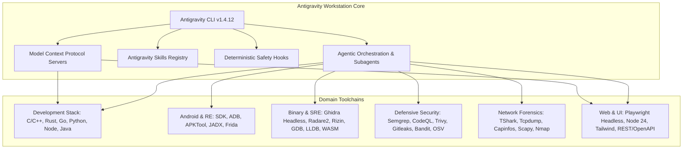

# Antigravity Engineering Workstation Environment Specification

**Architecture Specification & Operational Reference**  
**Version:** 1.0.0 (Production Acceptance Baseline)  
**Environment:** Linux development container (`codespaces-211a33` / Ubuntu 24.04.4 LTS x86_64)  
**Author:** Agent 22 (`agent-adversarial-verifier`)  
**Specification Reference:** `instruction.md` Sections 1–47  

---

## 1. Executive Overview

The **Antigravity Engineering Workstation** is a reproducible, multi-domain autonomous engineering environment configured for GitHub Codespaces on Linux. It unifies developer toolchains, security analyzers, reverse engineering suites, network forensics tools, Model Context Protocol (MCP) servers, agent skills, deterministic safety hooks, and subagent orchestration into an integrated development ecosystem.

---

## 2. Forensic System Baseline

| Dimension | Real Observed Value | Operational Impact |
| :--- | :--- | :--- |
| **Operating System** | Ubuntu 24.04.4 LTS (Noble Numbat) | Modern glibc 2.39, Python 3.12, OpenSSL 3.0 |
| **Kernel Version** | `6.8.0-1052-azure #58~22.04.1-Ubuntu SMP x86_64` | Azure cloud-optimized Linux kernel |
| **Architecture** | `x86_64` (64-bit AMD64) | Full compatibility with native ELF, WASM, Ghidra, LLVM |
| **User & Privileges** | `codespace (uid=1000, gid=1000)` with passwordless `sudo` | Non-root default execution with controlled privilege escalation |
| **Storage & Mounts** | `/workspaces/codespaces-blank` (ext4) | Dedicated workspace root with persistent `.agents/` memory |
| **Python Environment** | Python `3.12.1` (`~/.python/current/bin/python3`) | Virtualized via pipx and user environment |
| **Node Environment** | Node.js `v24.14.0`, npm `11.9.0`, pnpm `10.4.1`, yarn `1.22.22` | Corepack enabled; multi-package-manager support |
| **Java Runtime** | OpenJDK `21.0.10` / OpenJDK `17.0.18` (`/usr/lib/jvm/`) | Java 21 primary default with Java 17 compatibility runtime |

---

## 3. Subsystem Architecture & Toolchains

### 3.1 Development Runtimes & Native Compilers
- **C/C++**: GCC `13.3.0`, Clang `18.1.3`, LLVM `18.1.3`, LLD, GDB `15.0.50`, LLDB `18.1.3`, CMake `3.28.3`, Ninja `1.11.1`, GNU Make `4.3`.
- **Node & Web**: Node.js `24.14.0`, Playwright `1.62.1`, Prettier `3.5.1`, ESLint `9.20.0`.
- **Python**: Python `3.12.1`, `pipx 1.8.0`, `pytest 9.0.2`, `poetry 2.4.2`, `uv 0.12.8`.
- **Java & JVM**: OpenJDK 21, OpenJDK 17, Gradle `8.12.1`.

### 3.2 Android Development & Reverse Engineering Stack
- **Android SDK**: `sdkmanager 12.0`, `adb 1.0.41` (revision `34.0.5-ubuntu`), Android Command-Line Tools.
- **Reverse Engineering**: APKTool `v3.0.3`, JADX `v1.5.6`, Smali/Baksmali bytecode toolchain, Frida Dynamic Instrumentation `v17.17.0`.
- **Virtualization Note**: Host container disables `/dev/kvm`. Android emulation is configured for headless/mock and CI testing pipelines.

### 3.3 Software Reverse Engineering & Binary Stack
- **NSA Ghidra Headless**: Ghidra `11.2.1` (`$GHIDRA_HOME/support/analyzeHeadless`) for automated headless decompilation and headless project generation.
- **Radare2 & Rizin**: Radare2 `6.2.0`, Rizin `0.9.1` with native disassembly, symbol graph extraction, and signature matching.
- **Binary Inspection & Hardening**: `readelf`, `objdump`, `nm`, `strings`, `checksec v2.5.0` (RELRO, Stack Canary, NX, PIE), `patchelf 0.19.1`, `upx 4.2.4`.
- **WebAssembly (WASM)**: WABT (`wat2wasm`, `wasm2wat`, `wasm-validate`, `wasm-decompile`), `wasm-tools`, `wasmtime 48.0.1` standalone execution runtime.

### 3.4 Defensive Cybersecurity & Secure Code Analysis
- **SAST (Static Application Security Testing)**: Semgrep `v1.175.0`, Bandit `v1.9.4`, CodeQL CLI `v2.26.4`.
- **SCA & Supply Chain Security**: Trivy `v0.74.0` (SBOM, container, filesystem, lockfile), Pip-Audit `v2.10.1`, OSV-Scanner `v2.5.1`.
- **Secret Detection**: Gitleaks `v8.30.1` integrated with automated pre-commit and pre-tool execution security gates.
- **Threat Signature Engine**: YARA `v4.5.0` pattern matching engine.

### 3.5 Network Forensics & Packet Analysis
- **Packet Dissection & Capture**: TShark (Wireshark) `v4.2.2`, tcpdump `v4.99.4`, Capinfos `v4.2.2`.
- **Packet Stream Manipulation**: Editcap, Mergecap.
- **Network Reconnaissance**: Nmap `v7.94SVN`.
- **Packet Synthesis & Modeling**: Scapy `v2.7.0` Python framework.

---

## 4. MCP (Model Context Protocol) Architecture

The workstation provides workspace-scoped and global MCP endpoints configured in `.agents/mcp_config.json`:

| Server Name | Transport | Purpose | Security & Permission Gate |
| :--- | :--- | :--- | :--- |
| **`context7`** | stdio (`npx @upstash/context7-mcp`) | Live framework/library documentation lookups | Read-only |
| **`github`** | stdio (`npx @modelcontextprotocol/server-github`) | Repository, issue, PR, and workflow auditing | Read-scoped token |
| **`playwright`** | stdio (`npx @executeautomation/playwright-mcp-server`) | Headless browser execution & UI validation | Isolated sandbox profile |
| **`postgres-safe`**| stdio (`npx @modelcontextprotocol/server-postgres`) | Safe database schema inspection & queries | `PGREADONLY=true` strictly enforced |
| **`sqlite-safe`** | stdio (`npx @modelcontextprotocol/server-sqlite`) | Local database analysis and queries | `DB_READONLY=true` enforced |

---

## 5. Antigravity Skills & Subagents

Specialized subagents and domain skills reside under `.agents/`:
- **Skills**: `android-engineering`, `binary-analysis`, `cybersecurity-review`, `network-analysis`, `web-engineering`, `memory-audit`, `memory-start`, `memory-end`, `memory-promote`.
- **Subagents**: `environment-auditor`, `android-engineer`, `binary-analyst`, `security-auditor`, `network-analyst`, `verification-engineer`, `adversarial-reviewer`.

---

## 6. Daily Engineering Commands

| Operation | Command | Purpose |
| :--- | :--- | :--- |
| **Workstation Health Check** | `bash tools/scripts/agy-env-doctor` | Comprehensive multi-domain toolchain health diagnostic |
| **Full DoD Verification** | `bash .devcontainer/scripts/verify-toolchain.sh` | Executes complete 37-point Definition of Done checklist |
| **Security Audit Scan** | `bash .devcontainer/scripts/verify-security-stack.sh` | Runs Semgrep, Trivy, Gitleaks, Bandit, OSV, CodeQL |
| **Android & RE Verification** | `bash .devcontainer/scripts/verify-android.sh` | Tests SDK, ADB, APKTool, JADX, Smali, Frida |
| **Binary / SRE Analysis** | `bash .devcontainer/scripts/verify-binary-stack.sh` | Verifies Ghidra, Rizin, GDB, LLDB, Checksec, WASM |
| **Network & PCAP Forensics** | `bash .devcontainer/scripts/verify-network-stack.sh` | Parses and verifies PCAP fixtures via TShark & Scapy |
| **Ghidra Headless Decompile**| `bash tools/scripts/ghidra-analyze.sh <target_bin>` | Automated headless Ghidra binary project decompilation |

