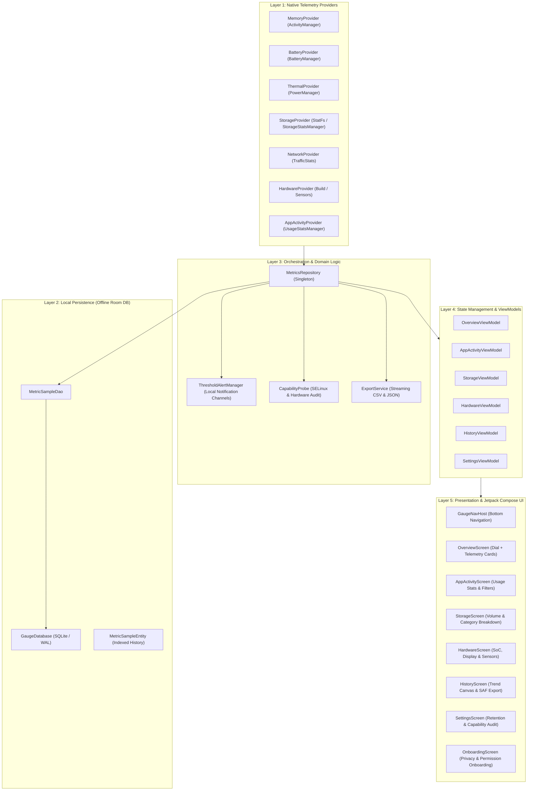

# GAUGE: System Monitor — Comprehensive Architectural Specification

`GAUGE: System Monitor` (`com.androidactivity.guage`) is a native, offline-first Android system telemetry application engineered with **Kotlin 1.9** and **Jetpack Compose 1.5** targeting Android 10 (API 29) through Android 15 (API 35).

---

## 1. High-Level Architectural Diagram

---

## 2. Layer 1: Native Telemetry Providers

The provider layer extracts truthful telemetry directly from Android framework services without synthetic modeling:

1. **`MemoryProvider`**:
   - Queries `ActivityManager.getMemoryInfo()` for `totalMem`, `availMem`, `threshold`, and `lowMemory`.
   - Computes real used RAM percentage: `((total - available) / total) * 100.0`.
   - Reads self-process memory allocations via `Runtime.getRuntime()` and `Debug.MemoryInfo`.
2. **`BatteryProvider`**:
   - Registers a sticky broadcast receiver for `Intent.ACTION_BATTERY_CHANGED`.
   - Collects charge level %, battery temperature in tenths of a degree Celsius, voltage in millivolts, charging status, health, and power source (AC, USB, Wireless).
3. **`ThermalProvider`**:
   - Listens to `PowerManager.OnThermalStatusChangedListener` (API 29+).
   - Maps platform status to `ThermalStatus` enum (`NONE`, `LIGHT`, `MODERATE`, `SEVERE`, `CRITICAL`, `EMERGENCY`, `SHUTDOWN`).
   - Queries `PowerManager.getThermalHeadroom()` (API 30+) for predictive throttling metrics.
4. **`StorageProvider`**:
   - Reads filesystem volume bytes via `StatFs(Environment.getDataDirectory().path)`.
   - Categorizes internal storage breakdown (Apps, Media, System) using `StorageStatsManager` when `PACKAGE_USAGE_STATS` is available.
   - Detects mounted secondary storage volumes via `StorageManager.getStorageVolumes()`.
5. **`NetworkProvider`**:
   - Collects cumulative interface bytes from `TrafficStats.getTotalRxBytes()` and `TrafficStats.getTotalTxBytes()`.
   - Samples delta rates every 2 seconds to calculate real throughput in KB/s.
   - Identifies active network types (Wi-Fi, Cellular, Ethernet) via `ConnectivityManager`.
6. **`HardwareProvider`**:
   - Reads SoC manufacturer, model, board, device codename, and supported ABIs from `android.os.Build`.
   - Enumerates physical and logical CPU cores via `/sys/devices/system/cpu/possible`.
   - Reads window metrics and display characteristics (`Display.getMode()`, `DisplayMetrics`).
   - Enumerates physical hardware sensors via `SensorManager.getSensorList(Sensor.TYPE_ALL)`.
7. **`AppActivityProvider`**:
   - Queries `UsageStatsManager.queryUsageStats()` over a 24-hour window to calculate foreground screen time.
   - Gracefully falls back to `PackageManager.queryIntentActivities()` with launcher category if Usage Access is ungranted.

---

## 3. Layer 2: Persistence & Retention Engine

Historical telemetry is stored exclusively in a private SQLite database via **Android Room 2.6.1**:
- **`MetricSampleEntity`**: Indexed by `timestamp` and `metricType` for fast range queries.
- **`MetricSampleDao`**: Provides streaming `Flow<List<MetricSampleEntity>>` queries for recent samples and time-window slices.
- **Retention Pruning**:
  - Automatically deletes samples older than user preference (7, 30, or 90 days) during periodic sampling loops.
  - Ensures local database file size remains compact (< 5MB for 7 days of continuous monitoring).

---

## 4. Layer 3: Domain, Alerts & Export Service

- **`CapabilityProbe`**:
  - Dynamically probes the host Android environment.
  - Verifies presence of SELinux sandboxing preventing `/proc/stat` access and informs the UI accordingly.
- **`ThresholdAlertManager`**:
  - Configures high-priority diagnostic notification channels (`gauge_system_alerts`).
  - Evaluates live telemetry against configurable thresholds (RAM pressure >= 85%, Battery temp >= 43°C).
  - Honors Android 13+ `POST_NOTIFICATIONS` runtime permissions.
- **`ExportService`**:
  - Memory-efficient streaming writer taking an arbitrary `OutputStream`.
  - Serializes history into standard RFC 4180 CSV with escaped quotes and ISO-8601 UTC timestamps.
  - Serializes history into structured JSON for data science and device diagnostics.

---

## 5. Layer 4 & 5: ViewModels & Jetpack Compose UI

- **Unidirectional Data Flow (UDF)**: ViewModels expose immutable `StateFlow<T>` objects consumed by Compose via `collectAsState()`.
- **Canvas-Drawn Custom Instruments**:
  - `MemoryPressureDial`: Circular arc gauge with animated needle, high-contrast tick marks, and real-time status colors.
  - `GaugeMascot`: Animated vector mascot ("Gaugey") responsive to live system load.
  - `TrendChart`: Responsive sparkline graph plotting historical telemetry over 1h, 24h, and 7d timeframes.
- **Strict Color Architecture**: All UI elements adhere to the audited palette defined in `docs/design/figma-tokens.json` with zero forbidden hex values.
