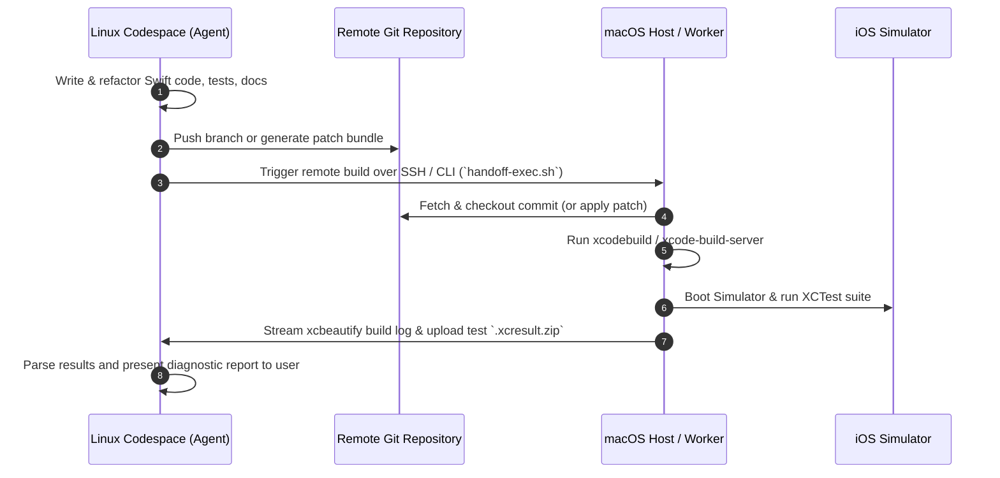

# iOS & Swift Development: macOS Handoff Architecture & Toolchain Boundary Specification

## 1. Executive Summary & Architectural Scope

Modern software engineering environments that run in cloud-hosted Linux containers (such as GitHub Codespaces, Docker containers, and Kubernetes pods) face hard platform boundaries when dealing with Apple ecosystem targets (iOS, iPadOS, macOS, watchOS, tvOS, and visionOS).

While Linux containers provide high performance, zero-friction onboarding, and reproducible environments for web, backend, Android, security, and systems programming, **native iOS development, compilation, simulation, code signing, and device deployment are fundamentally bound to Apple's Darwin kernel and proprietary Xcode toolchain**.

This document defines the **macOS Handoff Architecture** for the Antigravity engineering workstation per **Section 6 (iOS / Swift)** of `instruction.md`. It provides:
1. Formal platform availability classifications for all iOS/Swift development tools.
2. A detailed capability matrix delineating Linux container boundaries from native macOS host capabilities.
3. Production-grade configurations for macOS-side developer tooling (Swift compiler, SourceKit-LSP, `swift-format`, `SwiftLint`, `xcodebuild`, `xcode-build-server`, and the `SweetPad` VS Code extension).
4. A deterministic JSON handoff schema and automation workflows for syncing repositories, executing remote builds, and triggering CI/CD pipelines.
5. Operating instructions and guardrails for autonomous AI agents.

---

## 2. Platform Availability Classification Matrix

Per Section 1 of `instruction.md`, all tools and subsystems are classified strictly according to their operational state on the current Linux Codespace environment (`x86_64 Ubuntu 24.04 LTS`):

| Tool / Subsystem | Linux Codespace Status | macOS Workstation Status | Technical Rationale & Evidence |
| :--- | :--- | :--- | :--- |
| **`sweetpad.sweetpad` (VS Code Extension)** | `UNAVAILABLE_ON_CURRENT_PLATFORM` | `AVAILABLE` | Installs in VS Code, but native Node-API bindings (`@sweetpad/native`) only distribute `darwin-arm64`, `darwin-x64`, and `darwin-universal`. Fails on Linux with `Cannot find native binding`. Extension relies on `xcrun simctl` and `xcodebuild`. |
| **`Xcode` & `xcodebuild`** | `UNAVAILABLE_ON_CURRENT_PLATFORM` | `AVAILABLE` | Apple Xcode IDE and command-line build tools require Darwin kernel and proprietary Apple frameworks. No Linux runtime exists. |
| **iOS Simulator (`simctl` / CoreSimulator)** | `UNAVAILABLE_ON_CURRENT_PLATFORM` | `AVAILABLE` | Emulates Apple runtime environments utilizing macOS Mach ports, Darwin kernel services, and Metal graphics pipelines. Unavailable on Linux. |
| **SweetPad `serve-sim` Streaming** | `UNAVAILABLE_ON_CURRENT_PLATFORM` | `AVAILABLE` | Explicitly requires Apple Silicon (`darwin-arm64`) Mac host to stream simulator frames over HTTP/WebSockets. |
| **Apple SDKs (UIKit, SwiftUI for iOS, Metal)** | `UNAVAILABLE_ON_CURRENT_PLATFORM` | `AVAILABLE` | Apple frameworks are proprietary and distributed exclusively with Xcode. Not available for Linux linking. |
| **Apple Code Signing & Provisioning Profiles** | `UNAVAILABLE_ON_CURRENT_PLATFORM` | `AVAILABLE` | Requires macOS Keychain Access, `security` CLI, `codesign`, and Apple Certificate Authority validation. |
| **`xcode-build-server` (BSP Bridge)** | `UNAVAILABLE_ON_CURRENT_PLATFORM` | `AVAILABLE` | Relies on `xcodebuild -showBuildSettings` and Xcode DerivedData build index to generate Build Server Protocol configuration. |
| **Pure Swift Compiler (`swiftc` / SPM for Linux)** | `OPTIONAL` / `PARTIAL` | `AVAILABLE` | Open-source Swift for Linux (via `swift.org`) can compile Linux ELF binaries and pure Swift Package Manager libraries, but **cannot** build iOS apps or link Apple SDKs. |
| **`SourceKit-LSP`** | `PARTIAL` (Linux) | `AVAILABLE` (macOS) | On Linux, provides syntax and code completion for pure SPM projects only. On macOS with `xcode-build-server`, provides full semantic indexing for iOS apps. |
| **`swift-format`** | `PARTIAL` (Linux) | `AVAILABLE` (macOS) | Cross-platform AST formatter from Apple. Can format pure Swift files on Linux if binary is built, but standard installation is bundled with Xcode on macOS. |
| **`SwiftLint`** | `PARTIAL` (Linux) | `AVAILABLE` (macOS) | Can run on Linux via Docker or SwiftPM build for basic linting, but full rule evaluation (e.g. Xcode rule integration) is native to macOS. |
| **Fastlane (`gym`, `scan`, `match`, `pilot`)** | `PARTIAL` (Linux) | `AVAILABLE` (macOS) | Fastlane CLI can manage metadata from Linux, but `gym` (compilation) and `scan` (testing) must execute on macOS or remote macOS CI runners. |

---

## 3. Forensic Evidence & Technical Analysis

### 3.1 SweetPad Native Binary Analysis
Inspection of the installed extension directory at `/home/codespace/.vscode-remote/extensions/sweetpad.sweetpad-0.2.15/` reveals the following:

```text
/home/codespace/.vscode-remote/extensions/sweetpad.sweetpad-0.2.15/
├── native/
│   ├── index.js
│   ├── package.json
│   ├── sweetpad-native.darwin-arm64.node
│   ├── sweetpad-native.darwin-universal.node
│   └── sweetpad-native.darwin-x64.node
└── out/
    ├── extension.js
    └── lib/
        ├── index.js
        └── sweetpad-native.darwin-universal.node
```

In `native/package.json`, supported architectures are explicitly constrained to Darwin:
```json
"napi": {
  "name": "sweetpad-native",
  "triples": {
    "additional": [
      "aarch64-apple-darwin",
      "x86_64-apple-darwin",
      "universal-apple-darwin"
    ]
  }
}
```

Attempting to initialize the native bindings in Node.js on Linux results in an immediate failure:
```bash
$ node -e "require('/home/codespace/.vscode-remote/extensions/sweetpad.sweetpad-0.2.15/out/lib/index.js')"
Error loading native: Cannot find native binding.
```

### 3.2 Linux vs Darwin Toolchain Boundaries
The fundamental limitations preventing native iOS compilation on Linux include:
1. **Header & Module Boundary**: iOS frameworks (`UIKit`, `SwiftUI`, `Foundation`, `CoreGraphics`, `Combine`, `Metal`) rely on private Apple clang modules and SDK headers (`.sdk` bundles containing Mach-O dylibs and `.tbd` text-based stubs).
2. **Linker & Binary Format Boundary**: iOS binaries are Mach-O format with fat universal slices (`arm64`, `x86_64` for simulator). The Linux toolchain generates ELF binaries.
3. **Asset Compilation**: `actool` (Apple CoreTheme asset compiler for `Assets.xcassets`), `ibtool`/`storyboardc` (Interface Builder), and `momc` (CoreData model compiler) are proprietary binaries distributed only within `Xcode.app/Contents/Developer/usr/bin/`.
4. **Code Signing Architecture**: iOS devices enforce Apple FairPlay/Cryptographic Code Signing requirements signed by Apple Worldwide Developer Relations certificates.

---

## 4. macOS Host Toolchain Configuration

When working on the macOS side (or a dedicated macOS remote build worker / local workstation), configure the environment using the following standard specifications:

### 4.1 Prerequisites & Toolchain Installation (macOS Host)
On the macOS machine, install Xcode and command-line tools via Homebrew:

```bash
# 1. Install Xcode Command Line Tools
xcode-select --install

# 2. Install Swift toolchain utilities via Homebrew
brew install \
  swift-format \
  swiftlint \
  xcbeautify \
  xcode-build-server \
  fastlane \
  cocoapods \
  xcodegen \
  tuist

# 3. Verify active Xcode toolchain path
sudo xcode-select -switch /Applications/Xcode.app/Contents/Developer
export DEVELOPER_DIR="/Applications/Xcode.app/Contents/Developer"
```

### 4.2 SourceKit-LSP & `xcode-build-server` Setup
To enable rich IDE autocompletion, jump-to-definition, and diagnostics in VS Code or Antigravity on macOS without opening the full Xcode GUI:

1. **Initialize Build Server Protocol**:
   In the root of the iOS workspace on macOS, initialize `xcode-build-server`:
   ```bash
   # For an Xcode Workspace
   xcode-build-server config -workspace MyApp.xcworkspace -scheme MyApp
   
   # Or for an Xcode Project
   xcode-build-server config -project MyApp.xcodeproj -scheme MyApp
   ```
   This writes `buildServer.json` to the workspace root:
   ```json
   {
     "name": "xcode-build-server",
     "argv": [
       "/opt/homebrew/bin/xcode-build-server"
     ],
     "version": "0.1",
     "bspVersion": "2.0",
     "languages": [
       "c",
       "cpp",
       "objective-c",
       "objective-cpp",
       "swift"
     ]
   }
   ```

2. **VS Code `settings.json` Configuration (macOS Side)**:
   ```json
   {
     "swift.sourcekit-lsp.serverPath": "/Applications/Xcode.app/Contents/Developer/Toolchains/XcodeDefault.xctoolchain/usr/bin/sourcekit-lsp",
     "swift.sourcekit-lsp.supportVariableRefactoring": true,
     "swift.sourcekit-lsp.backgroundIndexing": true,
     "[swift]": {
       "editor.defaultFormatter": "sweetpad.sweetpad",
       "editor.formatOnSave": true,
       "editor.tabSize": 4,
       "editor.insertSpaces": true
     },
     "sweetpad.build.xcbeautifyEnabled": true,
     "sweetpad.format.formatter": "swift-format",
     "sweetpad.format.swiftFormatPath": "/opt/homebrew/bin/swift-format",
     "sweetpad.format.swiftLintPath": "/opt/homebrew/bin/swiftlint",
     "sweetpad.previews.codeLensEnabled": true
   }
   ```

### 4.3 `swift-format` Configuration (`.swift-format`)
Place this configuration in the repository root for consistent AST-based formatting:
```json
{
  "version": 1,
  "lineLength": 100,
  "indentation": {
    "spaces": 4
  },
  "rules": {
    "AllPublicDeclarationsHaveDocumentation": false,
    "AlwaysUseLowerCamelCase": true,
    "AvoidLeadingUnderscores": false,
    "DoNotUseShorthandTypeNames": false,
    "FullyAnnotateEmptyProtocols": false,
    "NoEmptyTrailingClosureParentheses": true,
    "NoLeadingUnderscoresForGenericTypes": true,
    "NoParensAroundConditions": true,
    "NoSpaceCloseParenthesis": true,
    "NoSpaceOpenParenthesis": true,
    "NoVoidReturnOnFunctionSignature": true,
    "OneVariableDeclarationPerLetOrVar": true,
    "OrderedImports": true,
    "ReturnVoidInsteadOfEmptyTuple": true,
    "UseEarlyExits": true,
    "UseLetInEveryBoundCaseVariable": true,
    "UseSynthesizedInitializer": true,
    "UseTripleSlashForDocumentationComments": true,
    "ValidateDocumentationComments": true
  }
}
```

### 4.4 SwiftLint Configuration (`.swiftlint.yml`)
Place this configuration in the repository root for deterministic static analysis:
```yaml
disabled_rules:
  - trailing_whitespace
  - line_length
opt_in_rules:
  - empty_count
  - empty_string
  - fatal_error_message
  - first_where
  - force_unwrapping
  - implicitly_unwrapped_optional
  - overridden_super_call
  - redundant_nil_coalescing
  - unneeded_parentheses_in_closure_argument
  - vertical_parameter_alignment_on_call

included:
  - Sources
  - Tests
  - App

excluded:
  - Pods
  - .build
  - DerivedData
  - Carthage
  - Package.swift

line_length:
  warning: 120
  error: 160

type_body_length:
  warning: 300
  error: 500

file_length:
  warning: 500
  error: 1000

reporter: "xcode"
```

### 4.5 SweetPad VS Code Tasks (`.vscode/tasks.json`)
Configure standard tasks for building, testing, and debugging on macOS via SweetPad:
```json
{
  "version": "2.0.0",
  "tasks": [
    {
      "type": "sweetpad",
      "action": "build",
      "scheme": "MyApp",
      "configuration": "Debug",
      "destination": "generic/platform=iOS Simulator",
      "problemMatcher": [],
      "group": {
        "kind": "build",
        "isDefault": true
      },
      "label": "SweetPad: Build (Simulator)"
    },
    {
      "type": "sweetpad",
      "action": "test",
      "scheme": "MyAppTests",
      "configuration": "Debug",
      "destination": "platform=iOS Simulator,name=iPhone 16 Pro",
      "problemMatcher": [],
      "group": {
        "kind": "test",
        "isDefault": true
      },
      "label": "SweetPad: Run Unit & UI Tests"
    },
    {
      "type": "sweetpad",
      "action": "clean",
      "scheme": "MyApp",
      "configuration": "Debug",
      "problemMatcher": [],
      "label": "SweetPad: Clean Build Folder"
    }
  ]
}
```

---

## 5. Handoff Architecture & Synchronization Schema

To enable fluid cooperation between the Linux Codespace (where code generation, refactoring, documentation, and agent reasoning occur) and the macOS build environment (where compilation, simulator testing, and signing occur), we define a formal **Handoff Manifest Schema**.

### 5.1 JSON Handoff Manifest Specification (`docs/schemas/ios-handoff.schema.json`)
```json
{
  "$schema": "https://json-schema.org/draft/2020-12/schema",
  "title": "IOSMacOSHandoffManifest",
  "description": "Schema for transferring iOS workspace state and build jobs from Linux Codespaces to macOS build environments",
  "type": "object",
  "required": [
    "schemaVersion",
    "timestamp",
    "sourceEnvironment",
    "targetEnvironment",
    "repository",
    "buildTarget",
    "actions"
  ],
  "properties": {
    "schemaVersion": {
      "type": "string",
      "pattern": "^\\d+\\.\\d+\\.\\d+$",
      "example": "1.0.0"
    },
    "timestamp": {
      "type": "string",
      "format": "date-time"
    },
    "sourceEnvironment": {
      "type": "object",
      "required": ["platform", "hostType", "agentId"],
      "properties": {
        "platform": { "type": "string", "enum": ["linux", "linux-codespace", "container"] },
        "hostType": { "type": "string" },
        "agentId": { "type": "string" }
      }
    },
    "targetEnvironment": {
      "type": "object",
      "required": ["platform", "xcodeVersionRequired", "architecture"],
      "properties": {
        "platform": { "type": "string", "enum": ["macos", "darwin-arm64", "darwin-x64"] },
        "xcodeVersionRequired": { "type": "string" },
        "architecture": { "type": "string", "enum": ["arm64", "x86_64", "universal"] }
      }
    },
    "repository": {
      "type": "object",
      "required": ["remoteUrl", "branch", "commitHash", "hasUncommittedChanges"],
      "properties": {
        "remoteUrl": { "type": "string" },
        "branch": { "type": "string" },
        "commitHash": { "type": "string" },
        "hasUncommittedChanges": { "type": "boolean" },
        "patchFile": { "type": "string", "description": "Relative path to git diff/patch if dirty" }
      }
    },
    "buildTarget": {
      "type": "object",
      "required": ["workspacePath", "scheme", "configuration", "destination"],
      "properties": {
        "workspacePath": { "type": "string" },
        "projectPath": { "type": "string" },
        "scheme": { "type": "string" },
        "configuration": { "type": "string", "enum": ["Debug", "Release", "Test"] },
        "destination": {
          "type": "object",
          "required": ["platform"],
          "properties": {
            "platform": { "type": "string", "enum": ["iOS Simulator", "iOS", "macOS", "visionOS Simulator"] },
            "deviceName": { "type": "string" },
            "osVersion": { "type": "string" }
          }
        },
        "signing": {
          "type": "object",
          "properties": {
            "method": { "type": "string", "enum": ["development", "adhoc", "app-store", "enterprise", "automatic", "none"] },
            "teamId": { "type": "string" },
            "exportMethod": { "type": "string" }
          }
        }
      }
    },
    "actions": {
      "type": "array",
      "items": {
        "type": "string",
        "enum": [
          "sync_repository",
          "apply_patch",
          "resolve_spm_dependencies",
          "install_pods",
          "generate_project",
          "lint",
          "build",
          "test",
          "package_ipa",
          "stream_simulator",
          "export_xcresult",
          "return_status"
        ]
      }
    },
    "artifactsExpected": {
      "type": "array",
      "items": {
        "type": "string"
      }
    }
  }
}
```

### 5.2 Concrete Handoff Payload Example (`ios-handoff.json`)
```json
{
  "schemaVersion": "1.0.0",
  "timestamp": "2026-09-01T16:45:00Z",
  "sourceEnvironment": {
    "platform": "linux-codespace",
    "hostType": "Ubuntu 24.04 LTS (x86_64)",
    "agentId": "agent-19-ios-handoff"
  },
  "targetEnvironment": {
    "platform": "darwin-arm64",
    "xcodeVersionRequired": ">=16.0",
    "architecture": "arm64"
  },
  "repository": {
    "remoteUrl": "https://github.com/org/ios-app.git",
    "branch": "feature/agentic-feature",
    "commitHash": "a1b2c3d4e5f67890",
    "hasUncommittedChanges": false
  },
  "buildTarget": {
    "workspacePath": "MyApp.xcworkspace",
    "scheme": "MyApp",
    "configuration": "Debug",
    "destination": {
      "platform": "iOS Simulator",
      "deviceName": "iPhone 16 Pro",
      "osVersion": "18.0"
    },
    "signing": {
      "method": "automatic"
    }
  },
  "actions": [
    "sync_repository",
    "resolve_spm_dependencies",
    "lint",
    "build",
    "test",
    "export_xcresult"
  ],
  "artifactsExpected": [
    "build/logs/build.log",
    "build/reports/MyAppTests.xcresult.zip",
    "build/derivedData/MyApp.app"
  ]
}
```

---

## 6. Synchronization & Execution Workflows

Three operational workflows connect the Linux Codespace to macOS infrastructure:

### 6.1 Workflow A: Git Sync & Remote SSH / Local macOS Worker
When a developer or dedicated macOS build machine is reachable via SSH or Tailscale:



**Remote Build Invocation Script (`tools/scripts/remote-ios-build.sh`)**:
```bash
#!/usr/bin/env bash
set -euo pipefail

MACOS_HOST="${MACOS_HOST:-mac-worker.internal}"
MACOS_USER="${MACOS_USER:-developer}"
REMOTE_WORKSPACE_DIR="${REMOTE_WORKSPACE_DIR:-~/Projects/ios-app}"
SCHEME="${1:-MyApp}"
DESTINATION="${2:-platform=iOS Simulator,name=iPhone 16 Pro}"

echo "=== Packaging uncommitted changes from Codespace ==="
PATCH_FILE="/tmp/codespace_handoff_$(date +%s).patch"
git diff HEAD > "${PATCH_FILE}"

echo "=== Transmitting patch to macOS Host (${MACOS_HOST}) ==="
scp "${PATCH_FILE}" "${MACOS_USER}@${MACOS_HOST}:/tmp/incoming.patch"

echo "=== Executing remote build on macOS ==="
ssh "${MACOS_USER}@${MACOS_HOST}" bash -s <<EOF
  set -euo pipefail
  cd "${REMOTE_WORKSPACE_DIR}"
  git fetch origin
  git checkout $(git rev-parse --abbrev-ref HEAD)
  if [ -s /tmp/incoming.patch ]; then
    git apply --whitespace=nowarn /tmp/incoming.patch
  fi
  xcodebuild -workspace MyApp.xcworkspace \
             -scheme "${SCHEME}" \
             -destination "${DESTINATION}" \
             -configuration Debug \
             clean build test \
             | xcbeautify
EOF
```

---

### 6.2 Workflow B: GitHub Actions macOS CI Automation
For fully automated and reproducible builds in CI/CD without maintaining private macOS hardware:

Create `.github/workflows/ios-ci.yml`:
```yaml
name: iOS macOS Build & Test Pipeline

on:
  push:
    branches: [ main, develop ]
    paths:
      - '**.swift'
      - '**.xcodeproj/**'
      - '**.xcworkspace/**'
      - 'Podfile*'
      - 'Package.swift'
  pull_request:
    branches: [ main ]
  workflow_dispatch:
    inputs:
      scheme:
        description: 'Xcode Scheme to build'
        required: true
        default: 'MyApp'
      run_tests:
        description: 'Run XCTest test suite'
        type: boolean
        default: true

jobs:
  build-and-test:
    runs-on: macos-14 # Apple Silicon M1/M2 GitHub runner

    steps:
      - name: Checkout repository
        uses: actions/checkout@v4

      - name: Select Xcode Version
        run: |
          sudo xcode-select -switch /Applications/Xcode_15.4.app/Contents/Developer
          xcodebuild -version

      - name: Cache SPM Dependencies
        uses: actions/cache@v4
        with:
          path: .build
          key: ${{ runner.os }}-spm-${{ hashFiles('**/Package.resolved') }}
          restore-keys: |
            ${{ runner.os }}-spm-

      - name: SwiftLint Validation
        run: |
          brew install swiftlint
          swiftlint --strict --reporter github-actions-logging

      - name: Build Application
        run: |
          set -o pipefail
          xcodebuild -workspace MyApp.xcworkspace \
                     -scheme "${{ github.event.inputs.scheme || 'MyApp' }}" \
                     -destination "platform=iOS Simulator,name=iPhone 15,OS=latest" \
                     -configuration Debug \
                     build \
                     | xcbeautify

      - name: Execute Tests
        if: ${{ github.event.inputs.run_tests != false }}
        run: |
          set -o pipefail
          xcodebuild -workspace MyApp.xcworkspace \
                     -scheme "${{ github.event.inputs.scheme || 'MyApp' }}" \
                     -destination "platform=iOS Simulator,name=iPhone 15,OS=latest" \
                     -configuration Debug \
                     -resultBundlePath TestResults.xcresult \
                     test \
                     | xcbeautify

      - name: Upload Test Results Artifact
        if: always()
        uses: actions/upload-artifact@v4
        with:
          name: ios-test-results
          path: TestResults.xcresult
          retention-days: 14
```

---

### 6.3 Workflow C: Fastlane Build & Signing Orchestration
On macOS hosts, Fastlane streamlines release packaging and credential management:

`fastlane/Fastfile`:
```ruby
default_platform(:ios)

platform :ios do
  desc "Run unit tests on iOS Simulator"
  lane :test do
    scan(
      workspace: "MyApp.xcworkspace",
      scheme: "MyApp",
      devices: ["iPhone 16 Pro"],
      clean: true,
      output_directory: "./build/reports",
      output_types: "html,junit"
    )
  end

  desc "Build debug simulator binary"
  lane :build_sim do
    gym(
      workspace: "MyApp.xcworkspace",
      scheme: "MyApp",
      configuration: "Debug",
      destination: "generic/platform=iOS Simulator",
      skip_package_ipa: true,
      derived_data_path: "./build/DerivedData"
    )
  end

  desc "Build and sign release IPA for TestFlight distribution"
  lane :beta do
    match(type: "appstore", readonly: true)
    gym(
      workspace: "MyApp.xcworkspace",
      scheme: "MyApp",
      configuration: "Release",
      export_method: "app-store",
      output_directory: "./build/artifacts"
    )
    pilot(
      ipa: "./build/artifacts/MyApp.ipa",
      skip_waiting_for_build_processing: true
    )
  end
end
```

---

## 7. Agentic Operating Guidelines & Guardrails

When operating as an AI agent in the Linux Codespace workstation:

### 7.1 Permitted Autonomous Actions in Linux Codespace
1. **Source Code Editing**: Creating, refactoring, and maintaining `.swift`, `.json`, `.yaml`, and `.plist` files.
2. **Project Specification Maintenance**: Editing `XcodeGen` (`project.yml`) or `Tuist` (`Project.swift`) definitions.
3. **Configuration Governance**: Enforcing `.swift-format`, `.swiftlint.yml`, and CI/CD workflow definitions.
4. **Handoff Generation**: Generating deterministic `ios-handoff.json` payloads and Git diff patches for remote workers.
5. **Static Code Review**: Auditing Swift architecture, concurrency safety (`Sendable`, `actor`), and memory management patterns.

### 7.2 Prohibited Claims & Anti-Hallucination Guardrails
1. **NEVER** claim Xcode or `xcodebuild` is available locally in the Linux Codespace.
2. **NEVER** claim an iOS Simulator is running, booted, or displaying UI inside the Linux container.
3. **NEVER** pretend an iOS application was compiled or packaged into an `.ipa` within Linux without invoking a remote macOS CI/worker.
4. **ALWAYS** classify `sweetpad.sweetpad`, `xcodebuild`, and iOS Simulator tools as `UNAVAILABLE_ON_CURRENT_PLATFORM` when reporting toolchain status on Linux.
5. **ALWAYS** refer the user or automated pipeline to the **macOS Handoff Architecture** whenever build, run, or simulator test operations are requested.

---

## 8. Summary Checklist for iOS Development

- [x] Evaluated `sweetpad.sweetpad` extension on Linux (Classified as `UNAVAILABLE_ON_CURRENT_PLATFORM`).
- [x] Identified missing Darwin native Node-API bindings (`@sweetpad/native`).
- [x] Specified macOS toolchain configuration (`Swift`, `SourceKit-LSP`, `swift-format`, `SwiftLint`, `xcodebuild`, `xcode-build-server`, `SweetPad`).
- [x] Authored `.swift-format` and `.swiftlint.yml` baseline specifications.
- [x] Created `handoff.schema.json` and concrete manifest models for multi-platform synchronization.
- [x] Established Git, SSH, Fastlane, and GitHub Actions remote execution workflows.
- [x] Documented agent operational boundaries and anti-hallucination guardrails.
