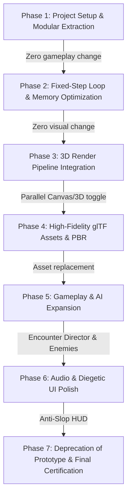

# Architecture & Technology Research Report
**Project**: CYBER-RUNNER 2099: Rebuild & Transformation  
**Document Version**: 1.0.0  
**Status**: Research & Planning Phase (Zero Code / Zero Game Modifications)  
**Authoritative Reference**: [`instruction.md`](file:///workspaces/codespaces-blank/instruction.md) & Forensic Audit Baseline  

---

## Executive Summary

The objective of this research phase is to establish the **smallest practical technical foundation** capable of transforming the monolithic 2D canvas prototype (`cyber-runner.html`) into a modern, high-fidelity 3D cyberpunk browser game. 

Per the non-negotiable principles of `instruction.md`:
1. We **do not** select technologies because they sound impressive or fashionable.
2. We prioritize player experience, responsiveness, frame pacing, maintainability, and universal desktop/mobile browser reach.
3. We preserve all working gameplay mechanics (controls, mobile touch, procedural audio, scoring, upgrades, progression) through a disciplined, gradual migration rather than a destructive rewrite.

---

## 1. Deep Research & Evaluation of the 20 Core Technologies

| # | Technology / Pattern | Technical Assessment & 2026 Status | Fit for CYBER-RUNNER 2099 | Verdict |
|---|---|---|---|---|
| **1** | **Three.js** | Industry standard web 3D library (~160KB gzipped core). Massive ecosystem of loaders (`GLTFLoader`, `KTX2Loader`), materials, skeletal animation, and lighting. Exceptional maintainability and debugging tools. | Ideal foundation. Modular, lightweight, non-invasive, and can render in parallel with existing 2D/DOM layers during gradual migration. | **CHOSEN (Core 3D Engine)** |
| **2** | **Three.js WebGPURenderer** | Stabilized in Three.js (r171+). Unified WebGPU backend with automatic, zero-configuration WebGL 2 fallback. Features TSL (Three Shading Language) compiling to WGSL or GLSL. Enables GPU compute shaders for 500k+ particles. | Future-proof graphics pipeline. Provides cutting-edge WebGPU features while maintaining 100% device compatibility via built-in WebGL2 fallback. | **CHOSEN (Primary Render Pipeline)** |
| **3** | **Babylon.js** | Fully-featured, monolithic 3D game engine by Microsoft. Includes built-in physics, GUI, audio, and inspector. | Bundle size is heavy (>1MB gzipped, 3.5MB+ uncompressed). Highly opinionated architecture makes gradual migration from `cyber-runner.html` rigid and difficult. Slower mobile startup. | **REJECTED (Too Heavy / Rigid)** |
| **4** | **Native WebGPU** | Low-level W3C browser GPU API (similar to Vulkan/Metal/DirectX 12). | Requires 10,000+ lines of low-level boilerplate just to parse glTF, compute skinning matrices, and calculate PBR BRDFs. Massive development cost with zero gameplay benefit. | **REJECTED (Impractical Overhead)** |
| **5** | **WebGL2 Fallback** | Universal browser standard (99.5%+ global support across desktop and mobile browsers). | Essential safety net. Guarantees the game runs on older iPhones, budget Android devices, Linux workstations, and headless CI test environments. Handled automatically by `WebGPURenderer`. | **CHOSEN (Mandatory Fallback)** |
| **6** | **Rapier Physics (`@dimforge/rapier3d`)** | Rust-based rigid-body physics engine compiled to WebAssembly (WASM). High performance for 3D dynamics and constraints. | For runner traversal (jump, slide, obstacle collision), a lightweight kinematic solver (AABB/Raycast) provides zero-latency response, zero WASM bloat, and instant startup. Rapier should be introduced modularly in later phases for dynamic vehicle and ragdoll physics. | **DEFERRED / MODULAR (Kinematic First, Rapier for Phase 5 Vehicles)** |
| **7** | **Web Workers** | Multi-threaded JavaScript background execution. | Offloading game loop/physics across threads introduces 1–2 frames (16–33ms) of message transfer latency, harming fast-paced twitch dodging. SharedArrayBuffer requires strict COOP/COEP headers. Main-thread simulation takes < 1.5ms. | **REJECTED FOR LOOP (Retained only for async background tasks)** |
| **8** | **OffscreenCanvas** | Canvas rendering inside Web Workers. | Safari and mobile WebKit exhibit context loss and resize bugs with worker canvases. Disconnects canvas from tight DOM UI sync and complicates Playwright visual testing. | **REJECTED (Unnecessary Complexity)** |
| **9** | **TypeScript** | Statically typed superset of JavaScript. Strict type contracts, interfaces, and compile-time verification. | Eliminates runtime undefined crashes, formalizes data schemas (`SaveDataV1`, `InputActions`), enables safe modular refactoring of 2,633-line prototype. Zero runtime overhead. | **CHOSEN (Core Language)** |
| **10** | **Vite** | Next-generation web bundler with instant native ESM dev server and Rollup production build. | Sub-second HMR, instant startup, seamless asset bundling, and out-of-the-box integration with TypeScript, Vitest, and Playwright. | **CHOSEN (Build Tool & Dev Environment)** |
| **11** | **ECS / Data-Oriented Architecture** | Entity-Component-System architectural paradigm. | Heavy ECS libraries (BitECS, Becsy) add memory-indirection and boilerplate overhead unnecessary for < 200 entities. A pragmatic Entity-Component/Service pattern with data-oriented hot paths (typed arrays, object pools) gives maximum clarity and speed. | **CHOSEN (Pragmatic Entity-Component Pattern)** |
| **12** | **glTF / GLB** | ISO/IEC 12113 standard 3D runtime format. Bundles geometry, PBR materials, skeletal rigs, and animations. | Essential standard for 3D assets. Replaces flat 2D vector shapes with authored cyberpunk character models, drones, and district scenery. | **CHOSEN (Standard 3D Asset Format)** |
| **13** | **KTX2 / Basis Universal** | Khronos standard GPU texture compression (transcodes to BC7 on desktop, ASTC on mobile). | Reduces VRAM consumption by 70–80% compared to uncompressed PNG/JPEG, eliminates mobile GPU texture upload hitches and memory thrashing. | **CHOSEN (Texture Compression Standard)** |
| **14** | **Meshopt (Meshoptimizer)** | Geometry optimization and compression for glTF (`EXT_meshopt_compression`). | 10x faster decompression than Draco, zero runtime CPU stutter during asset streaming, optimizes vertex cache and overdraw. | **CHOSEN (Geometry Optimization)** |
| **15** | **GPU Instancing (`THREE.InstancedMesh`)** | Renders hundreds of identical mesh instances in a single GPU draw call. | Crucial for cyberpunk cityscapes (streetlights, barrier stripes, windows, neon signs, floating debris). Reduces draw calls from 300+ down to < 25. | **CHOSEN (Environment Rendering)** |
| **16** | **PBR Materials** | Physically Based Rendering (`MeshStandardMaterial` / `MeshPhysicalMaterial`). | True surface response (metalness, roughness, normal maps, emissive neon, ambient occlusion). Scalable to simple Lambert/Unlit on low-tier mobile. | **CHOSEN (Material Pipeline)** |
| **17** | **Skeletal Animation** | Skinned mesh rigging with bone weights and hierarchical animation mixers (`AnimationMixer`). | Replaces 2D oscillating rectangle limbs with fluid humanoid running, jumping, sliding, and combat animations with smooth cross-fading. | **CHOSEN (Character Animation)** |
| **18** | **Post-Processing** | Screen-space visual pipeline (ACESFilmic tone mapping, bloom, vignette, chromatic aberration). | Establishes the cyberpunk visual mood while keeping performance strictly controlled via scalable quality tiers (`LOW` disables bloom, `HIGH` enables selective glow). | **CHOSEN (Scalable Post-Processing)** |
| **19** | **Procedural World Generation** | Chunk-based encounter templates with difficulty budgeting and safety validation. | Replaces the prototype's naive random timers with rhythmic, solvable obstacle sequences that scale intelligently with distance. | **CHOSEN (Encounter Director)** |
| **20** | **Browser Performance Optimization** | Object pooling, fixed 60Hz timestep, DPR capping (2.0 max, 1.5 mobile), frustum culling, DOM decoupling. | Directly targets and eliminates the 49.9ms p99 GC spikes identified in the baseline audit, ensuring rock-solid 60 FPS pacing across desktop and mobile. | **CHOSEN (Core Engineering Practice)** |

---

## 2. Technology Comparison Matrix

| Option | Visual Quality | Performance | Compatibility (Desktop/Mobile) | Dev Complexity | Bundle Footprint | Migration Risk | Verdict |
|---|---|---|---|---|---|---|---|
| **Three.js WebGPURenderer + WebGL2** | High (PBR, TSL, Compute) | High (60–120 FPS, low overhead) | 100% (Universal WebGPU + WebGL2 fallback) | Moderate | ~180 KB (gzipped) | Low (Gradual overlay) | **WINNER** |
| **Three.js WebGLRenderer only** | Medium-High (PBR, Standard shaders) | High (60 FPS) | 100% (Universal WebGL2) | Low-Moderate | ~160 KB (gzipped) | Low | **Solid Alternate** |
| **Babylon.js** | High (Complete engine) | Medium-High (High memory) | High | High (Monolithic API) | ~1.1 MB (gzipped) | High (Big bang rewrite) | **REJECTED** |
| **Native WebGPU** | High (Custom engine) | Maximum (if perfectly written) | Limited (No WebGL2 fallback unless manually coded) | Extreme | ~20 KB (raw) | Extreme | **REJECTED** |
| **Canvas 2D (Status Quo)** | Low (Flat vector primitives) | Moderate (GC spikes from allocations) | 100% | Low | 91 KB (monolithic) | Zero | **PROTOTYPE BASELINE** |

---

## 3. Preserving Working Gameplay Systems

A fundamental principle of this engineering effort is **respecting working functionality**. The following systems from `cyber-runner.html` will be preserved, refactored into typed modules, and enhanced without breaking behavior:

1. **Controls & Input Handling**:
   - Keyboard: `Space`/`W`/`Up` (Jump), `S`/`Down`/`Ctrl` (Slide), `Shift`/`E` (Overdrive), `Esc`/`P` (Pause).
   - Gamepad: Standard W3C Gamepad API integration for analog sticks and face buttons.
   - Mobile Touch: Dual-mode input with swipe gestures (Swipe Up = Jump, Swipe Down = Slide, Double Tap = Overdrive) and on-screen thumb buttons (Slide, Jump, Boost).
   - Dynamic orientation awareness with safe-area insets.

2. **Procedural Audio Synthesizer (`CyberSynthAudio`)**:
   - The self-contained Web Audio API synth (32-step 124 BPM sequencer, frequency-swept kick, noise snare, square hi-hat, filtered sawtooth bass, arpeggiated lead, and procedural SFX) has **zero download footprint** and **zero network asset delay**.
   - Preserved completely and wrapped in a typed `AudioService`. Expanded with dynamic intensity layers (Exploration $\to$ Alert $\to$ Overdrive) rather than discarded.

3. **Scoring & Combo System**:
   - Distance points ($5 \times \text{mps} \times \text{combo}$), Shards (+10), Cores (+50), Overdrive obstacle smashes (+250).
   - Combo doubling ($1\times \to 2\times \to 4\times \to 8\times$) with a 3.2s decay timer.
   - Rank evaluation tiers (S+, S, A, B, C, D).

4. **Meta-Progression & Upgrades**:
   - `bankedShards` meta-currency and Cyber-Clinic upgrades (Starting Shield, Quantum Magnet Radius, Multiplier Chip).
   - Migrated from fragile raw `localStorage` strings into a versioned schema (`SaveDataV1` $\to$ `SaveDataV2`) with backward compatibility and data validation.

5. **Powerups & Active States**:
   - Nano-Shield (1-hit absorption, 1.0s invulnerability window, shatter VFX).
   - Flux Magnet (220px+ attraction radius pulling shards/cores at 750 px/s).
   - Chrono Glitch (0.6x time dilation / 40% slow motion).
   - Overdrive (1.4x speed, invulnerability, obstacle smash destruction, afterimage trail).

6. **Core Game Loop & Movement Constants**:
   - Base speed $460\text{ px/s}$, accelerating linearly by $6.5\text{ px/s}^2$ to $980\text{ px/s}$.
   - Jump velocity $-780\text{ px/s}$, gravity $1900\text{ px/s}^2$, double-jump multiplier $0.92\times$, slide duration $0.55\text{s}$.
   - Ground coordinate alignment ($32\text{ px} = 1\text{ meter}$).

---

## 4. Gradual Migration Strategy: Safe Phased Refactoring

Rather than destroying the monolithic `cyber-runner.html` in an unmanageable rewrite, the migration proceeds in **seven distinct, verifiable phases**:

### Phase Details:
* **Phase 1: Project Setup & Modular Extraction (Zero Gameplay Change)**
  - Initialize Vite + TypeScript environment in `src/`.
  - Extract `CyberSynthAudio` into `src/audio/CyberAudioService.ts`.
  - Extract game state and input into `src/core/InputManager.ts` and `src/core/GameState.ts`.
  - Extract Canvas 2D rendering into `src/rendering/Canvas2DRenderer.ts`.
  - Run Playwright automated tests to prove 100% mechanical parity with original `cyber-runner.html`.

* **Phase 2: Fixed-Step Loop & Memory Optimization**
  - Implement fixed 60Hz simulation accumulator (`fixedUpdate(1/60)`) with alpha interpolation.
  - Implement pre-allocated Object Pools for particles and floating text, eliminating GC frame spikes.
  - Implement versioned save schema (`SaveDataV1`).

* **Phase 3: 3D Render Pipeline Integration (Three.js WebGPURenderer + WebGL2)**
  - Instantiate Three.js canvas layer behind the HUD.
  - Create camera rig, directional cyberpunk lighting, and track geometry.
  - Provide a runtime graphics setting allowing instant switching between Canvas 2D and 3D to ensure zero gameplay regressions.

* **Phase 4: High-Fidelity glTF Assets, Materials & Animations**
  - Load authored glTF/GLB humanoid runner with skeletal animation mixer (run, jump, slide, overdrive).
  - Add PBR materials, KTX2 compressed textures, and Meshopt geometry.
  - Add GPU instanced scenery (buildings, streetlights, barriers).

* **Phase 5: Gameplay & AI Encounter Expansion**
  - Replace naive random countdown timers with the **Chunked Encounter Director**.
  - Upgrade static drone obstacles to AI sentinels with search cones and attack patterns.
  - Add wall-run and air-dash traversal mechanics.

* **Phase 6: Audio Layers & Diegetic UI Redesign**
  - Add reactive multi-track stems to procedural audio (dynamic tension layers).
  - Redesign HUD following the Anti-Slop Design Directive (diegetic gauges, high contrast, zero generic glassmorphic card clutter).

* **Phase 7: Prototype Deprecation & Quality Gate Certification**
  - Archive `cyber-runner.html` to `legacy/`.
  - Run full Playwright test suite, visual regression baselines, and performance benchmark suites across all 4 quality tiers (`LOW`, `MEDIUM`, `HIGH`, `ULTRA`).

