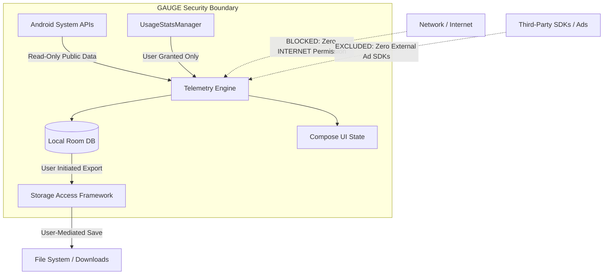

# GAUGE: Security, Privacy & Reliability Architecture Review
## Threat Model, Permission Minimization, Data Lifecycle, and Failure Mode Analysis

This security and privacy review establishes the defensive architecture, data protection boundaries, and reliability mitigations for **GAUGE: System Monitor**.

---

## 1. Threat Model & Privacy Architecture

### 1.1 Asset Inventory & Classification
| Data Asset | Sensitivity | Storage Location | Retention Window | Exfiltration Risk Mitigation |
| :--- | :---: | :--- | :--- | :--- |
| **Installed Package Names & Usage History** | Medium | Local Room DB (`gauge_history.db`) in private app sandbox. | User-selected: 7, 30, or 90 days. Pruned automatically. | **Zero Network Access:** Manifest omits `android.permission.INTERNET`. Impossible to transmit over network. |
| **System Memory & Thermal Telemetry** | Low | Volatile memory (`StateFlow`) and bounded local SQLite table. | Bounded to maximum 1,000 historical samples. | Completely local. Accessible only to GAUGE. |
| **Hardware & Sensor Specifications** | Low | Volatile memory only. Not persisted. | Session only. | Read directly via public Android APIs. |
| **Exported CSV / JSON Files** | Medium | User-chosen external location (e.g., Downloads, Drive). | Managed by user. | Generated on-demand via Storage Access Framework (`ACTION_CREATE_DOCUMENT`). |

### 1.2 Threat Vectors & Architectural Mitigations



1. **Threat: Silent Data Exfiltration / Remote Telemetry**
   - *Mitigation:* GAUGE completely omits `<uses-permission android:name="android.permission.INTERNET" />` from its `AndroidManifest.xml`. The Android Linux kernel sandbox cryptographically prevents the application process from opening sockets, transmitting HTTP/HTTPS requests, or communicating with any remote server.
2. **Threat: Package Snooping & User Profiling**
   - *Mitigation:* GAUGE complies with Android 11+ Package Visibility. Rather than demanding the dangerous `QUERY_ALL_PACKAGES` permission (which triggers Play Store rejection and security flags), GAUGE queries only packages that declare an active launcher intent (`Intent.ACTION_MAIN`, `CATEGORY_LAUNCHER`).
3. **Threat: Over-Privileged Storage Abuse**
   - *Mitigation:* GAUGE does not request `READ_EXTERNAL_STORAGE`, `WRITE_EXTERNAL_STORAGE`, or `MANAGE_EXTERNAL_STORAGE`. When the user exports CSV or JSON metrics, GAUGE launches Android's native Storage Access Framework (`ACTION_CREATE_DOCUMENT`), where the user explicitly selects the destination directory.
4. **Threat: Accessibility Service Abuse**
   - *Mitigation:* Some unscrupulous monitoring tools abuse Android `AccessibilityService` to spy on user interactions and force-kill apps. GAUGE **never** implements an Accessibility Service, relying purely on standard, lawful Android management APIs.

---

## 2. Permission Minimization Register

| Permission | Protection Level | Purpose & Necessity | Fallback if Denied | User-Facing Disclosure |
| :--- | :---: | :--- | :--- | :--- |
| `android.permission.PACKAGE_USAGE_STATS` | Special App Access (`appop`) | Query foreground application durations and package storage breakdown (`StorageStatsManager`). | App Activity tab displays prompt explaining Usage Access; Overview and Hardware tabs remain 100% functional. | Clear in-app dialog explaining that usage stats never leave the device and can be revoked in Settings anytime. |
| `android.permission.POST_NOTIFICATIONS` | Runtime (API 33+) | Deliver user-configured local threshold alerts (e.g. sustained high thermal throttling). | Alerts are silenced; app displays notification settings banner. | Explained in Notification Settings with direct system settings toggle. |
| `android.permission.FOREGROUND_SERVICE` | Normal | Optional continuous background session recording. | Metric recording runs only while the app is actively in the foreground. | Persistent system notification clearly displaying active recording status and "Stop" button. |
| `android.permission.FOREGROUND_SERVICE_SPECIAL_USE` | Normal (API 34+) | Required by Android 14+ for custom utility monitoring foreground services. | Reverts to foreground-only collection. | Complies with Android 14 foreground service declaration standards. |

---

## 3. Data Lifecycle & Retention Architecture

```text
[ Live Sensor / Metric Reading ]
             │
             ▼
[ Bounded Ring Buffer in RAM (Last 60 samples @ 1s) ] ──► Live Compose Graphs
             │
             ▼ (Every 15s when Session Active)
[ Room SQLite Database (gauge_history.db) ]
             │
             ├──► Automatic Retention Cleanup (Prunes rows older than 7/30/90 days)
             │
             ├──► Manual "Clear History" Action (Atomic DELETE FROM metrics_history)
             │
             └──► User-Initiated Export (Streamed to CSV/JSON via SAF OutputStream)
```

- **Database Size Management:** Each metric row consumes ~48 bytes. At 1 sample every 15 seconds during active recording, 24 hours of continuous monitoring produces ~5,760 rows (~276 KB). Over 30 days, database size remains bounded under **10 MB**, ensuring zero device storage bloat.
- **Atomic Deletion:** "Clear History" in Settings issues an atomic `DELETE FROM metrics_history` transaction, immediately reclaiming storage.

---

## 4. Failure Mode & Resilience Engineering

| Potential Failure Mode | Root Cause | Preventive Mitigation | Observable Behavior |
| :--- | :--- | :--- | :--- |
| **Permission Revocation in Settings** | User toggles off Usage Access while GAUGE is in background. | GAUGE checks `checkCallingOrSelfPermission` / `AppOpsManager` on every `onResume()` before querying `UsageStatsManager`. | Seamlessly transitions App Activity tab to "Permission Required" state without crashing. |
| **Aggressive OEM Process Termination** | Samsung OneUI / Xiaomi MIUI kills background tasks. | GAUGE saves all state reactively to Room DB. UI states are derived via `StateFlow` from persistent tables. | Upon relaunch, Gauge restores the exact previous view and displays last recorded metrics with "Interrupted" timestamp. |
| **Device Reboot / Clock Change** | User changes time or reboots device, causing negative timestamp deltas. | Delta calculations validate that `currentTime >= lastTime`. Negative deltas are discarded. | Uptime and TrafficStats counters reset gracefully; no negative CPU or network rates. |
| **Corrupted History Database** | Unexpected power loss during SQLite write. | Room configured with WAL (Write-Ahead Logging) and automatic fallback migration. | Database recovers via WAL; if unrecoverable, recreates schema cleanly without crashing. |
| **Zero Installed Launchers (Rare Kiosk)** | Custom Android kiosk environment with no standard launcher packages. | `queryIntentActivities` null/empty checks with dedicated empty state. | Displays "No user-launchable apps discovered on this system profile." |
